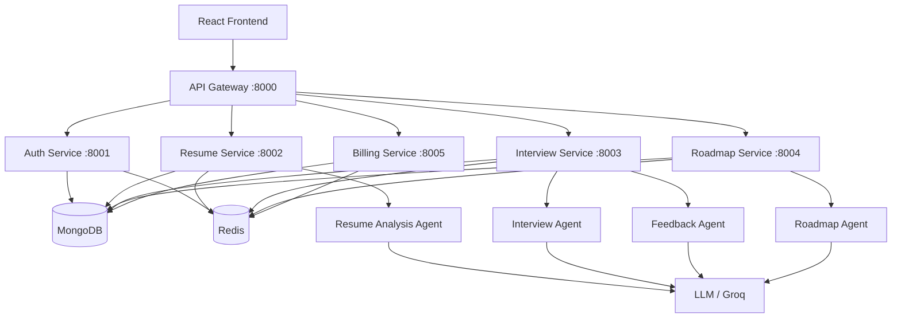

# 🤖 Multi-Agent AI Interview Platform

### An AI-Powered Interview Preparation & Career Guidance Platform

A full-stack, microservices-based AI interview platform that helps candidates prepare for technical and HR interviews through specialized AI agents. It provides intelligent resume analysis, personalized mock interviews, AI-powered performance evaluation, and customized learning roadmaps.

Built using the MERN stack, LangChain, LangGraph, Redis, MongoDB, and Docker.

---

## 🌟 Key Features

- **🧠 AI Interview Agent:** Conducts personalized technical and HR mock interviews based on the candidate's target role.
- **📄 Resume Analysis Agent:** Analyzes uploaded resumes and extracts skills, experience, and areas for improvement.
- **📊 AI Feedback Agent:** Evaluates interview responses and provides structured feedback, strengths, weaknesses, and improvement suggestions.
- **🎯 Roadmap Agent:** Generates personalized learning roadmaps based on interview performance and skill gaps.
- **🔐 Authentication:** Secure user authentication and account management using Firebase Authentication.
- **💳 Credit & Payment System:** Integrated payment functionality using Razorpay.
- **⚡ Redis Caching:** Improves performance by caching frequently accessed data.
- **📈 User Dashboard:** Provides access to interviews, reports, resume analysis, and learning progress.
- **🏗️ Microservices Architecture:** Independent backend services for modularity, scalability, and maintainability.

---

## 🛠️ Technology Stack

| Category | Technologies |
|---|---|
| Frontend | React.js, JavaScript, CSS |
| Backend | Node.js, Express.js |
| Database | MongoDB |
| Caching | Redis |
| AI Integration | LangChain, LangGraph, Groq LLM |
| Authentication | Firebase Authentication |
| Payments | Razorpay |
| Containerization | Docker |
| Cloud Infrastructure | AWS ECR, ECS, Fargate |
| API Architecture | REST APIs |

---

## 🏗️ System Architecture

The platform follows a microservices architecture in which the frontend communicates with backend services through a centralized API Gateway.



### Microservices Overview

| Service | Port | Responsibility |
|---|---:|---|
| API Gateway | 8000 | Centralized API routing |
| Auth Service | 8001 | Authentication and user management |
| Resume Service | 8002 | Resume processing and analysis |
| Interview Service | 8003 | Mock interviews and AI feedback |
| Roadmap Service | 8004 | Personalized learning roadmaps |
| Billing Service | 8005 | Credits and payment management |

**Note:** The Feedback Agent is implemented within the Interview Service rather than as a separate microservice.

---

## 🧠 AI Agent Workflow

The platform uses specialized AI agents to perform different tasks.

1. **Resume Agent:** Analyzes the candidate's resume and identifies relevant skills.
2. **Interview Agent:** Generates role-specific interview questions and conducts mock interviews.
3. **Feedback Agent:** Evaluates candidate responses and generates structured performance reports.
4. **Roadmap Agent:** Identifies skill gaps and generates personalized learning recommendations.

LangChain and LangGraph support the AI workflows, agent interactions, and structured outputs.

---

## 📂 Project Structure

The following is a simplified logical representation. Adjust directory names to match your actual repository.

```text
Multi-Agent-AI-Interview-Platform/
│
├── frontend/
│   ├── src/
│   ├── public/
│   ├── package.json
│   └── .env.example
│
├── backend/
│   ├── gateway/
│   ├── services/
│   │   ├── auth/
│   │   ├── resume/
│   │   ├── interview/
│   │   ├── roadmap/
│   │   └── billing/
│   │
│   └── shared/
│
├── README.md
└── .gitignore
```

---

## 🚀 Getting Started

Follow these instructions to run the project locally.

### 1. Prerequisites

Install the following before starting:

- Node.js (LTS version)
- npm
- MongoDB Atlas account or local MongoDB
- Redis server or Redis Cloud
- Git
- Firebase project
- Groq API key

### 2. Clone the Repository

```bash
git clone https://github.com/YOUR_USERNAME/YOUR_REPOSITORY.git
```

Navigate into the project:

```bash
cd YOUR_REPOSITORY
```

### 3. Configure Environment Variables

Create `.env` files in the frontend, gateway, and individual backend service directories wherever required by the application.

Example backend environment configuration:

1. Frontend — frontend/.env.example
VITE_API_URL=http://localhost:8000

VITE_FIREBASE_API_KEY=your_firebase_api_key
VITE_FIREBASE_AUTH_DOMAIN=your_project.firebaseapp.com
VITE_FIREBASE_PROJECT_ID=your_firebase_project_id
VITE_FIREBASE_STORAGE_BUCKET=your_project.appspot.com
VITE_FIREBASE_MESSAGING_SENDER_ID=your_sender_id
VITE_FIREBASE_APP_ID=your_firebase_app_id

VITE_RAZORPAY_KEY_ID=your_razorpay_key_id


2. API Gateway — backend/gateway/.env.example
PORT=8000

AUTH_SERVICE_URL=http://localhost:8001
RESUME_SERVICE_URL=http://localhost:8002
INTERVIEW_SERVICE_URL=http://localhost:8003
ROADMAP_SERVICE_URL=http://localhost:8004
BILLING_SERVICE_URL=http://localhost:8005


3. Auth Service — backend/services/auth/.env.example
PORT=8001

MONGODB_URL=your_mongodb_connection_string
REDIS_URL=your_redis_connection_string

FIREBASE_PROJECT_ID=your_firebase_project_id
FIREBASE_CLIENT_EMAIL=your_firebase_service_account_email
FIREBASE_PRIVATE_KEY="your_firebase_private_key"


4. Resume Service — backend/services/resume/.env.example
PORT=8002

MONGODB_URL=your_mongodb_connection_string
REDIS_URL=your_redis_connection_string

GEMINI_API_KEY=your_gemini_api_key


5. Interview Service — backend/services/interview/.env.example
PORT=8003

MONGODB_URL=your_mongodb_connection_string
REDIS_URL=your_redis_connection_string

GROQ_API_KEY=your_groq_api_key


6. Roadmap Service — backend/services/roadmap/.env.example
PORT=8004

MONGODB_URL=your_mongodb_connection_string
REDIS_URL=your_redis_connection_string

GEMINI_API_KEY=your_gemini_api_key


7. Billing Service — backend/services/billing/.env.example
PORT=8005

MONGODB_URL=your_mongodb_connection_string
REDIS_URL=your_redis_connection_string

RAZORPAY_KEY_ID=your_razorpay_key_id
RAZORPAY_KEY_SECRET=your_razorpay_key_secret

Configure the following integrations as required:

- MongoDB connection string
- Redis connection string
- Groq API key
- Firebase configuration
- Razorpay API credentials
- Frontend and backend service URLs

**Important:** The variable names above are illustrative. Use the exact environment variable names expected by each service's source code.

For frontend configuration, create the required Vite environment variables in `.env` (for example, `VITE_API_URL` if your application uses it).

Never commit actual API keys, passwords, database credentials, or `.env` files to GitHub.

### 4. Install Dependencies

Install dependencies separately in the frontend and backend service directories.

Example:

```bash
cd frontend
npm install
```

For each backend service:

```bash
cd backend/services/auth
npm install
```

Repeat for the remaining services and the API Gateway, using their respective directories.

### 5. Start Redis

Ensure your Redis instance is running and accessible.

For a locally installed Redis server:

```bash
redis-server
```

For Redis Cloud, configure the appropriate connection URL in the service environment files.

### 6. Start Backend Microservices

Run each service in a separate terminal.

Example:

```bash
cd backend/services/auth
npm run dev
```

Start the remaining services:

```text
Auth Service       → Port 8001
Resume Service     → Port 8002
Interview Service  → Port 8003
Roadmap Service    → Port 8004
Billing Service    → Port 8005
API Gateway        → Port 8000
```

Make sure the API Gateway has the correct URLs for all backend services.

### 7. Start the Frontend

Open another terminal:

```bash
cd frontend
npm install
npm run dev
```

Open the local URL displayed by Vite in your browser.

---

## 🐳 Docker & AWS Deployment

The backend services are designed to be containerized using Docker.

The deployment workflow includes:

1. Creating Docker images for individual microservices.
2. Building and testing images locally.
3. Pushing container images to Amazon Elastic Container Registry (ECR).
4. Configuring Amazon ECS task definitions.
5. Running containers using AWS Fargate.
6. Configuring service communication and environment variables.

**Infrastructure:** Docker + AWS ECR + Amazon ECS + AWS Fargate.

Cloud deployment configuration and availability depend on the infrastructure setup.

---

## 🔒 Security & Best Practices

- Keep API keys and credentials in environment variables.
- Never upload `.env` files to public repositories.
- Use Firebase Authentication for identity management.
- Validate incoming API requests.
- Configure appropriate CORS policies.
- Secure payment-related operations.
- Use HTTPS for production communication.
- Avoid exposing database credentials in frontend code.

---

## 🎯 Project Objectives

The primary objective is to build an intelligent interview preparation platform that combines Generative AI with modern backend engineering.

This project demonstrates practical implementation of:

- Multi-agent AI workflows.
- Large Language Model integration.
- Microservices architecture.
- REST API development.
- Database management and Redis caching.
- Authentication and payment integration.
- Docker containerization.
- Cloud deployment architecture.

---

## 🔮 Future Enhancements

- Real-time voice-based AI interviews.
- Advanced interview analytics.
- More personalized skill assessments.
- Multi-language interview support.
- Enhanced progress tracking.
- Scalable AI agent orchestration.

---

## 👨‍💻 Author

**Suresh Sahu**

B.Tech – Computer Science & Engineering

Interested in Software Development, Backend Engineering, Generative AI, and Distributed Systems.

---

## ⭐ Support

If you find this project interesting, consider giving this repository a ⭐ on GitHub!

Your feedback and contributions are welcome.

---

**Built with ❤️ using MERN, Generative AI, and Microservices Architecture.**
