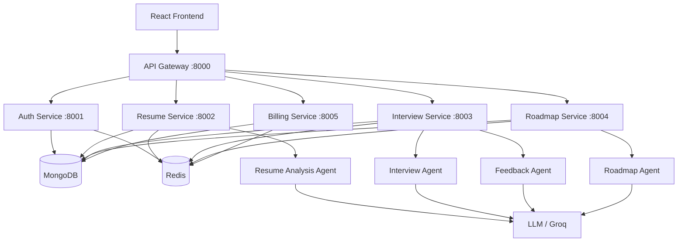

# 🤖 Multi-Agent AI Interview Platform

### An AI-Powered Interview Preparation & Career Guidance Platform

A full-stack, microservices-based AI interview platform that helps candidates prepare for technical and HR interviews through specialized AI agents. It provides intelligent resume analysis, personalized mock interviews, AI-powered performance evaluation, and customized learning roadmaps.

Built using the MERN stack, LangChain, LangGraph, Redis, MongoDB, and Docker.

---

## 🌟 Key Features

- **🧠 AI Interview Agent:** Conducts personalized technical and HR mock interviews based on the candidate's target role.
- **📄 Resume Analysis Agent:** Analyzes uploaded resumes and extracts skills, experience, and areas for improvement.
- **📊 AI Feedback Agent:** Evaluates interview responses and provides structured feedback, strengths, weaknesses, and improvement suggestions.
- **🎯 Roadmap Agent:** Generates personalized learning roadmaps based on interview performance and skill gaps.
- **🔐 Authentication:** Secure user authentication and account management using Firebase Authentication.
- **💳 Credit & Payment System:** Integrated payment functionality using Razorpay.
- **⚡ Redis Caching:** Improves performance by caching frequently accessed data.
- **📈 User Dashboard:** Provides access to interviews, reports, resume analysis, and learning progress.
- **🏗️ Microservices Architecture:** Independent backend services for modularity, scalability, and maintainability.

---

## 🛠️ Technology Stack

| Category | Technologies |
|---|---|
| Frontend | React.js, JavaScript, CSS |
| Backend | Node.js, Express.js |
| Database | MongoDB |
| Caching | Redis |
| AI Integration | LangChain, LangGraph, Groq LLM |
| Authentication | Firebase Authentication |
| Payments | Razorpay |
| Containerization | Docker |
| Cloud Infrastructure | AWS ECR, ECS, Fargate |
| API Architecture | REST APIs |

---

## 🏗️ System Architecture

The platform follows a microservices architecture in which the frontend communicates with backend services through a centralized API Gateway.


1. Overall Multi.AI architecture
Your platform uses a microservices architecture with four main AI agents and separate supporting services.
System architecture
High-level architecture · Mermaid flowchart
#chatgpt-mermaid-_r_26f_{font-family:-apple-system-body,ui-sans-serif,-apple-system,system-ui,"Segoe UI",Helvetica,"Apple Color Emoji",Arial,sans-serif,"Segoe UI Emoji","Segoe UI Symbol";font-size:16px;fill:rgb(13, 13, 13);}@keyframes edge-animation-frame{from{stroke-dashoffset:0;}}@keyframes dash{to{stroke-dashoffset:0;}}#chatgpt-mermaid-_r_26f_ .edge-animation-slow{stroke-dasharray:9,5!important;stroke-dashoffset:900;animation:dash 50s linear infinite;stroke-linecap:round;}#chatgpt-mermaid-_r_26f_ .edge-animation-fast{stroke-dasharray:9,5!important;stroke-dashoffset:900;animation:dash 20s linear infinite;stroke-linecap:round;}#chatgpt-mermaid-_r_26f_ .error-icon{fill:rgb(243, 243, 243);}#chatgpt-mermaid-_r_26f_ .error-text{fill:rgb(13, 13, 13);stroke:rgb(13, 13, 13);}#chatgpt-mermaid-_r_26f_ .edge-thickness-normal{stroke-width:1px;}#chatgpt-mermaid-_r_26f_ .edge-thickness-thick{stroke-width:3.5px;}#chatgpt-mermaid-_r_26f_ .edge-pattern-solid{stroke-dasharray:0;}#chatgpt-mermaid-_r_26f_ .edge-thickness-invisible{stroke-width:0;fill:none;}#chatgpt-mermaid-_r_26f_ .edge-pattern-dashed{stroke-dasharray:3;}#chatgpt-mermaid-_r_26f_ .edge-pattern-dotted{stroke-dasharray:2;}#chatgpt-mermaid-_r_26f_ .marker{fill:rgb(143, 143, 143);stroke:rgb(143, 143, 143);}#chatgpt-mermaid-_r_26f_ .marker.cross{stroke:rgb(143, 143, 143);}#chatgpt-mermaid-_r_26f_ svg{font-family:-apple-system-body,ui-sans-serif,-apple-system,system-ui,"Segoe UI",Helvetica,"Apple Color Emoji",Arial,sans-serif,"Segoe UI Emoji","Segoe UI Symbol";font-size:16px;}#chatgpt-mermaid-_r_26f_ p{margin:0;}#chatgpt-mermaid-_r_26f_ .label{font-family:-apple-system-body,ui-sans-serif,-apple-system,system-ui,"Segoe UI",Helvetica,"Apple Color Emoji",Arial,sans-serif,"Segoe UI Emoji","Segoe UI Symbol";color:rgb(13, 13, 13);}#chatgpt-mermaid-_r_26f_ .cluster-label text{fill:rgb(13, 13, 13);}#chatgpt-mermaid-_r_26f_ .cluster-label span{color:rgb(13, 13, 13);}#chatgpt-mermaid-_r_26f_ .cluster-label span p{background-color:transparent;}#chatgpt-mermaid-_r_26f_ .label text,#chatgpt-mermaid-_r_26f_ span{fill:rgb(13, 13, 13);color:rgb(13, 13, 13);}#chatgpt-mermaid-_r_26f_ .node rect,#chatgpt-mermaid-_r_26f_ .node circle,#chatgpt-mermaid-_r_26f_ .node ellipse,#chatgpt-mermaid-_r_26f_ .node polygon,#chatgpt-mermaid-_r_26f_ .node path{fill:rgb(222, 234, 251);stroke:rgb(83, 154, 248);stroke-width:1px;}#chatgpt-mermaid-_r_26f_ .rough-node .label text,#chatgpt-mermaid-_r_26f_ .node .label text,#chatgpt-mermaid-_r_26f_ .image-shape .label,#chatgpt-mermaid-_r_26f_ .icon-shape .label{text-anchor:middle;}#chatgpt-mermaid-_r_26f_ .node .katex path{fill:#000;stroke:#000;stroke-width:1px;}#chatgpt-mermaid-_r_26f_ .rough-node .label,#chatgpt-mermaid-_r_26f_ .node .label,#chatgpt-mermaid-_r_26f_ .image-shape .label,#chatgpt-mermaid-_r_26f_ .icon-shape .label{text-align:center;}#chatgpt-mermaid-_r_26f_ .node.clickable{cursor:pointer;}#chatgpt-mermaid-_r_26f_ .root .anchor path{fill:rgb(143, 143, 143)!important;stroke-width:0;stroke:rgb(143, 143, 143);}#chatgpt-mermaid-_r_26f_ .arrowheadPath{fill:rgb(143, 143, 143);}#chatgpt-mermaid-_r_26f_ .edgePath .path{stroke:rgb(143, 143, 143);stroke-width:1px;}#chatgpt-mermaid-_r_26f_ .flowchart-link{stroke:rgb(143, 143, 143);fill:none;}#chatgpt-mermaid-_r_26f_ .edgeLabel{background-color:rgb(252, 252, 252);text-align:center;}#chatgpt-mermaid-_r_26f_ .edgeLabel p{background-color:rgb(252, 252, 252);}#chatgpt-mermaid-_r_26f_ .edgeLabel rect{opacity:0.5;background-color:rgb(252, 252, 252);fill:rgb(252, 252, 252);}#chatgpt-mermaid-_r_26f_ .labelBkg{background-color:rgba(252, 252, 252, 0.5);}#chatgpt-mermaid-_r_26f_ .cluster rect{fill:rgb(243, 243, 243);stroke:rgba(0, 0, 0, 0.1);stroke-width:1px;}#chatgpt-mermaid-_r_26f_ .cluster text{fill:rgb(13, 13, 13);}#chatgpt-mermaid-_r_26f_ .cluster span{color:rgb(13, 13, 13);}#chatgpt-mermaid-_r_26f_ div.mermaidTooltip{position:absolute;text-align:center;max-width:200px;padding:2px;font-family:-apple-system-body,ui-sans-serif,-apple-system,system-ui,"Segoe UI",Helvetica,"Apple Color Emoji",Arial,sans-serif,"Segoe UI Emoji","Segoe UI Symbol";font-size:12px;background:rgb(243, 243, 243);border:1px solid rgba(0, 0, 0, 0.1);border-radius:2px;pointer-events:none;z-index:100;}#chatgpt-mermaid-_r_26f_ .flowchartTitleText{text-anchor:middle;font-size:18px;fill:rgb(13, 13, 13);}#chatgpt-mermaid-_r_26f_ rect.text{fill:none;stroke-width:0;}#chatgpt-mermaid-_r_26f_ .icon-shape,#chatgpt-mermaid-_r_26f_ .image-shape{background-color:rgb(252, 252, 252);text-align:center;}#chatgpt-mermaid-_r_26f_ .icon-shape p,#chatgpt-mermaid-_r_26f_ .image-shape p{background-color:rgb(252, 252, 252);padding:2px;}#chatgpt-mermaid-_r_26f_ .icon-shape .label rect,#chatgpt-mermaid-_r_26f_ .image-shape .label rect{opacity:0.5;background-color:rgb(252, 252, 252);fill:rgb(252, 252, 252);}#chatgpt-mermaid-_r_26f_ .label-icon{display:inline-block;height:1em;overflow:visible;vertical-align:-0.125em;}#chatgpt-mermaid-_r_26f_ .node .label-icon path{fill:currentColor;stroke:revert;stroke-width:revert;}#chatgpt-mermaid-_r_26f_ .node .neo-node{stroke:rgb(83, 154, 248);}#chatgpt-mermaid-_r_26f_ [data-look="neo"].node rect,#chatgpt-mermaid-_r_26f_ [data-look="neo"].cluster rect,#chatgpt-mermaid-_r_26f_ [data-look="neo"].node polygon{stroke:url(#chatgpt-mermaid-_r_26f_-gradient);filter:drop-shadow( 1px 2px 2px rgba(185,185,185,1));}#chatgpt-mermaid-_r_26f_ [data-look="neo"].swimlane.cluster rect{filter:none;}#chatgpt-mermaid-_r_26f_ [data-look="neo"].node path{stroke:url(#chatgpt-mermaid-_r_26f_-gradient);stroke-width:1px;}#chatgpt-mermaid-_r_26f_ [data-look="neo"].node .outer-path{filter:drop-shadow( 1px 2px 2px rgba(185,185,185,1));}#chatgpt-mermaid-_r_26f_ [data-look="neo"].node .neo-line path{stroke:rgb(83, 154, 248);filter:none;}#chatgpt-mermaid-_r_26f_ [data-look="neo"].node circle{stroke:url(#chatgpt-mermaid-_r_26f_-gradient);filter:drop-shadow( 1px 2px 2px rgba(185,185,185,1));}#chatgpt-mermaid-_r_26f_ [data-look="neo"].node circle .state-start{fill:#000000;}#chatgpt-mermaid-_r_26f_ [data-look="neo"].icon-shape .icon{fill:url(#chatgpt-mermaid-_r_26f_-gradient);filter:drop-shadow( 1px 2px 2px rgba(185,185,185,1));}#chatgpt-mermaid-_r_26f_ [data-look="neo"].icon-shape .icon-neo path{stroke:url(#chatgpt-mermaid-_r_26f_-gradient);filter:drop-shadow( 1px 2px 2px rgba(185,185,185,1));}#chatgpt-mermaid-_r_26f_ .node text{font-size:14px;font-weight:600;letter-spacing:normal;fill:rgb(0, 79, 153);}#chatgpt-mermaid-_r_26f_ .edgeLabels text{font-size:13px;font-weight:600;letter-spacing:-0.08px;fill:rgb(0, 79, 153);}#chatgpt-mermaid-_r_26f_ .node tspan[font-weight="normal"],#chatgpt-mermaid-_r_26f_ .edgeLabels tspan[font-weight="normal"]{font-weight:600;}#chatgpt-mermaid-_r_26f_ .edgeLabel .label rect{opacity:1;rx:13px;ry:13px;fill:rgb(245, 250, 255);stroke:rgb(206, 219, 229);stroke-width:1px;}#chatgpt-mermaid-_r_26f_ .node rect,#chatgpt-mermaid-_r_26f_ .node circle,#chatgpt-mermaid-_r_26f_ .node ellipse,#chatgpt-mermaid-_r_26f_ .node polygon,#chatgpt-mermaid-_r_26f_ .node path{fill:rgb(229, 243, 255);stroke:rgba(0, 0, 0, 0.1);stroke-width:1px;}#chatgpt-mermaid-_r_26f_ .node rect{rx:16px;ry:16px;}#chatgpt-mermaid-_r_26f_ .mermaid-decision .label-container{fill:rgb(245, 250, 255);stroke:rgb(206, 219, 229);stroke-dasharray:2,2;}#chatgpt-mermaid-_r_26f_ .edgePaths .flowchart-link{stroke:rgb(143, 143, 143);stroke-width:1px;stroke-linecap:round;stroke-linejoin:round;}#chatgpt-mermaid-_r_26f_ .marker{fill:rgb(143, 143, 143);stroke:rgb(143, 143, 143);}#chatgpt-mermaid-_r_26f_ :root{--mermaid-font-family:-apple-system-body,ui-sans-serif,-apple-system,system-ui,"Segoe UI",Helvetica,"Apple Color Emoji",Arial,sans-serif,"Segoe UI Emoji","Segoe UI Symbol";}UserReact + Vite FrontendAPI Gateway :8000Auth Service :8001Resume Service :8002Interview Service :8003Roadmap Service :8004Billing Service :8005Firebase AuthenticationMongoDBMongoDBMongoDBMongoDBMongoDBRedis CacheMulter + PDF ParserGroq LLMLangGraph OrchestratorLangGraph OrchestratorYouTube Data APIRazorpay Payment GatewayUser Coin ManagementDashboard & ReportsResume / Interview / RoadmapUI


The MongoDB connections are shown logically. The exact collection names and database-sharing configuration should be aligned with your actual Mongoose models.

2. Main application flowchart
This describes the complete user journey through Multi.AI.
#chatgpt-mermaid-_r_26m_{font-family:-apple-system-body,ui-sans-serif,-apple-system,system-ui,"Segoe UI",Helvetica,"Apple Color Emoji",Arial,sans-serif,"Segoe UI Emoji","Segoe UI Symbol";font-size:16px;fill:rgb(13, 13, 13);}@keyframes edge-animation-frame{from{stroke-dashoffset:0;}}@keyframes dash{to{stroke-dashoffset:0;}}#chatgpt-mermaid-_r_26m_ .edge-animation-slow{stroke-dasharray:9,5!important;stroke-dashoffset:900;animation:dash 50s linear infinite;stroke-linecap:round;}#chatgpt-mermaid-_r_26m_ .edge-animation-fast{stroke-dasharray:9,5!important;stroke-dashoffset:900;animation:dash 20s linear infinite;stroke-linecap:round;}#chatgpt-mermaid-_r_26m_ .error-icon{fill:rgb(243, 243, 243);}#chatgpt-mermaid-_r_26m_ .error-text{fill:rgb(13, 13, 13);stroke:rgb(13, 13, 13);}#chatgpt-mermaid-_r_26m_ .edge-thickness-normal{stroke-width:1px;}#chatgpt-mermaid-_r_26m_ .edge-thickness-thick{stroke-width:3.5px;}#chatgpt-mermaid-_r_26m_ .edge-pattern-solid{stroke-dasharray:0;}#chatgpt-mermaid-_r_26m_ .edge-thickness-invisible{stroke-width:0;fill:none;}#chatgpt-mermaid-_r_26m_ .edge-pattern-dashed{stroke-dasharray:3;}#chatgpt-mermaid-_r_26m_ .edge-pattern-dotted{stroke-dasharray:2;}#chatgpt-mermaid-_r_26m_ .marker{fill:rgb(143, 143, 143);stroke:rgb(143, 143, 143);}#chatgpt-mermaid-_r_26m_ .marker.cross{stroke:rgb(143, 143, 143);}#chatgpt-mermaid-_r_26m_ svg{font-family:-apple-system-body,ui-sans-serif,-apple-system,system-ui,"Segoe UI",Helvetica,"Apple Color Emoji",Arial,sans-serif,"Segoe UI Emoji","Segoe UI Symbol";font-size:16px;}#chatgpt-mermaid-_r_26m_ p{margin:0;}#chatgpt-mermaid-_r_26m_ .label{font-family:-apple-system-body,ui-sans-serif,-apple-system,system-ui,"Segoe UI",Helvetica,"Apple Color Emoji",Arial,sans-serif,"Segoe UI Emoji","Segoe UI Symbol";color:rgb(13, 13, 13);}#chatgpt-mermaid-_r_26m_ .cluster-label text{fill:rgb(13, 13, 13);}#chatgpt-mermaid-_r_26m_ .cluster-label span{color:rgb(13, 13, 13);}#chatgpt-mermaid-_r_26m_ .cluster-label span p{background-color:transparent;}#chatgpt-mermaid-_r_26m_ .label text,#chatgpt-mermaid-_r_26m_ span{fill:rgb(13, 13, 13);color:rgb(13, 13, 13);}#chatgpt-mermaid-_r_26m_ .node rect,#chatgpt-mermaid-_r_26m_ .node circle,#chatgpt-mermaid-_r_26m_ .node ellipse,#chatgpt-mermaid-_r_26m_ .node polygon,#chatgpt-mermaid-_r_26m_ .node path{fill:rgb(222, 234, 251);stroke:rgb(83, 154, 248);stroke-width:1px;}#chatgpt-mermaid-_r_26m_ .rough-node .label text,#chatgpt-mermaid-_r_26m_ .node .label text,#chatgpt-mermaid-_r_26m_ .image-shape .label,#chatgpt-mermaid-_r_26m_ .icon-shape .label{text-anchor:middle;}#chatgpt-mermaid-_r_26m_ .node .katex path{fill:#000;stroke:#000;stroke-width:1px;}#chatgpt-mermaid-_r_26m_ .rough-node .label,#chatgpt-mermaid-_r_26m_ .node .label,#chatgpt-mermaid-_r_26m_ .image-shape .label,#chatgpt-mermaid-_r_26m_ .icon-shape .label{text-align:center;}#chatgpt-mermaid-_r_26m_ .node.clickable{cursor:pointer;}#chatgpt-mermaid-_r_26m_ .root .anchor path{fill:rgb(143, 143, 143)!important;stroke-width:0;stroke:rgb(143, 143, 143);}#chatgpt-mermaid-_r_26m_ .arrowheadPath{fill:rgb(143, 143, 143);}#chatgpt-mermaid-_r_26m_ .edgePath .path{stroke:rgb(143, 143, 143);stroke-width:1px;}#chatgpt-mermaid-_r_26m_ .flowchart-link{stroke:rgb(143, 143, 143);fill:none;}#chatgpt-mermaid-_r_26m_ .edgeLabel{background-color:rgb(252, 252, 252);text-align:center;}#chatgpt-mermaid-_r_26m_ .edgeLabel p{background-color:rgb(252, 252, 252);}#chatgpt-mermaid-_r_26m_ .edgeLabel rect{opacity:0.5;background-color:rgb(252, 252, 252);fill:rgb(252, 252, 252);}#chatgpt-mermaid-_r_26m_ .labelBkg{background-color:rgba(252, 252, 252, 0.5);}#chatgpt-mermaid-_r_26m_ .cluster rect{fill:rgb(243, 243, 243);stroke:rgba(0, 0, 0, 0.1);stroke-width:1px;}#chatgpt-mermaid-_r_26m_ .cluster text{fill:rgb(13, 13, 13);}#chatgpt-mermaid-_r_26m_ .cluster span{color:rgb(13, 13, 13);}#chatgpt-mermaid-_r_26m_ div.mermaidTooltip{position:absolute;text-align:center;max-width:200px;padding:2px;font-family:-apple-system-body,ui-sans-serif,-apple-system,system-ui,"Segoe UI",Helvetica,"Apple Color Emoji",Arial,sans-serif,"Segoe UI Emoji","Segoe UI Symbol";font-size:12px;background:rgb(243, 243, 243);border:1px solid rgba(0, 0, 0, 0.1);border-radius:2px;pointer-events:none;z-index:100;}#chatgpt-mermaid-_r_26m_ .flowchartTitleText{text-anchor:middle;font-size:18px;fill:rgb(13, 13, 13);}#chatgpt-mermaid-_r_26m_ rect.text{fill:none;stroke-width:0;}#chatgpt-mermaid-_r_26m_ .icon-shape,#chatgpt-mermaid-_r_26m_ .image-shape{background-color:rgb(252, 252, 252);text-align:center;}#chatgpt-mermaid-_r_26m_ .icon-shape p,#chatgpt-mermaid-_r_26m_ .image-shape p{background-color:rgb(252, 252, 252);padding:2px;}#chatgpt-mermaid-_r_26m_ .icon-shape .label rect,#chatgpt-mermaid-_r_26m_ .image-shape .label rect{opacity:0.5;background-color:rgb(252, 252, 252);fill:rgb(252, 252, 252);}#chatgpt-mermaid-_r_26m_ .label-icon{display:inline-block;height:1em;overflow:visible;vertical-align:-0.125em;}#chatgpt-mermaid-_r_26m_ .node .label-icon path{fill:currentColor;stroke:revert;stroke-width:revert;}#chatgpt-mermaid-_r_26m_ .node .neo-node{stroke:rgb(83, 154, 248);}#chatgpt-mermaid-_r_26m_ [data-look="neo"].node rect,#chatgpt-mermaid-_r_26m_ [data-look="neo"].cluster rect,#chatgpt-mermaid-_r_26m_ [data-look="neo"].node polygon{stroke:url(#chatgpt-mermaid-_r_26m_-gradient);filter:drop-shadow( 1px 2px 2px rgba(185,185,185,1));}#chatgpt-mermaid-_r_26m_ [data-look="neo"].swimlane.cluster rect{filter:none;}#chatgpt-mermaid-_r_26m_ [data-look="neo"].node path{stroke:url(#chatgpt-mermaid-_r_26m_-gradient);stroke-width:1px;}#chatgpt-mermaid-_r_26m_ [data-look="neo"].node .outer-path{filter:drop-shadow( 1px 2px 2px rgba(185,185,185,1));}#chatgpt-mermaid-_r_26m_ [data-look="neo"].node .neo-line path{stroke:rgb(83, 154, 248);filter:none;}#chatgpt-mermaid-_r_26m_ [data-look="neo"].node circle{stroke:url(#chatgpt-mermaid-_r_26m_-gradient);filter:drop-shadow( 1px 2px 2px rgba(185,185,185,1));}#chatgpt-mermaid-_r_26m_ [data-look="neo"].node circle .state-start{fill:#000000;}#chatgpt-mermaid-_r_26m_ [data-look="neo"].icon-shape .icon{fill:url(#chatgpt-mermaid-_r_26m_-gradient);filter:drop-shadow( 1px 2px 2px rgba(185,185,185,1));}#chatgpt-mermaid-_r_26m_ [data-look="neo"].icon-shape .icon-neo path{stroke:url(#chatgpt-mermaid-_r_26m_-gradient);filter:drop-shadow( 1px 2px 2px rgba(185,185,185,1));}#chatgpt-mermaid-_r_26m_ .node text{font-size:14px;font-weight:600;letter-spacing:normal;fill:rgb(0, 79, 153);}#chatgpt-mermaid-_r_26m_ .edgeLabels text{font-size:13px;font-weight:600;letter-spacing:-0.08px;fill:rgb(0, 79, 153);}#chatgpt-mermaid-_r_26m_ .node tspan[font-weight="normal"],#chatgpt-mermaid-_r_26m_ .edgeLabels tspan[font-weight="normal"]{font-weight:600;}#chatgpt-mermaid-_r_26m_ .edgeLabel .label rect{opacity:1;rx:13px;ry:13px;fill:rgb(245, 250, 255);stroke:rgb(206, 219, 229);stroke-width:1px;}#chatgpt-mermaid-_r_26m_ .node rect,#chatgpt-mermaid-_r_26m_ .node circle,#chatgpt-mermaid-_r_26m_ .node ellipse,#chatgpt-mermaid-_r_26m_ .node polygon,#chatgpt-mermaid-_r_26m_ .node path{fill:rgb(229, 243, 255);stroke:rgba(0, 0, 0, 0.1);stroke-width:1px;}#chatgpt-mermaid-_r_26m_ .node rect{rx:16px;ry:16px;}#chatgpt-mermaid-_r_26m_ .mermaid-decision .label-container{fill:rgb(245, 250, 255);stroke:rgb(206, 219, 229);stroke-dasharray:2,2;}#chatgpt-mermaid-_r_26m_ .edgePaths .flowchart-link{stroke:rgb(143, 143, 143);stroke-width:1px;stroke-linecap:round;stroke-linejoin:round;}#chatgpt-mermaid-_r_26m_ .marker{fill:rgb(143, 143, 143);stroke:rgb(143, 143, 143);}#chatgpt-mermaid-_r_26m_ :root{--mermaid-font-family:-apple-system-body,ui-sans-serif,-apple-system,system-ui,"Segoe UI",Helvetica,"Apple Color Emoji",Arial,sans-serif,"Segoe UI Emoji","Segoe UI Symbol";}StartOpen Multi.AIGoogle LoginAuthenticated?DashboardChoose FeatureUpload Resume PDFExtract Resume TextResume AI ScoringDisplay Score & SuggestionsSelect Role & Interview TypeGenerate Interview QuestionsConduct InterviewEvaluate AnswersGenerate Interview ReportEnter Target Role & Skill LevelGenerate PersonalizedRoadmapGenerate Learning ResourcesDisplay Modules & ResourcesSelect Coin PackageCreate Razorpay OrderComplete PaymentVerify PaymentCredit Interview CoinsEndNoYesResumeInterviewRoadmapBilling


3. Individual AI agent flowcharts
3.1 Resume Scoring Agent


linkedin.com


#chatgpt-mermaid-_r_270_{font-family:-apple-system-body,ui-sans-serif,-apple-system,system-ui,"Segoe UI",Helvetica,"Apple Color Emoji",Arial,sans-serif,"Segoe UI Emoji","Segoe UI Symbol";font-size:16px;fill:rgb(13, 13, 13);}@keyframes edge-animation-frame{from{stroke-dashoffset:0;}}@keyframes dash{to{stroke-dashoffset:0;}}#chatgpt-mermaid-_r_270_ .edge-animation-slow{stroke-dasharray:9,5!important;stroke-dashoffset:900;animation:dash 50s linear infinite;stroke-linecap:round;}#chatgpt-mermaid-_r_270_ .edge-animation-fast{stroke-dasharray:9,5!important;stroke-dashoffset:900;animation:dash 20s linear infinite;stroke-linecap:round;}#chatgpt-mermaid-_r_270_ .error-icon{fill:rgb(243, 243, 243);}#chatgpt-mermaid-_r_270_ .error-text{fill:rgb(13, 13, 13);stroke:rgb(13, 13, 13);}#chatgpt-mermaid-_r_270_ .edge-thickness-normal{stroke-width:1px;}#chatgpt-mermaid-_r_270_ .edge-thickness-thick{stroke-width:3.5px;}#chatgpt-mermaid-_r_270_ .edge-pattern-solid{stroke-dasharray:0;}#chatgpt-mermaid-_r_270_ .edge-thickness-invisible{stroke-width:0;fill:none;}#chatgpt-mermaid-_r_270_ .edge-pattern-dashed{stroke-dasharray:3;}#chatgpt-mermaid-_r_270_ .edge-pattern-dotted{stroke-dasharray:2;}#chatgpt-mermaid-_r_270_ .marker{fill:rgb(143, 143, 143);stroke:rgb(143, 143, 143);}#chatgpt-mermaid-_r_270_ .marker.cross{stroke:rgb(143, 143, 143);}#chatgpt-mermaid-_r_270_ svg{font-family:-apple-system-body,ui-sans-serif,-apple-system,system-ui,"Segoe UI",Helvetica,"Apple Color Emoji",Arial,sans-serif,"Segoe UI Emoji","Segoe UI Symbol";font-size:16px;}#chatgpt-mermaid-_r_270_ p{margin:0;}#chatgpt-mermaid-_r_270_ .label{font-family:-apple-system-body,ui-sans-serif,-apple-system,system-ui,"Segoe UI",Helvetica,"Apple Color Emoji",Arial,sans-serif,"Segoe UI Emoji","Segoe UI Symbol";color:rgb(13, 13, 13);}#chatgpt-mermaid-_r_270_ .cluster-label text{fill:rgb(13, 13, 13);}#chatgpt-mermaid-_r_270_ .cluster-label span{color:rgb(13, 13, 13);}#chatgpt-mermaid-_r_270_ .cluster-label span p{background-color:transparent;}#chatgpt-mermaid-_r_270_ .label text,#chatgpt-mermaid-_r_270_ span{fill:rgb(13, 13, 13);color:rgb(13, 13, 13);}#chatgpt-mermaid-_r_270_ .node rect,#chatgpt-mermaid-_r_270_ .node circle,#chatgpt-mermaid-_r_270_ .node ellipse,#chatgpt-mermaid-_r_270_ .node polygon,#chatgpt-mermaid-_r_270_ .node path{fill:rgb(222, 234, 251);stroke:rgb(83, 154, 248);stroke-width:1px;}#chatgpt-mermaid-_r_270_ .rough-node .label text,#chatgpt-mermaid-_r_270_ .node .label text,#chatgpt-mermaid-_r_270_ .image-shape .label,#chatgpt-mermaid-_r_270_ .icon-shape .label{text-anchor:middle;}#chatgpt-mermaid-_r_270_ .node .katex path{fill:#000;stroke:#000;stroke-width:1px;}#chatgpt-mermaid-_r_270_ .rough-node .label,#chatgpt-mermaid-_r_270_ .node .label,#chatgpt-mermaid-_r_270_ .image-shape .label,#chatgpt-mermaid-_r_270_ .icon-shape .label{text-align:center;}#chatgpt-mermaid-_r_270_ .node.clickable{cursor:pointer;}#chatgpt-mermaid-_r_270_ .root .anchor path{fill:rgb(143, 143, 143)!important;stroke-width:0;stroke:rgb(143, 143, 143);}#chatgpt-mermaid-_r_270_ .arrowheadPath{fill:rgb(143, 143, 143);}#chatgpt-mermaid-_r_270_ .edgePath .path{stroke:rgb(143, 143, 143);stroke-width:1px;}#chatgpt-mermaid-_r_270_ .flowchart-link{stroke:rgb(143, 143, 143);fill:none;}#chatgpt-mermaid-_r_270_ .edgeLabel{background-color:rgb(252, 252, 252);text-align:center;}#chatgpt-mermaid-_r_270_ .edgeLabel p{background-color:rgb(252, 252, 252);}#chatgpt-mermaid-_r_270_ .edgeLabel rect{opacity:0.5;background-color:rgb(252, 252, 252);fill:rgb(252, 252, 252);}#chatgpt-mermaid-_r_270_ .labelBkg{background-color:rgba(252, 252, 252, 0.5);}#chatgpt-mermaid-_r_270_ .cluster rect{fill:rgb(243, 243, 243);stroke:rgba(0, 0, 0, 0.1);stroke-width:1px;}#chatgpt-mermaid-_r_270_ .cluster text{fill:rgb(13, 13, 13);}#chatgpt-mermaid-_r_270_ .cluster span{color:rgb(13, 13, 13);}#chatgpt-mermaid-_r_270_ div.mermaidTooltip{position:absolute;text-align:center;max-width:200px;padding:2px;font-family:-apple-system-body,ui-sans-serif,-apple-system,system-ui,"Segoe UI",Helvetica,"Apple Color Emoji",Arial,sans-serif,"Segoe UI Emoji","Segoe UI Symbol";font-size:12px;background:rgb(243, 243, 243);border:1px solid rgba(0, 0, 0, 0.1);border-radius:2px;pointer-events:none;z-index:100;}#chatgpt-mermaid-_r_270_ .flowchartTitleText{text-anchor:middle;font-size:18px;fill:rgb(13, 13, 13);}#chatgpt-mermaid-_r_270_ rect.text{fill:none;stroke-width:0;}#chatgpt-mermaid-_r_270_ .icon-shape,#chatgpt-mermaid-_r_270_ .image-shape{background-color:rgb(252, 252, 252);text-align:center;}#chatgpt-mermaid-_r_270_ .icon-shape p,#chatgpt-mermaid-_r_270_ .image-shape p{background-color:rgb(252, 252, 252);padding:2px;}#chatgpt-mermaid-_r_270_ .icon-shape .label rect,#chatgpt-mermaid-_r_270_ .image-shape .label rect{opacity:0.5;background-color:rgb(252, 252, 252);fill:rgb(252, 252, 252);}#chatgpt-mermaid-_r_270_ .label-icon{display:inline-block;height:1em;overflow:visible;vertical-align:-0.125em;}#chatgpt-mermaid-_r_270_ .node .label-icon path{fill:currentColor;stroke:revert;stroke-width:revert;}#chatgpt-mermaid-_r_270_ .node .neo-node{stroke:rgb(83, 154, 248);}#chatgpt-mermaid-_r_270_ [data-look="neo"].node rect,#chatgpt-mermaid-_r_270_ [data-look="neo"].cluster rect,#chatgpt-mermaid-_r_270_ [data-look="neo"].node polygon{stroke:url(#chatgpt-mermaid-_r_270_-gradient);filter:drop-shadow( 1px 2px 2px rgba(185,185,185,1));}#chatgpt-mermaid-_r_270_ [data-look="neo"].swimlane.cluster rect{filter:none;}#chatgpt-mermaid-_r_270_ [data-look="neo"].node path{stroke:url(#chatgpt-mermaid-_r_270_-gradient);stroke-width:1px;}#chatgpt-mermaid-_r_270_ [data-look="neo"].node .outer-path{filter:drop-shadow( 1px 2px 2px rgba(185,185,185,1));}#chatgpt-mermaid-_r_270_ [data-look="neo"].node .neo-line path{stroke:rgb(83, 154, 248);filter:none;}#chatgpt-mermaid-_r_270_ [data-look="neo"].node circle{stroke:url(#chatgpt-mermaid-_r_270_-gradient);filter:drop-shadow( 1px 2px 2px rgba(185,185,185,1));}#chatgpt-mermaid-_r_270_ [data-look="neo"].node circle .state-start{fill:#000000;}#chatgpt-mermaid-_r_270_ [data-look="neo"].icon-shape .icon{fill:url(#chatgpt-mermaid-_r_270_-gradient);filter:drop-shadow( 1px 2px 2px rgba(185,185,185,1));}#chatgpt-mermaid-_r_270_ [data-look="neo"].icon-shape .icon-neo path{stroke:url(#chatgpt-mermaid-_r_270_-gradient);filter:drop-shadow( 1px 2px 2px rgba(185,185,185,1));}#chatgpt-mermaid-_r_270_ .node text{font-size:14px;font-weight:600;letter-spacing:normal;fill:rgb(0, 79, 153);}#chatgpt-mermaid-_r_270_ .edgeLabels text{font-size:13px;font-weight:600;letter-spacing:-0.08px;fill:rgb(0, 79, 153);}#chatgpt-mermaid-_r_270_ .node tspan[font-weight="normal"],#chatgpt-mermaid-_r_270_ .edgeLabels tspan[font-weight="normal"]{font-weight:600;}#chatgpt-mermaid-_r_270_ .edgeLabel .label rect{opacity:1;rx:13px;ry:13px;fill:rgb(245, 250, 255);stroke:rgb(206, 219, 229);stroke-width:1px;}#chatgpt-mermaid-_r_270_ .node rect,#chatgpt-mermaid-_r_270_ .node circle,#chatgpt-mermaid-_r_270_ .node ellipse,#chatgpt-mermaid-_r_270_ .node polygon,#chatgpt-mermaid-_r_270_ .node path{fill:rgb(229, 243, 255);stroke:rgba(0, 0, 0, 0.1);stroke-width:1px;}#chatgpt-mermaid-_r_270_ .node rect{rx:16px;ry:16px;}#chatgpt-mermaid-_r_270_ .mermaid-decision .label-container{fill:rgb(245, 250, 255);stroke:rgb(206, 219, 229);stroke-dasharray:2,2;}#chatgpt-mermaid-_r_270_ .edgePaths .flowchart-link{stroke:rgb(143, 143, 143);stroke-width:1px;stroke-linecap:round;stroke-linejoin:round;}#chatgpt-mermaid-_r_270_ .marker{fill:rgb(143, 143, 143);stroke:rgb(143, 143, 143);}#chatgpt-mermaid-_r_270_ :root{--mermaid-font-family:-apple-system-body,ui-sans-serif,-apple-system,system-ui,"Segoe UI",Helvetica,"Apple Color Emoji",Arial,sans-serif,"Segoe UI Emoji","Segoe UI Symbol";}User uploads PDFResume ServiceMulter File UploadPDF ParseExtract Resume TextPrepare AI PromptGroq LLM via LangChainAnalyze ResumeEvaluate SkillsEvaluate ExperienceEvaluate ProjectsEvaluate EducationStructured Scoring ResultSave Result in MongoDBReturn Result through GatewayDisplay Resume Score


3.2 Interview Agent – LangGraph workflow
#chatgpt-mermaid-_r_277_{font-family:-apple-system-body,ui-sans-serif,-apple-system,system-ui,"Segoe UI",Helvetica,"Apple Color Emoji",Arial,sans-serif,"Segoe UI Emoji","Segoe UI Symbol";font-size:16px;fill:rgb(13, 13, 13);}@keyframes edge-animation-frame{from{stroke-dashoffset:0;}}@keyframes dash{to{stroke-dashoffset:0;}}#chatgpt-mermaid-_r_277_ .edge-animation-slow{stroke-dasharray:9,5!important;stroke-dashoffset:900;animation:dash 50s linear infinite;stroke-linecap:round;}#chatgpt-mermaid-_r_277_ .edge-animation-fast{stroke-dasharray:9,5!important;stroke-dashoffset:900;animation:dash 20s linear infinite;stroke-linecap:round;}#chatgpt-mermaid-_r_277_ .error-icon{fill:rgb(243, 243, 243);}#chatgpt-mermaid-_r_277_ .error-text{fill:rgb(13, 13, 13);stroke:rgb(13, 13, 13);}#chatgpt-mermaid-_r_277_ .edge-thickness-normal{stroke-width:1px;}#chatgpt-mermaid-_r_277_ .edge-thickness-thick{stroke-width:3.5px;}#chatgpt-mermaid-_r_277_ .edge-pattern-solid{stroke-dasharray:0;}#chatgpt-mermaid-_r_277_ .edge-thickness-invisible{stroke-width:0;fill:none;}#chatgpt-mermaid-_r_277_ .edge-pattern-dashed{stroke-dasharray:3;}#chatgpt-mermaid-_r_277_ .edge-pattern-dotted{stroke-dasharray:2;}#chatgpt-mermaid-_r_277_ .marker{fill:rgb(143, 143, 143);stroke:rgb(143, 143, 143);}#chatgpt-mermaid-_r_277_ .marker.cross{stroke:rgb(143, 143, 143);}#chatgpt-mermaid-_r_277_ svg{font-family:-apple-system-body,ui-sans-serif,-apple-system,system-ui,"Segoe UI",Helvetica,"Apple Color Emoji",Arial,sans-serif,"Segoe UI Emoji","Segoe UI Symbol";font-size:16px;}#chatgpt-mermaid-_r_277_ p{margin:0;}#chatgpt-mermaid-_r_277_ .label{font-family:-apple-system-body,ui-sans-serif,-apple-system,system-ui,"Segoe UI",Helvetica,"Apple Color Emoji",Arial,sans-serif,"Segoe UI Emoji","Segoe UI Symbol";color:rgb(13, 13, 13);}#chatgpt-mermaid-_r_277_ .cluster-label text{fill:rgb(13, 13, 13);}#chatgpt-mermaid-_r_277_ .cluster-label span{color:rgb(13, 13, 13);}#chatgpt-mermaid-_r_277_ .cluster-label span p{background-color:transparent;}#chatgpt-mermaid-_r_277_ .label text,#chatgpt-mermaid-_r_277_ span{fill:rgb(13, 13, 13);color:rgb(13, 13, 13);}#chatgpt-mermaid-_r_277_ .node rect,#chatgpt-mermaid-_r_277_ .node circle,#chatgpt-mermaid-_r_277_ .node ellipse,#chatgpt-mermaid-_r_277_ .node polygon,#chatgpt-mermaid-_r_277_ .node path{fill:rgb(222, 234, 251);stroke:rgb(83, 154, 248);stroke-width:1px;}#chatgpt-mermaid-_r_277_ .rough-node .label text,#chatgpt-mermaid-_r_277_ .node .label text,#chatgpt-mermaid-_r_277_ .image-shape .label,#chatgpt-mermaid-_r_277_ .icon-shape .label{text-anchor:middle;}#chatgpt-mermaid-_r_277_ .node .katex path{fill:#000;stroke:#000;stroke-width:1px;}#chatgpt-mermaid-_r_277_ .rough-node .label,#chatgpt-mermaid-_r_277_ .node .label,#chatgpt-mermaid-_r_277_ .image-shape .label,#chatgpt-mermaid-_r_277_ .icon-shape .label{text-align:center;}#chatgpt-mermaid-_r_277_ .node.clickable{cursor:pointer;}#chatgpt-mermaid-_r_277_ .root .anchor path{fill:rgb(143, 143, 143)!important;stroke-width:0;stroke:rgb(143, 143, 143);}#chatgpt-mermaid-_r_277_ .arrowheadPath{fill:rgb(143, 143, 143);}#chatgpt-mermaid-_r_277_ .edgePath .path{stroke:rgb(143, 143, 143);stroke-width:1px;}#chatgpt-mermaid-_r_277_ .flowchart-link{stroke:rgb(143, 143, 143);fill:none;}#chatgpt-mermaid-_r_277_ .edgeLabel{background-color:rgb(252, 252, 252);text-align:center;}#chatgpt-mermaid-_r_277_ .edgeLabel p{background-color:rgb(252, 252, 252);}#chatgpt-mermaid-_r_277_ .edgeLabel rect{opacity:0.5;background-color:rgb(252, 252, 252);fill:rgb(252, 252, 252);}#chatgpt-mermaid-_r_277_ .labelBkg{background-color:rgba(252, 252, 252, 0.5);}#chatgpt-mermaid-_r_277_ .cluster rect{fill:rgb(243, 243, 243);stroke:rgba(0, 0, 0, 0.1);stroke-width:1px;}#chatgpt-mermaid-_r_277_ .cluster text{fill:rgb(13, 13, 13);}#chatgpt-mermaid-_r_277_ .cluster span{color:rgb(13, 13, 13);}#chatgpt-mermaid-_r_277_ div.mermaidTooltip{position:absolute;text-align:center;max-width:200px;padding:2px;font-family:-apple-system-body,ui-sans-serif,-apple-system,system-ui,"Segoe UI",Helvetica,"Apple Color Emoji",Arial,sans-serif,"Segoe UI Emoji","Segoe UI Symbol";font-size:12px;background:rgb(243, 243, 243);border:1px solid rgba(0, 0, 0, 0.1);border-radius:2px;pointer-events:none;z-index:100;}#chatgpt-mermaid-_r_277_ .flowchartTitleText{text-anchor:middle;font-size:18px;fill:rgb(13, 13, 13);}#chatgpt-mermaid-_r_277_ rect.text{fill:none;stroke-width:0;}#chatgpt-mermaid-_r_277_ .icon-shape,#chatgpt-mermaid-_r_277_ .image-shape{background-color:rgb(252, 252, 252);text-align:center;}#chatgpt-mermaid-_r_277_ .icon-shape p,#chatgpt-mermaid-_r_277_ .image-shape p{background-color:rgb(252, 252, 252);padding:2px;}#chatgpt-mermaid-_r_277_ .icon-shape .label rect,#chatgpt-mermaid-_r_277_ .image-shape .label rect{opacity:0.5;background-color:rgb(252, 252, 252);fill:rgb(252, 252, 252);}#chatgpt-mermaid-_r_277_ .label-icon{display:inline-block;height:1em;overflow:visible;vertical-align:-0.125em;}#chatgpt-mermaid-_r_277_ .node .label-icon path{fill:currentColor;stroke:revert;stroke-width:revert;}#chatgpt-mermaid-_r_277_ .node .neo-node{stroke:rgb(83, 154, 248);}#chatgpt-mermaid-_r_277_ [data-look="neo"].node rect,#chatgpt-mermaid-_r_277_ [data-look="neo"].cluster rect,#chatgpt-mermaid-_r_277_ [data-look="neo"].node polygon{stroke:url(#chatgpt-mermaid-_r_277_-gradient);filter:drop-shadow( 1px 2px 2px rgba(185,185,185,1));}#chatgpt-mermaid-_r_277_ [data-look="neo"].swimlane.cluster rect{filter:none;}#chatgpt-mermaid-_r_277_ [data-look="neo"].node path{stroke:url(#chatgpt-mermaid-_r_277_-gradient);stroke-width:1px;}#chatgpt-mermaid-_r_277_ [data-look="neo"].node .outer-path{filter:drop-shadow( 1px 2px 2px rgba(185,185,185,1));}#chatgpt-mermaid-_r_277_ [data-look="neo"].node .neo-line path{stroke:rgb(83, 154, 248);filter:none;}#chatgpt-mermaid-_r_277_ [data-look="neo"].node circle{stroke:url(#chatgpt-mermaid-_r_277_-gradient);filter:drop-shadow( 1px 2px 2px rgba(185,185,185,1));}#chatgpt-mermaid-_r_277_ [data-look="neo"].node circle .state-start{fill:#000000;}#chatgpt-mermaid-_r_277_ [data-look="neo"].icon-shape .icon{fill:url(#chatgpt-mermaid-_r_277_-gradient);filter:drop-shadow( 1px 2px 2px rgba(185,185,185,1));}#chatgpt-mermaid-_r_277_ [data-look="neo"].icon-shape .icon-neo path{stroke:url(#chatgpt-mermaid-_r_277_-gradient);filter:drop-shadow( 1px 2px 2px rgba(185,185,185,1));}#chatgpt-mermaid-_r_277_ .node text{font-size:14px;font-weight:600;letter-spacing:normal;fill:rgb(0, 79, 153);}#chatgpt-mermaid-_r_277_ .edgeLabels text{font-size:13px;font-weight:600;letter-spacing:-0.08px;fill:rgb(0, 79, 153);}#chatgpt-mermaid-_r_277_ .node tspan[font-weight="normal"],#chatgpt-mermaid-_r_277_ .edgeLabels tspan[font-weight="normal"]{font-weight:600;}#chatgpt-mermaid-_r_277_ .edgeLabel .label rect{opacity:1;rx:13px;ry:13px;fill:rgb(245, 250, 255);stroke:rgb(206, 219, 229);stroke-width:1px;}#chatgpt-mermaid-_r_277_ .node rect,#chatgpt-mermaid-_r_277_ .node circle,#chatgpt-mermaid-_r_277_ .node ellipse,#chatgpt-mermaid-_r_277_ .node polygon,#chatgpt-mermaid-_r_277_ .node path{fill:rgb(229, 243, 255);stroke:rgba(0, 0, 0, 0.1);stroke-width:1px;}#chatgpt-mermaid-_r_277_ .node rect{rx:16px;ry:16px;}#chatgpt-mermaid-_r_277_ .mermaid-decision .label-container{fill:rgb(245, 250, 255);stroke:rgb(206, 219, 229);stroke-dasharray:2,2;}#chatgpt-mermaid-_r_277_ .edgePaths .flowchart-link{stroke:rgb(143, 143, 143);stroke-width:1px;stroke-linecap:round;stroke-linejoin:round;}#chatgpt-mermaid-_r_277_ .marker{fill:rgb(143, 143, 143);stroke:rgb(143, 143, 143);}#chatgpt-mermaid-_r_277_ :root{--mermaid-font-family:-apple-system-body,ui-sans-serif,-apple-system,system-ui,"Segoe UI",Helvetica,"Apple Color Emoji",Arial,sans-serif,"Segoe UI Emoji","Segoe UI Symbol";}Start InterviewReceive Role & Interview TypeUse Resume?Retrieve Resume ContextUse Role ContextQuestion Generation AgentGenerate QuestionsSave Interview SessionPresent QuestionReceive User AnswerAnswer Evaluation AgentEvaluate Relevance &CorrectnessGenerate Feedback and ScoreMore Questions?Summary / Report AgentCalculate Overall PerformanceStrengths & WeaknessesRecommendationsSave Final ReportInterview CompletedYesNoYesNo


3.3 Roadmap Agent and Resource Agent
#chatgpt-mermaid-_r_27h_{font-family:-apple-system-body,ui-sans-serif,-apple-system,system-ui,"Segoe UI",Helvetica,"Apple Color Emoji",Arial,sans-serif,"Segoe UI Emoji","Segoe UI Symbol";font-size:16px;fill:rgb(13, 13, 13);}@keyframes edge-animation-frame{from{stroke-dashoffset:0;}}@keyframes dash{to{stroke-dashoffset:0;}}#chatgpt-mermaid-_r_27h_ .edge-animation-slow{stroke-dasharray:9,5!important;stroke-dashoffset:900;animation:dash 50s linear infinite;stroke-linecap:round;}#chatgpt-mermaid-_r_27h_ .edge-animation-fast{stroke-dasharray:9,5!important;stroke-dashoffset:900;animation:dash 20s linear infinite;stroke-linecap:round;}#chatgpt-mermaid-_r_27h_ .error-icon{fill:rgb(243, 243, 243);}#chatgpt-mermaid-_r_27h_ .error-text{fill:rgb(13, 13, 13);stroke:rgb(13, 13, 13);}#chatgpt-mermaid-_r_27h_ .edge-thickness-normal{stroke-width:1px;}#chatgpt-mermaid-_r_27h_ .edge-thickness-thick{stroke-width:3.5px;}#chatgpt-mermaid-_r_27h_ .edge-pattern-solid{stroke-dasharray:0;}#chatgpt-mermaid-_r_27h_ .edge-thickness-invisible{stroke-width:0;fill:none;}#chatgpt-mermaid-_r_27h_ .edge-pattern-dashed{stroke-dasharray:3;}#chatgpt-mermaid-_r_27h_ .edge-pattern-dotted{stroke-dasharray:2;}#chatgpt-mermaid-_r_27h_ .marker{fill:rgb(143, 143, 143);stroke:rgb(143, 143, 143);}#chatgpt-mermaid-_r_27h_ .marker.cross{stroke:rgb(143, 143, 143);}#chatgpt-mermaid-_r_27h_ svg{font-family:-apple-system-body,ui-sans-serif,-apple-system,system-ui,"Segoe UI",Helvetica,"Apple Color Emoji",Arial,sans-serif,"Segoe UI Emoji","Segoe UI Symbol";font-size:16px;}#chatgpt-mermaid-_r_27h_ p{margin:0;}#chatgpt-mermaid-_r_27h_ .label{font-family:-apple-system-body,ui-sans-serif,-apple-system,system-ui,"Segoe UI",Helvetica,"Apple Color Emoji",Arial,sans-serif,"Segoe UI Emoji","Segoe UI Symbol";color:rgb(13, 13, 13);}#chatgpt-mermaid-_r_27h_ .cluster-label text{fill:rgb(13, 13, 13);}#chatgpt-mermaid-_r_27h_ .cluster-label span{color:rgb(13, 13, 13);}#chatgpt-mermaid-_r_27h_ .cluster-label span p{background-color:transparent;}#chatgpt-mermaid-_r_27h_ .label text,#chatgpt-mermaid-_r_27h_ span{fill:rgb(13, 13, 13);color:rgb(13, 13, 13);}#chatgpt-mermaid-_r_27h_ .node rect,#chatgpt-mermaid-_r_27h_ .node circle,#chatgpt-mermaid-_r_27h_ .node ellipse,#chatgpt-mermaid-_r_27h_ .node polygon,#chatgpt-mermaid-_r_27h_ .node path{fill:rgb(222, 234, 251);stroke:rgb(83, 154, 248);stroke-width:1px;}#chatgpt-mermaid-_r_27h_ .rough-node .label text,#chatgpt-mermaid-_r_27h_ .node .label text,#chatgpt-mermaid-_r_27h_ .image-shape .label,#chatgpt-mermaid-_r_27h_ .icon-shape .label{text-anchor:middle;}#chatgpt-mermaid-_r_27h_ .node .katex path{fill:#000;stroke:#000;stroke-width:1px;}#chatgpt-mermaid-_r_27h_ .rough-node .label,#chatgpt-mermaid-_r_27h_ .node .label,#chatgpt-mermaid-_r_27h_ .image-shape .label,#chatgpt-mermaid-_r_27h_ .icon-shape .label{text-align:center;}#chatgpt-mermaid-_r_27h_ .node.clickable{cursor:pointer;}#chatgpt-mermaid-_r_27h_ .root .anchor path{fill:rgb(143, 143, 143)!important;stroke-width:0;stroke:rgb(143, 143, 143);}#chatgpt-mermaid-_r_27h_ .arrowheadPath{fill:rgb(143, 143, 143);}#chatgpt-mermaid-_r_27h_ .edgePath .path{stroke:rgb(143, 143, 143);stroke-width:1px;}#chatgpt-mermaid-_r_27h_ .flowchart-link{stroke:rgb(143, 143, 143);fill:none;}#chatgpt-mermaid-_r_27h_ .edgeLabel{background-color:rgb(252, 252, 252);text-align:center;}#chatgpt-mermaid-_r_27h_ .edgeLabel p{background-color:rgb(252, 252, 252);}#chatgpt-mermaid-_r_27h_ .edgeLabel rect{opacity:0.5;background-color:rgb(252, 252, 252);fill:rgb(252, 252, 252);}#chatgpt-mermaid-_r_27h_ .labelBkg{background-color:rgba(252, 252, 252, 0.5);}#chatgpt-mermaid-_r_27h_ .cluster rect{fill:rgb(243, 243, 243);stroke:rgba(0, 0, 0, 0.1);stroke-width:1px;}#chatgpt-mermaid-_r_27h_ .cluster text{fill:rgb(13, 13, 13);}#chatgpt-mermaid-_r_27h_ .cluster span{color:rgb(13, 13, 13);}#chatgpt-mermaid-_r_27h_ div.mermaidTooltip{position:absolute;text-align:center;max-width:200px;padding:2px;font-family:-apple-system-body,ui-sans-serif,-apple-system,system-ui,"Segoe UI",Helvetica,"Apple Color Emoji",Arial,sans-serif,"Segoe UI Emoji","Segoe UI Symbol";font-size:12px;background:rgb(243, 243, 243);border:1px solid rgba(0, 0, 0, 0.1);border-radius:2px;pointer-events:none;z-index:100;}#chatgpt-mermaid-_r_27h_ .flowchartTitleText{text-anchor:middle;font-size:18px;fill:rgb(13, 13, 13);}#chatgpt-mermaid-_r_27h_ rect.text{fill:none;stroke-width:0;}#chatgpt-mermaid-_r_27h_ .icon-shape,#chatgpt-mermaid-_r_27h_ .image-shape{background-color:rgb(252, 252, 252);text-align:center;}#chatgpt-mermaid-_r_27h_ .icon-shape p,#chatgpt-mermaid-_r_27h_ .image-shape p{background-color:rgb(252, 252, 252);padding:2px;}#chatgpt-mermaid-_r_27h_ .icon-shape .label rect,#chatgpt-mermaid-_r_27h_ .image-shape .label rect{opacity:0.5;background-color:rgb(252, 252, 252);fill:rgb(252, 252, 252);}#chatgpt-mermaid-_r_27h_ .label-icon{display:inline-block;height:1em;overflow:visible;vertical-align:-0.125em;}#chatgpt-mermaid-_r_27h_ .node .label-icon path{fill:currentColor;stroke:revert;stroke-width:revert;}#chatgpt-mermaid-_r_27h_ .node .neo-node{stroke:rgb(83, 154, 248);}#chatgpt-mermaid-_r_27h_ [data-look="neo"].node rect,#chatgpt-mermaid-_r_27h_ [data-look="neo"].cluster rect,#chatgpt-mermaid-_r_27h_ [data-look="neo"].node polygon{stroke:url(#chatgpt-mermaid-_r_27h_-gradient);filter:drop-shadow( 1px 2px 2px rgba(185,185,185,1));}#chatgpt-mermaid-_r_27h_ [data-look="neo"].swimlane.cluster rect{filter:none;}#chatgpt-mermaid-_r_27h_ [data-look="neo"].node path{stroke:url(#chatgpt-mermaid-_r_27h_-gradient);stroke-width:1px;}#chatgpt-mermaid-_r_27h_ [data-look="neo"].node .outer-path{filter:drop-shadow( 1px 2px 2px rgba(185,185,185,1));}#chatgpt-mermaid-_r_27h_ [data-look="neo"].node .neo-line path{stroke:rgb(83, 154, 248);filter:none;}#chatgpt-mermaid-_r_27h_ [data-look="neo"].node circle{stroke:url(#chatgpt-mermaid-_r_27h_-gradient);filter:drop-shadow( 1px 2px 2px rgba(185,185,185,1));}#chatgpt-mermaid-_r_27h_ [data-look="neo"].node circle .state-start{fill:#000000;}#chatgpt-mermaid-_r_27h_ [data-look="neo"].icon-shape .icon{fill:url(#chatgpt-mermaid-_r_27h_-gradient);filter:drop-shadow( 1px 2px 2px rgba(185,185,185,1));}#chatgpt-mermaid-_r_27h_ [data-look="neo"].icon-shape .icon-neo path{stroke:url(#chatgpt-mermaid-_r_27h_-gradient);filter:drop-shadow( 1px 2px 2px rgba(185,185,185,1));}#chatgpt-mermaid-_r_27h_ .node text{font-size:14px;font-weight:600;letter-spacing:normal;fill:rgb(0, 79, 153);}#chatgpt-mermaid-_r_27h_ .edgeLabels text{font-size:13px;font-weight:600;letter-spacing:-0.08px;fill:rgb(0, 79, 153);}#chatgpt-mermaid-_r_27h_ .node tspan[font-weight="normal"],#chatgpt-mermaid-_r_27h_ .edgeLabels tspan[font-weight="normal"]{font-weight:600;}#chatgpt-mermaid-_r_27h_ .edgeLabel .label rect{opacity:1;rx:13px;ry:13px;fill:rgb(245, 250, 255);stroke:rgb(206, 219, 229);stroke-width:1px;}#chatgpt-mermaid-_r_27h_ .node rect,#chatgpt-mermaid-_r_27h_ .node circle,#chatgpt-mermaid-_r_27h_ .node ellipse,#chatgpt-mermaid-_r_27h_ .node polygon,#chatgpt-mermaid-_r_27h_ .node path{fill:rgb(229, 243, 255);stroke:rgba(0, 0, 0, 0.1);stroke-width:1px;}#chatgpt-mermaid-_r_27h_ .node rect{rx:16px;ry:16px;}#chatgpt-mermaid-_r_27h_ .mermaid-decision .label-container{fill:rgb(245, 250, 255);stroke:rgb(206, 219, 229);stroke-dasharray:2,2;}#chatgpt-mermaid-_r_27h_ .edgePaths .flowchart-link{stroke:rgb(143, 143, 143);stroke-width:1px;stroke-linecap:round;stroke-linejoin:round;}#chatgpt-mermaid-_r_27h_ .marker{fill:rgb(143, 143, 143);stroke:rgb(143, 143, 143);}#chatgpt-mermaid-_r_27h_ :root{--mermaid-font-family:-apple-system-body,ui-sans-serif,-apple-system,system-ui,"Segoe UI",Helvetica,"Apple Color Emoji",Arial,sans-serif,"Segoe UI Emoji","Segoe UI Symbol";}User Requests RoadmapReceive Target RoleReceive Target SalaryReceive Current Skill LevelRoadmap AgentAnalyze Skill GapGenerate Learning ModulesDefine Learning ObjectivesSave RoadmapResource AgentSearch Relevant LearningResourcesYouTube Data APIFilter Relevant ResourcesAttach Resources to ModulesSave / Update RoadmapDisplay Personalized Roadmap


3.4 Billing and coin management flow
#chatgpt-mermaid-_r_27o_{font-family:-apple-system-body,ui-sans-serif,-apple-system,system-ui,"Segoe UI",Helvetica,"Apple Color Emoji",Arial,sans-serif,"Segoe UI Emoji","Segoe UI Symbol";font-size:16px;fill:rgb(13, 13, 13);}@keyframes edge-animation-frame{from{stroke-dashoffset:0;}}@keyframes dash{to{stroke-dashoffset:0;}}#chatgpt-mermaid-_r_27o_ .edge-animation-slow{stroke-dasharray:9,5!important;stroke-dashoffset:900;animation:dash 50s linear infinite;stroke-linecap:round;}#chatgpt-mermaid-_r_27o_ .edge-animation-fast{stroke-dasharray:9,5!important;stroke-dashoffset:900;animation:dash 20s linear infinite;stroke-linecap:round;}#chatgpt-mermaid-_r_27o_ .error-icon{fill:rgb(243, 243, 243);}#chatgpt-mermaid-_r_27o_ .error-text{fill:rgb(13, 13, 13);stroke:rgb(13, 13, 13);}#chatgpt-mermaid-_r_27o_ .edge-thickness-normal{stroke-width:1px;}#chatgpt-mermaid-_r_27o_ .edge-thickness-thick{stroke-width:3.5px;}#chatgpt-mermaid-_r_27o_ .edge-pattern-solid{stroke-dasharray:0;}#chatgpt-mermaid-_r_27o_ .edge-thickness-invisible{stroke-width:0;fill:none;}#chatgpt-mermaid-_r_27o_ .edge-pattern-dashed{stroke-dasharray:3;}#chatgpt-mermaid-_r_27o_ .edge-pattern-dotted{stroke-dasharray:2;}#chatgpt-mermaid-_r_27o_ .marker{fill:rgb(143, 143, 143);stroke:rgb(143, 143, 143);}#chatgpt-mermaid-_r_27o_ .marker.cross{stroke:rgb(143, 143, 143);}#chatgpt-mermaid-_r_27o_ svg{font-family:-apple-system-body,ui-sans-serif,-apple-system,system-ui,"Segoe UI",Helvetica,"Apple Color Emoji",Arial,sans-serif,"Segoe UI Emoji","Segoe UI Symbol";font-size:16px;}#chatgpt-mermaid-_r_27o_ p{margin:0;}#chatgpt-mermaid-_r_27o_ .label{font-family:-apple-system-body,ui-sans-serif,-apple-system,system-ui,"Segoe UI",Helvetica,"Apple Color Emoji",Arial,sans-serif,"Segoe UI Emoji","Segoe UI Symbol";color:rgb(13, 13, 13);}#chatgpt-mermaid-_r_27o_ .cluster-label text{fill:rgb(13, 13, 13);}#chatgpt-mermaid-_r_27o_ .cluster-label span{color:rgb(13, 13, 13);}#chatgpt-mermaid-_r_27o_ .cluster-label span p{background-color:transparent;}#chatgpt-mermaid-_r_27o_ .label text,#chatgpt-mermaid-_r_27o_ span{fill:rgb(13, 13, 13);color:rgb(13, 13, 13);}#chatgpt-mermaid-_r_27o_ .node rect,#chatgpt-mermaid-_r_27o_ .node circle,#chatgpt-mermaid-_r_27o_ .node ellipse,#chatgpt-mermaid-_r_27o_ .node polygon,#chatgpt-mermaid-_r_27o_ .node path{fill:rgb(222, 234, 251);stroke:rgb(83, 154, 248);stroke-width:1px;}#chatgpt-mermaid-_r_27o_ .rough-node .label text,#chatgpt-mermaid-_r_27o_ .node .label text,#chatgpt-mermaid-_r_27o_ .image-shape .label,#chatgpt-mermaid-_r_27o_ .icon-shape .label{text-anchor:middle;}#chatgpt-mermaid-_r_27o_ .node .katex path{fill:#000;stroke:#000;stroke-width:1px;}#chatgpt-mermaid-_r_27o_ .rough-node .label,#chatgpt-mermaid-_r_27o_ .node .label,#chatgpt-mermaid-_r_27o_ .image-shape .label,#chatgpt-mermaid-_r_27o_ .icon-shape .label{text-align:center;}#chatgpt-mermaid-_r_27o_ .node.clickable{cursor:pointer;}#chatgpt-mermaid-_r_27o_ .root .anchor path{fill:rgb(143, 143, 143)!important;stroke-width:0;stroke:rgb(143, 143, 143);}#chatgpt-mermaid-_r_27o_ .arrowheadPath{fill:rgb(143, 143, 143);}#chatgpt-mermaid-_r_27o_ .edgePath .path{stroke:rgb(143, 143, 143);stroke-width:1px;}#chatgpt-mermaid-_r_27o_ .flowchart-link{stroke:rgb(143, 143, 143);fill:none;}#chatgpt-mermaid-_r_27o_ .edgeLabel{background-color:rgb(252, 252, 252);text-align:center;}#chatgpt-mermaid-_r_27o_ .edgeLabel p{background-color:rgb(252, 252, 252);}#chatgpt-mermaid-_r_27o_ .edgeLabel rect{opacity:0.5;background-color:rgb(252, 252, 252);fill:rgb(252, 252, 252);}#chatgpt-mermaid-_r_27o_ .labelBkg{background-color:rgba(252, 252, 252, 0.5);}#chatgpt-mermaid-_r_27o_ .cluster rect{fill:rgb(243, 243, 243);stroke:rgba(0, 0, 0, 0.1);stroke-width:1px;}#chatgpt-mermaid-_r_27o_ .cluster text{fill:rgb(13, 13, 13);}#chatgpt-mermaid-_r_27o_ .cluster span{color:rgb(13, 13, 13);}#chatgpt-mermaid-_r_27o_ div.mermaidTooltip{position:absolute;text-align:center;max-width:200px;padding:2px;font-family:-apple-system-body,ui-sans-serif,-apple-system,system-ui,"Segoe UI",Helvetica,"Apple Color Emoji",Arial,sans-serif,"Segoe UI Emoji","Segoe UI Symbol";font-size:12px;background:rgb(243, 243, 243);border:1px solid rgba(0, 0, 0, 0.1);border-radius:2px;pointer-events:none;z-index:100;}#chatgpt-mermaid-_r_27o_ .flowchartTitleText{text-anchor:middle;font-size:18px;fill:rgb(13, 13, 13);}#chatgpt-mermaid-_r_27o_ rect.text{fill:none;stroke-width:0;}#chatgpt-mermaid-_r_27o_ .icon-shape,#chatgpt-mermaid-_r_27o_ .image-shape{background-color:rgb(252, 252, 252);text-align:center;}#chatgpt-mermaid-_r_27o_ .icon-shape p,#chatgpt-mermaid-_r_27o_ .image-shape p{background-color:rgb(252, 252, 252);padding:2px;}#chatgpt-mermaid-_r_27o_ .icon-shape .label rect,#chatgpt-mermaid-_r_27o_ .image-shape .label rect{opacity:0.5;background-color:rgb(252, 252, 252);fill:rgb(252, 252, 252);}#chatgpt-mermaid-_r_27o_ .label-icon{display:inline-block;height:1em;overflow:visible;vertical-align:-0.125em;}#chatgpt-mermaid-_r_27o_ .node .label-icon path{fill:currentColor;stroke:revert;stroke-width:revert;}#chatgpt-mermaid-_r_27o_ .node .neo-node{stroke:rgb(83, 154, 248);}#chatgpt-mermaid-_r_27o_ [data-look="neo"].node rect,#chatgpt-mermaid-_r_27o_ [data-look="neo"].cluster rect,#chatgpt-mermaid-_r_27o_ [data-look="neo"].node polygon{stroke:url(#chatgpt-mermaid-_r_27o_-gradient);filter:drop-shadow( 1px 2px 2px rgba(185,185,185,1));}#chatgpt-mermaid-_r_27o_ [data-look="neo"].swimlane.cluster rect{filter:none;}#chatgpt-mermaid-_r_27o_ [data-look="neo"].node path{stroke:url(#chatgpt-mermaid-_r_27o_-gradient);stroke-width:1px;}#chatgpt-mermaid-_r_27o_ [data-look="neo"].node .outer-path{filter:drop-shadow( 1px 2px 2px rgba(185,185,185,1));}#chatgpt-mermaid-_r_27o_ [data-look="neo"].node .neo-line path{stroke:rgb(83, 154, 248);filter:none;}#chatgpt-mermaid-_r_27o_ [data-look="neo"].node circle{stroke:url(#chatgpt-mermaid-_r_27o_-gradient);filter:drop-shadow( 1px 2px 2px rgba(185,185,185,1));}#chatgpt-mermaid-_r_27o_ [data-look="neo"].node circle .state-start{fill:#000000;}#chatgpt-mermaid-_r_27o_ [data-look="neo"].icon-shape .icon{fill:url(#chatgpt-mermaid-_r_27o_-gradient);filter:drop-shadow( 1px 2px 2px rgba(185,185,185,1));}#chatgpt-mermaid-_r_27o_ [data-look="neo"].icon-shape .icon-neo path{stroke:url(#chatgpt-mermaid-_r_27o_-gradient);filter:drop-shadow( 1px 2px 2px rgba(185,185,185,1));}#chatgpt-mermaid-_r_27o_ .node text{font-size:14px;font-weight:600;letter-spacing:normal;fill:rgb(0, 79, 153);}#chatgpt-mermaid-_r_27o_ .edgeLabels text{font-size:13px;font-weight:600;letter-spacing:-0.08px;fill:rgb(0, 79, 153);}#chatgpt-mermaid-_r_27o_ .node tspan[font-weight="normal"],#chatgpt-mermaid-_r_27o_ .edgeLabels tspan[font-weight="normal"]{font-weight:600;}#chatgpt-mermaid-_r_27o_ .edgeLabel .label rect{opacity:1;rx:13px;ry:13px;fill:rgb(245, 250, 255);stroke:rgb(206, 219, 229);stroke-width:1px;}#chatgpt-mermaid-_r_27o_ .node rect,#chatgpt-mermaid-_r_27o_ .node circle,#chatgpt-mermaid-_r_27o_ .node ellipse,#chatgpt-mermaid-_r_27o_ .node polygon,#chatgpt-mermaid-_r_27o_ .node path{fill:rgb(229, 243, 255);stroke:rgba(0, 0, 0, 0.1);stroke-width:1px;}#chatgpt-mermaid-_r_27o_ .node rect{rx:16px;ry:16px;}#chatgpt-mermaid-_r_27o_ .mermaid-decision .label-container{fill:rgb(245, 250, 255);stroke:rgb(206, 219, 229);stroke-dasharray:2,2;}#chatgpt-mermaid-_r_27o_ .edgePaths .flowchart-link{stroke:rgb(143, 143, 143);stroke-width:1px;stroke-linecap:round;stroke-linejoin:round;}#chatgpt-mermaid-_r_27o_ .marker{fill:rgb(143, 143, 143);stroke:rgb(143, 143, 143);}#chatgpt-mermaid-_r_27o_ :root{--mermaid-font-family:-apple-system-body,ui-sans-serif,-apple-system,system-ui,"Segoe UI",Helvetica,"Apple Color Emoji",Arial,sans-serif,"Segoe UI Emoji","Segoe UI Symbol";}User opens BillingSelect Coin PackageBilling ServiceCreate Razorpay OrderReturn Order DetailsRazorpay CheckoutUser Completes PaymentReceive Payment DetailsVerify Razorpay SignaturePayment Valid?Reject PaymentUpdate Coin BalanceUpdate User AccountUpdate Billing RecordUpdate Redis Session / CacheReturn SuccessUpdated Coin BalanceNoYes


4. Sequence diagrams – all microservices
These diagrams show which component sends a request, which service processes it, and where data is stored.
4.1 Authentication sequence diagram
RedisMongoDBAuth ServiceAPI GatewayFirebaseReact FrontendRedisMongoDBAuth ServiceAPI GatewayFirebaseReact Frontend#chatgpt-mermaid-_r_27v_{font-family:-apple-system-body,ui-sans-serif,-apple-system,system-ui,"Segoe UI",Helvetica,"Apple Color Emoji",Arial,sans-serif,"Segoe UI Emoji","Segoe UI Symbol";font-size:16px;fill:rgb(13, 13, 13);}@keyframes edge-animation-frame{from{stroke-dashoffset:0;}}@keyframes dash{to{stroke-dashoffset:0;}}#chatgpt-mermaid-_r_27v_ .edge-animation-slow{stroke-dasharray:9,5!important;stroke-dashoffset:900;animation:dash 50s linear infinite;stroke-linecap:round;}#chatgpt-mermaid-_r_27v_ .edge-animation-fast{stroke-dasharray:9,5!important;stroke-dashoffset:900;animation:dash 20s linear infinite;stroke-linecap:round;}#chatgpt-mermaid-_r_27v_ .error-icon{fill:rgb(243, 243, 243);}#chatgpt-mermaid-_r_27v_ .error-text{fill:rgb(13, 13, 13);stroke:rgb(13, 13, 13);}#chatgpt-mermaid-_r_27v_ .edge-thickness-normal{stroke-width:1px;}#chatgpt-mermaid-_r_27v_ .edge-thickness-thick{stroke-width:3.5px;}#chatgpt-mermaid-_r_27v_ .edge-pattern-solid{stroke-dasharray:0;}#chatgpt-mermaid-_r_27v_ .edge-thickness-invisible{stroke-width:0;fill:none;}#chatgpt-mermaid-_r_27v_ .edge-pattern-dashed{stroke-dasharray:3;}#chatgpt-mermaid-_r_27v_ .edge-pattern-dotted{stroke-dasharray:2;}#chatgpt-mermaid-_r_27v_ .marker{fill:rgb(143, 143, 143);stroke:rgb(143, 143, 143);}#chatgpt-mermaid-_r_27v_ .marker.cross{stroke:rgb(143, 143, 143);}#chatgpt-mermaid-_r_27v_ svg{font-family:-apple-system-body,ui-sans-serif,-apple-system,system-ui,"Segoe UI",Helvetica,"Apple Color Emoji",Arial,sans-serif,"Segoe UI Emoji","Segoe UI Symbol";font-size:16px;}#chatgpt-mermaid-_r_27v_ p{margin:0;}#chatgpt-mermaid-_r_27v_ .actor{stroke:rgb(83, 154, 248);fill:rgb(222, 234, 251);stroke-width:1;}#chatgpt-mermaid-_r_27v_ rect.actor.outer-path[data-look="neo"]{filter:drop-shadow( 1px 2px 2px rgba(185,185,185,1));}#chatgpt-mermaid-_r_27v_ rect.note[data-look="neo"]{stroke:rgb(107, 198, 127);fill:rgb(243, 243, 243);filter:drop-shadow( 1px 2px 2px rgba(185,185,185,1));}#chatgpt-mermaid-_r_27v_ text.actor>tspan{fill:rgb(13, 13, 13);stroke:none;}#chatgpt-mermaid-_r_27v_ .actor-line{stroke:rgb(143, 143, 143);}#chatgpt-mermaid-_r_27v_ .innerArc{stroke-width:1.5;stroke-dasharray:none;}#chatgpt-mermaid-_r_27v_ .messageLine0{stroke-width:1.5;stroke-dasharray:none;stroke:rgb(143, 143, 143);}#chatgpt-mermaid-_r_27v_ .messageLine1{stroke-width:1.5;stroke-dasharray:2,2;stroke:rgb(143, 143, 143);}#chatgpt-mermaid-_r_27v_ [id$="-arrowhead"] path{fill:rgb(143, 143, 143);stroke:rgb(143, 143, 143);}#chatgpt-mermaid-_r_27v_ .sequenceNumber{fill:#707070;}#chatgpt-mermaid-_r_27v_ [id$="-sequencenumber"]{fill:rgb(143, 143, 143);}#chatgpt-mermaid-_r_27v_ [id$="-crosshead"] path{fill:rgb(143, 143, 143);stroke:rgb(143, 143, 143);}#chatgpt-mermaid-_r_27v_ .messageText{fill:rgb(13, 13, 13);stroke:none;}#chatgpt-mermaid-_r_27v_ .labelBox{stroke:rgba(0, 0, 0, 0.1);fill:rgb(252, 252, 252);filter:none;}#chatgpt-mermaid-_r_27v_ .labelText,#chatgpt-mermaid-_r_27v_ .labelText>tspan{fill:rgb(13, 13, 13);stroke:none;}#chatgpt-mermaid-_r_27v_ .loopText,#chatgpt-mermaid-_r_27v_ .loopText>tspan{fill:rgb(13, 13, 13);stroke:none;}#chatgpt-mermaid-_r_27v_ .sectionTitle,#chatgpt-mermaid-_r_27v_ .sectionTitle>tspan{fill:rgb(13, 13, 13);stroke:none;}#chatgpt-mermaid-_r_27v_ .loopLine{stroke-width:2px;stroke-dasharray:2,2;stroke:rgba(0, 0, 0, 0.1);fill:rgba(0, 0, 0, 0.1);}#chatgpt-mermaid-_r_27v_ .note{stroke:rgb(107, 198, 127);fill:rgb(243, 243, 243);}#chatgpt-mermaid-_r_27v_ .noteText,#chatgpt-mermaid-_r_27v_ .noteText>tspan{fill:rgb(13, 13, 13);stroke:none;font-weight:normal;}#chatgpt-mermaid-_r_27v_ .activation0{fill:rgb(243, 243, 243);stroke:hsl(0, 0%, 85.2941176471%);}#chatgpt-mermaid-_r_27v_ .activation1{fill:rgb(243, 243, 243);stroke:hsl(0, 0%, 85.2941176471%);}#chatgpt-mermaid-_r_27v_ .activation2{fill:rgb(243, 243, 243);stroke:hsl(0, 0%, 85.2941176471%);}#chatgpt-mermaid-_r_27v_ .actorPopupMenu{position:absolute;}#chatgpt-mermaid-_r_27v_ .actorPopupMenuPanel{position:absolute;fill:rgb(222, 234, 251);box-shadow:0px 8px 16px 0px rgba(0,0,0,0.2);filter:drop-shadow(3px 5px 2px rgb(0 0 0 / 0.4));}#chatgpt-mermaid-_r_27v_ .actor-man circle,#chatgpt-mermaid-_r_27v_ line{fill:rgb(222, 234, 251);stroke-width:2px;}#chatgpt-mermaid-_r_27v_ g rect.rect{filter:drop-shadow( 1px 2px 2px rgba(185,185,185,1));stroke:rgb(83, 154, 248);}#chatgpt-mermaid-_r_27v_ .node .neo-node{stroke:rgb(83, 154, 248);}#chatgpt-mermaid-_r_27v_ [data-look="neo"].node rect,#chatgpt-mermaid-_r_27v_ [data-look="neo"].cluster rect,#chatgpt-mermaid-_r_27v_ [data-look="neo"].node polygon{stroke:url(#chatgpt-mermaid-_r_27v_-gradient);filter:drop-shadow( 1px 2px 2px rgba(185,185,185,1));}#chatgpt-mermaid-_r_27v_ [data-look="neo"].swimlane.cluster rect{filter:none;}#chatgpt-mermaid-_r_27v_ [data-look="neo"].node path{stroke:url(#chatgpt-mermaid-_r_27v_-gradient);stroke-width:1px;}#chatgpt-mermaid-_r_27v_ [data-look="neo"].node .outer-path{filter:drop-shadow( 1px 2px 2px rgba(185,185,185,1));}#chatgpt-mermaid-_r_27v_ [data-look="neo"].node .neo-line path{stroke:rgb(83, 154, 248);filter:none;}#chatgpt-mermaid-_r_27v_ [data-look="neo"].node circle{stroke:url(#chatgpt-mermaid-_r_27v_-gradient);filter:drop-shadow( 1px 2px 2px rgba(185,185,185,1));}#chatgpt-mermaid-_r_27v_ [data-look="neo"].node circle .state-start{fill:#000000;}#chatgpt-mermaid-_r_27v_ [data-look="neo"].icon-shape .icon{fill:url(#chatgpt-mermaid-_r_27v_-gradient);filter:drop-shadow( 1px 2px 2px rgba(185,185,185,1));}#chatgpt-mermaid-_r_27v_ [data-look="neo"].icon-shape .icon-neo path{stroke:url(#chatgpt-mermaid-_r_27v_-gradient);filter:drop-shadow( 1px 2px 2px rgba(185,185,185,1));}#chatgpt-mermaid-_r_27v_ :root{--mermaid-font-family:-apple-system-body,ui-sans-serif,-apple-system,system-ui,"Segoe UI",Helvetica,"Apple Color Emoji",Arial,sans-serif,"Segoe UI Emoji","Segoe UI Symbol";}UserClick Google Login1Google Sign-in2Authentication Token3POST /api/auth/login4Forward Login Request5Verify Token6Verified User7Find or Create User8User Details9Create Session10Store Session (if configured)11Session Cookie + User Data12Authentication Response13Update Redux State14Show Dashboard15User


4.2 Resume service sequence diagram
MongoDBGroq + LangChainPDF ParserResume ServiceAuth MiddlewareAPI GatewayReact FrontendMongoDBGroq + LangChainPDF ParserResume ServiceAuth MiddlewareAPI GatewayReact Frontend#chatgpt-mermaid-_r_286_{font-family:-apple-system-body,ui-sans-serif,-apple-system,system-ui,"Segoe UI",Helvetica,"Apple Color Emoji",Arial,sans-serif,"Segoe UI Emoji","Segoe UI Symbol";font-size:16px;fill:rgb(13, 13, 13);}@keyframes edge-animation-frame{from{stroke-dashoffset:0;}}@keyframes dash{to{stroke-dashoffset:0;}}#chatgpt-mermaid-_r_286_ .edge-animation-slow{stroke-dasharray:9,5!important;stroke-dashoffset:900;animation:dash 50s linear infinite;stroke-linecap:round;}#chatgpt-mermaid-_r_286_ .edge-animation-fast{stroke-dasharray:9,5!important;stroke-dashoffset:900;animation:dash 20s linear infinite;stroke-linecap:round;}#chatgpt-mermaid-_r_286_ .error-icon{fill:rgb(243, 243, 243);}#chatgpt-mermaid-_r_286_ .error-text{fill:rgb(13, 13, 13);stroke:rgb(13, 13, 13);}#chatgpt-mermaid-_r_286_ .edge-thickness-normal{stroke-width:1px;}#chatgpt-mermaid-_r_286_ .edge-thickness-thick{stroke-width:3.5px;}#chatgpt-mermaid-_r_286_ .edge-pattern-solid{stroke-dasharray:0;}#chatgpt-mermaid-_r_286_ .edge-thickness-invisible{stroke-width:0;fill:none;}#chatgpt-mermaid-_r_286_ .edge-pattern-dashed{stroke-dasharray:3;}#chatgpt-mermaid-_r_286_ .edge-pattern-dotted{stroke-dasharray:2;}#chatgpt-mermaid-_r_286_ .marker{fill:rgb(143, 143, 143);stroke:rgb(143, 143, 143);}#chatgpt-mermaid-_r_286_ .marker.cross{stroke:rgb(143, 143, 143);}#chatgpt-mermaid-_r_286_ svg{font-family:-apple-system-body,ui-sans-serif,-apple-system,system-ui,"Segoe UI",Helvetica,"Apple Color Emoji",Arial,sans-serif,"Segoe UI Emoji","Segoe UI Symbol";font-size:16px;}#chatgpt-mermaid-_r_286_ p{margin:0;}#chatgpt-mermaid-_r_286_ .actor{stroke:rgb(83, 154, 248);fill:rgb(222, 234, 251);stroke-width:1;}#chatgpt-mermaid-_r_286_ rect.actor.outer-path[data-look="neo"]{filter:drop-shadow( 1px 2px 2px rgba(185,185,185,1));}#chatgpt-mermaid-_r_286_ rect.note[data-look="neo"]{stroke:rgb(107, 198, 127);fill:rgb(243, 243, 243);filter:drop-shadow( 1px 2px 2px rgba(185,185,185,1));}#chatgpt-mermaid-_r_286_ text.actor>tspan{fill:rgb(13, 13, 13);stroke:none;}#chatgpt-mermaid-_r_286_ .actor-line{stroke:rgb(143, 143, 143);}#chatgpt-mermaid-_r_286_ .innerArc{stroke-width:1.5;stroke-dasharray:none;}#chatgpt-mermaid-_r_286_ .messageLine0{stroke-width:1.5;stroke-dasharray:none;stroke:rgb(143, 143, 143);}#chatgpt-mermaid-_r_286_ .messageLine1{stroke-width:1.5;stroke-dasharray:2,2;stroke:rgb(143, 143, 143);}#chatgpt-mermaid-_r_286_ [id$="-arrowhead"] path{fill:rgb(143, 143, 143);stroke:rgb(143, 143, 143);}#chatgpt-mermaid-_r_286_ .sequenceNumber{fill:#707070;}#chatgpt-mermaid-_r_286_ [id$="-sequencenumber"]{fill:rgb(143, 143, 143);}#chatgpt-mermaid-_r_286_ [id$="-crosshead"] path{fill:rgb(143, 143, 143);stroke:rgb(143, 143, 143);}#chatgpt-mermaid-_r_286_ .messageText{fill:rgb(13, 13, 13);stroke:none;}#chatgpt-mermaid-_r_286_ .labelBox{stroke:rgba(0, 0, 0, 0.1);fill:rgb(252, 252, 252);filter:none;}#chatgpt-mermaid-_r_286_ .labelText,#chatgpt-mermaid-_r_286_ .labelText>tspan{fill:rgb(13, 13, 13);stroke:none;}#chatgpt-mermaid-_r_286_ .loopText,#chatgpt-mermaid-_r_286_ .loopText>tspan{fill:rgb(13, 13, 13);stroke:none;}#chatgpt-mermaid-_r_286_ .sectionTitle,#chatgpt-mermaid-_r_286_ .sectionTitle>tspan{fill:rgb(13, 13, 13);stroke:none;}#chatgpt-mermaid-_r_286_ .loopLine{stroke-width:2px;stroke-dasharray:2,2;stroke:rgba(0, 0, 0, 0.1);fill:rgba(0, 0, 0, 0.1);}#chatgpt-mermaid-_r_286_ .note{stroke:rgb(107, 198, 127);fill:rgb(243, 243, 243);}#chatgpt-mermaid-_r_286_ .noteText,#chatgpt-mermaid-_r_286_ .noteText>tspan{fill:rgb(13, 13, 13);stroke:none;font-weight:normal;}#chatgpt-mermaid-_r_286_ .activation0{fill:rgb(243, 243, 243);stroke:hsl(0, 0%, 85.2941176471%);}#chatgpt-mermaid-_r_286_ .activation1{fill:rgb(243, 243, 243);stroke:hsl(0, 0%, 85.2941176471%);}#chatgpt-mermaid-_r_286_ .activation2{fill:rgb(243, 243, 243);stroke:hsl(0, 0%, 85.2941176471%);}#chatgpt-mermaid-_r_286_ .actorPopupMenu{position:absolute;}#chatgpt-mermaid-_r_286_ .actorPopupMenuPanel{position:absolute;fill:rgb(222, 234, 251);box-shadow:0px 8px 16px 0px rgba(0,0,0,0.2);filter:drop-shadow(3px 5px 2px rgb(0 0 0 / 0.4));}#chatgpt-mermaid-_r_286_ .actor-man circle,#chatgpt-mermaid-_r_286_ line{fill:rgb(222, 234, 251);stroke-width:2px;}#chatgpt-mermaid-_r_286_ g rect.rect{filter:drop-shadow( 1px 2px 2px rgba(185,185,185,1));stroke:rgb(83, 154, 248);}#chatgpt-mermaid-_r_286_ .node .neo-node{stroke:rgb(83, 154, 248);}#chatgpt-mermaid-_r_286_ [data-look="neo"].node rect,#chatgpt-mermaid-_r_286_ [data-look="neo"].cluster rect,#chatgpt-mermaid-_r_286_ [data-look="neo"].node polygon{stroke:url(#chatgpt-mermaid-_r_286_-gradient);filter:drop-shadow( 1px 2px 2px rgba(185,185,185,1));}#chatgpt-mermaid-_r_286_ [data-look="neo"].swimlane.cluster rect{filter:none;}#chatgpt-mermaid-_r_286_ [data-look="neo"].node path{stroke:url(#chatgpt-mermaid-_r_286_-gradient);stroke-width:1px;}#chatgpt-mermaid-_r_286_ [data-look="neo"].node .outer-path{filter:drop-shadow( 1px 2px 2px rgba(185,185,185,1));}#chatgpt-mermaid-_r_286_ [data-look="neo"].node .neo-line path{stroke:rgb(83, 154, 248);filter:none;}#chatgpt-mermaid-_r_286_ [data-look="neo"].node circle{stroke:url(#chatgpt-mermaid-_r_286_-gradient);filter:drop-shadow( 1px 2px 2px rgba(185,185,185,1));}#chatgpt-mermaid-_r_286_ [data-look="neo"].node circle .state-start{fill:#000000;}#chatgpt-mermaid-_r_286_ [data-look="neo"].icon-shape .icon{fill:url(#chatgpt-mermaid-_r_286_-gradient);filter:drop-shadow( 1px 2px 2px rgba(185,185,185,1));}#chatgpt-mermaid-_r_286_ [data-look="neo"].icon-shape .icon-neo path{stroke:url(#chatgpt-mermaid-_r_286_-gradient);filter:drop-shadow( 1px 2px 2px rgba(185,185,185,1));}#chatgpt-mermaid-_r_286_ :root{--mermaid-font-family:-apple-system-body,ui-sans-serif,-apple-system,system-ui,"Segoe UI",Helvetica,"Apple Color Emoji",Arial,sans-serif,"Segoe UI Emoji","Segoe UI Symbol";}UserUpload Resume PDF1POST /api/resume2Verify Session3User Authenticated4Forward Request + x-user-id5Multer File Validation6Extract PDF Text7Extracted Text8Send Resume Analysis Prompt9Structured Score + Feedback10Save Resume Analysis11Saved Document12Analysis Result13Resume Score + Suggestions14Display Results15User


4.3 Interview service sequence diagram
RedisMongoDBGroq LLMLangGraphInterview ServiceAuth MiddlewareAPI GatewayReact FrontendRedisMongoDBGroq LLMLangGraphInterview ServiceAuth MiddlewareAPI GatewayReact Frontend#chatgpt-mermaid-_r_28d_{font-family:-apple-system-body,ui-sans-serif,-apple-system,system-ui,"Segoe UI",Helvetica,"Apple Color Emoji",Arial,sans-serif,"Segoe UI Emoji","Segoe UI Symbol";font-size:16px;fill:rgb(13, 13, 13);}@keyframes edge-animation-frame{from{stroke-dashoffset:0;}}@keyframes dash{to{stroke-dashoffset:0;}}#chatgpt-mermaid-_r_28d_ .edge-animation-slow{stroke-dasharray:9,5!important;stroke-dashoffset:900;animation:dash 50s linear infinite;stroke-linecap:round;}#chatgpt-mermaid-_r_28d_ .edge-animation-fast{stroke-dasharray:9,5!important;stroke-dashoffset:900;animation:dash 20s linear infinite;stroke-linecap:round;}#chatgpt-mermaid-_r_28d_ .error-icon{fill:rgb(243, 243, 243);}#chatgpt-mermaid-_r_28d_ .error-text{fill:rgb(13, 13, 13);stroke:rgb(13, 13, 13);}#chatgpt-mermaid-_r_28d_ .edge-thickness-normal{stroke-width:1px;}#chatgpt-mermaid-_r_28d_ .edge-thickness-thick{stroke-width:3.5px;}#chatgpt-mermaid-_r_28d_ .edge-pattern-solid{stroke-dasharray:0;}#chatgpt-mermaid-_r_28d_ .edge-thickness-invisible{stroke-width:0;fill:none;}#chatgpt-mermaid-_r_28d_ .edge-pattern-dashed{stroke-dasharray:3;}#chatgpt-mermaid-_r_28d_ .edge-pattern-dotted{stroke-dasharray:2;}#chatgpt-mermaid-_r_28d_ .marker{fill:rgb(143, 143, 143);stroke:rgb(143, 143, 143);}#chatgpt-mermaid-_r_28d_ .marker.cross{stroke:rgb(143, 143, 143);}#chatgpt-mermaid-_r_28d_ svg{font-family:-apple-system-body,ui-sans-serif,-apple-system,system-ui,"Segoe UI",Helvetica,"Apple Color Emoji",Arial,sans-serif,"Segoe UI Emoji","Segoe UI Symbol";font-size:16px;}#chatgpt-mermaid-_r_28d_ p{margin:0;}#chatgpt-mermaid-_r_28d_ .actor{stroke:rgb(83, 154, 248);fill:rgb(222, 234, 251);stroke-width:1;}#chatgpt-mermaid-_r_28d_ rect.actor.outer-path[data-look="neo"]{filter:drop-shadow( 1px 2px 2px rgba(185,185,185,1));}#chatgpt-mermaid-_r_28d_ rect.note[data-look="neo"]{stroke:rgb(107, 198, 127);fill:rgb(243, 243, 243);filter:drop-shadow( 1px 2px 2px rgba(185,185,185,1));}#chatgpt-mermaid-_r_28d_ text.actor>tspan{fill:rgb(13, 13, 13);stroke:none;}#chatgpt-mermaid-_r_28d_ .actor-line{stroke:rgb(143, 143, 143);}#chatgpt-mermaid-_r_28d_ .innerArc{stroke-width:1.5;stroke-dasharray:none;}#chatgpt-mermaid-_r_28d_ .messageLine0{stroke-width:1.5;stroke-dasharray:none;stroke:rgb(143, 143, 143);}#chatgpt-mermaid-_r_28d_ .messageLine1{stroke-width:1.5;stroke-dasharray:2,2;stroke:rgb(143, 143, 143);}#chatgpt-mermaid-_r_28d_ [id$="-arrowhead"] path{fill:rgb(143, 143, 143);stroke:rgb(143, 143, 143);}#chatgpt-mermaid-_r_28d_ .sequenceNumber{fill:#707070;}#chatgpt-mermaid-_r_28d_ [id$="-sequencenumber"]{fill:rgb(143, 143, 143);}#chatgpt-mermaid-_r_28d_ [id$="-crosshead"] path{fill:rgb(143, 143, 143);stroke:rgb(143, 143, 143);}#chatgpt-mermaid-_r_28d_ .messageText{fill:rgb(13, 13, 13);stroke:none;}#chatgpt-mermaid-_r_28d_ .labelBox{stroke:rgba(0, 0, 0, 0.1);fill:rgb(252, 252, 252);filter:none;}#chatgpt-mermaid-_r_28d_ .labelText,#chatgpt-mermaid-_r_28d_ .labelText>tspan{fill:rgb(13, 13, 13);stroke:none;}#chatgpt-mermaid-_r_28d_ .loopText,#chatgpt-mermaid-_r_28d_ .loopText>tspan{fill:rgb(13, 13, 13);stroke:none;}#chatgpt-mermaid-_r_28d_ .sectionTitle,#chatgpt-mermaid-_r_28d_ .sectionTitle>tspan{fill:rgb(13, 13, 13);stroke:none;}#chatgpt-mermaid-_r_28d_ .loopLine{stroke-width:2px;stroke-dasharray:2,2;stroke:rgba(0, 0, 0, 0.1);fill:rgba(0, 0, 0, 0.1);}#chatgpt-mermaid-_r_28d_ .note{stroke:rgb(107, 198, 127);fill:rgb(243, 243, 243);}#chatgpt-mermaid-_r_28d_ .noteText,#chatgpt-mermaid-_r_28d_ .noteText>tspan{fill:rgb(13, 13, 13);stroke:none;font-weight:normal;}#chatgpt-mermaid-_r_28d_ .activation0{fill:rgb(243, 243, 243);stroke:hsl(0, 0%, 85.2941176471%);}#chatgpt-mermaid-_r_28d_ .activation1{fill:rgb(243, 243, 243);stroke:hsl(0, 0%, 85.2941176471%);}#chatgpt-mermaid-_r_28d_ .activation2{fill:rgb(243, 243, 243);stroke:hsl(0, 0%, 85.2941176471%);}#chatgpt-mermaid-_r_28d_ .actorPopupMenu{position:absolute;}#chatgpt-mermaid-_r_28d_ .actorPopupMenuPanel{position:absolute;fill:rgb(222, 234, 251);box-shadow:0px 8px 16px 0px rgba(0,0,0,0.2);filter:drop-shadow(3px 5px 2px rgb(0 0 0 / 0.4));}#chatgpt-mermaid-_r_28d_ .actor-man circle,#chatgpt-mermaid-_r_28d_ line{fill:rgb(222, 234, 251);stroke-width:2px;}#chatgpt-mermaid-_r_28d_ g rect.rect{filter:drop-shadow( 1px 2px 2px rgba(185,185,185,1));stroke:rgb(83, 154, 248);}#chatgpt-mermaid-_r_28d_ .node .neo-node{stroke:rgb(83, 154, 248);}#chatgpt-mermaid-_r_28d_ [data-look="neo"].node rect,#chatgpt-mermaid-_r_28d_ [data-look="neo"].cluster rect,#chatgpt-mermaid-_r_28d_ [data-look="neo"].node polygon{stroke:url(#chatgpt-mermaid-_r_28d_-gradient);filter:drop-shadow( 1px 2px 2px rgba(185,185,185,1));}#chatgpt-mermaid-_r_28d_ [data-look="neo"].swimlane.cluster rect{filter:none;}#chatgpt-mermaid-_r_28d_ [data-look="neo"].node path{stroke:url(#chatgpt-mermaid-_r_28d_-gradient);stroke-width:1px;}#chatgpt-mermaid-_r_28d_ [data-look="neo"].node .outer-path{filter:drop-shadow( 1px 2px 2px rgba(185,185,185,1));}#chatgpt-mermaid-_r_28d_ [data-look="neo"].node .neo-line path{stroke:rgb(83, 154, 248);filter:none;}#chatgpt-mermaid-_r_28d_ [data-look="neo"].node circle{stroke:url(#chatgpt-mermaid-_r_28d_-gradient);filter:drop-shadow( 1px 2px 2px rgba(185,185,185,1));}#chatgpt-mermaid-_r_28d_ [data-look="neo"].node circle .state-start{fill:#000000;}#chatgpt-mermaid-_r_28d_ [data-look="neo"].icon-shape .icon{fill:url(#chatgpt-mermaid-_r_28d_-gradient);filter:drop-shadow( 1px 2px 2px rgba(185,185,185,1));}#chatgpt-mermaid-_r_28d_ [data-look="neo"].icon-shape .icon-neo path{stroke:url(#chatgpt-mermaid-_r_28d_-gradient);filter:drop-shadow( 1px 2px 2px rgba(185,185,185,1));}#chatgpt-mermaid-_r_28d_ :root{--mermaid-font-family:-apple-system-body,ui-sans-serif,-apple-system,system-ui,"Segoe UI",Helvetica,"Apple Color Emoji",Arial,sans-serif,"Segoe UI Emoji","Segoe UI Symbol";}loop[Each Interview Question]UserStart Interview1POST /api/interview2Verify Session3Authorized4Forward Request + User ID5Initialize Interview Graph6Generate Questions7Questions8Interview Questions9Save Interview Session10Interview ID + Questions11Submit Answer12Submit Answer13Forward Answer14Evaluate Answer15Analyze Relevance & Correctness16Score + Feedback17Evaluation Result18Update Question Evaluation19Feedback / Next Question20Generate Final Report21Analyze Complete Interview22Summary + Performance23Final Report24Save Report25Cache Interview Data (if configured)26Final Report27Display Interview Results28User


4.4 Roadmap service sequence diagram
MongoDBYouTube APIGroq LLMResource AgentRoadmap AgentLangGraphRoadmap ServiceAuth MiddlewareAPI GatewayReact FrontendMongoDBYouTube APIGroq LLMResource AgentRoadmap AgentLangGraphRoadmap ServiceAuth MiddlewareAPI GatewayReact Frontend#chatgpt-mermaid-_r_28k_{font-family:-apple-system-body,ui-sans-serif,-apple-system,system-ui,"Segoe UI",Helvetica,"Apple Color Emoji",Arial,sans-serif,"Segoe UI Emoji","Segoe UI Symbol";font-size:16px;fill:rgb(13, 13, 13);}@keyframes edge-animation-frame{from{stroke-dashoffset:0;}}@keyframes dash{to{stroke-dashoffset:0;}}#chatgpt-mermaid-_r_28k_ .edge-animation-slow{stroke-dasharray:9,5!important;stroke-dashoffset:900;animation:dash 50s linear infinite;stroke-linecap:round;}#chatgpt-mermaid-_r_28k_ .edge-animation-fast{stroke-dasharray:9,5!important;stroke-dashoffset:900;animation:dash 20s linear infinite;stroke-linecap:round;}#chatgpt-mermaid-_r_28k_ .error-icon{fill:rgb(243, 243, 243);}#chatgpt-mermaid-_r_28k_ .error-text{fill:rgb(13, 13, 13);stroke:rgb(13, 13, 13);}#chatgpt-mermaid-_r_28k_ .edge-thickness-normal{stroke-width:1px;}#chatgpt-mermaid-_r_28k_ .edge-thickness-thick{stroke-width:3.5px;}#chatgpt-mermaid-_r_28k_ .edge-pattern-solid{stroke-dasharray:0;}#chatgpt-mermaid-_r_28k_ .edge-thickness-invisible{stroke-width:0;fill:none;}#chatgpt-mermaid-_r_28k_ .edge-pattern-dashed{stroke-dasharray:3;}#chatgpt-mermaid-_r_28k_ .edge-pattern-dotted{stroke-dasharray:2;}#chatgpt-mermaid-_r_28k_ .marker{fill:rgb(143, 143, 143);stroke:rgb(143, 143, 143);}#chatgpt-mermaid-_r_28k_ .marker.cross{stroke:rgb(143, 143, 143);}#chatgpt-mermaid-_r_28k_ svg{font-family:-apple-system-body,ui-sans-serif,-apple-system,system-ui,"Segoe UI",Helvetica,"Apple Color Emoji",Arial,sans-serif,"Segoe UI Emoji","Segoe UI Symbol";font-size:16px;}#chatgpt-mermaid-_r_28k_ p{margin:0;}#chatgpt-mermaid-_r_28k_ .actor{stroke:rgb(83, 154, 248);fill:rgb(222, 234, 251);stroke-width:1;}#chatgpt-mermaid-_r_28k_ rect.actor.outer-path[data-look="neo"]{filter:drop-shadow( 1px 2px 2px rgba(185,185,185,1));}#chatgpt-mermaid-_r_28k_ rect.note[data-look="neo"]{stroke:rgb(107, 198, 127);fill:rgb(243, 243, 243);filter:drop-shadow( 1px 2px 2px rgba(185,185,185,1));}#chatgpt-mermaid-_r_28k_ text.actor>tspan{fill:rgb(13, 13, 13);stroke:none;}#chatgpt-mermaid-_r_28k_ .actor-line{stroke:rgb(143, 143, 143);}#chatgpt-mermaid-_r_28k_ .innerArc{stroke-width:1.5;stroke-dasharray:none;}#chatgpt-mermaid-_r_28k_ .messageLine0{stroke-width:1.5;stroke-dasharray:none;stroke:rgb(143, 143, 143);}#chatgpt-mermaid-_r_28k_ .messageLine1{stroke-width:1.5;stroke-dasharray:2,2;stroke:rgb(143, 143, 143);}#chatgpt-mermaid-_r_28k_ [id$="-arrowhead"] path{fill:rgb(143, 143, 143);stroke:rgb(143, 143, 143);}#chatgpt-mermaid-_r_28k_ .sequenceNumber{fill:#707070;}#chatgpt-mermaid-_r_28k_ [id$="-sequencenumber"]{fill:rgb(143, 143, 143);}#chatgpt-mermaid-_r_28k_ [id$="-crosshead"] path{fill:rgb(143, 143, 143);stroke:rgb(143, 143, 143);}#chatgpt-mermaid-_r_28k_ .messageText{fill:rgb(13, 13, 13);stroke:none;}#chatgpt-mermaid-_r_28k_ .labelBox{stroke:rgba(0, 0, 0, 0.1);fill:rgb(252, 252, 252);filter:none;}#chatgpt-mermaid-_r_28k_ .labelText,#chatgpt-mermaid-_r_28k_ .labelText>tspan{fill:rgb(13, 13, 13);stroke:none;}#chatgpt-mermaid-_r_28k_ .loopText,#chatgpt-mermaid-_r_28k_ .loopText>tspan{fill:rgb(13, 13, 13);stroke:none;}#chatgpt-mermaid-_r_28k_ .sectionTitle,#chatgpt-mermaid-_r_28k_ .sectionTitle>tspan{fill:rgb(13, 13, 13);stroke:none;}#chatgpt-mermaid-_r_28k_ .loopLine{stroke-width:2px;stroke-dasharray:2,2;stroke:rgba(0, 0, 0, 0.1);fill:rgba(0, 0, 0, 0.1);}#chatgpt-mermaid-_r_28k_ .note{stroke:rgb(107, 198, 127);fill:rgb(243, 243, 243);}#chatgpt-mermaid-_r_28k_ .noteText,#chatgpt-mermaid-_r_28k_ .noteText>tspan{fill:rgb(13, 13, 13);stroke:none;font-weight:normal;}#chatgpt-mermaid-_r_28k_ .activation0{fill:rgb(243, 243, 243);stroke:hsl(0, 0%, 85.2941176471%);}#chatgpt-mermaid-_r_28k_ .activation1{fill:rgb(243, 243, 243);stroke:hsl(0, 0%, 85.2941176471%);}#chatgpt-mermaid-_r_28k_ .activation2{fill:rgb(243, 243, 243);stroke:hsl(0, 0%, 85.2941176471%);}#chatgpt-mermaid-_r_28k_ .actorPopupMenu{position:absolute;}#chatgpt-mermaid-_r_28k_ .actorPopupMenuPanel{position:absolute;fill:rgb(222, 234, 251);box-shadow:0px 8px 16px 0px rgba(0,0,0,0.2);filter:drop-shadow(3px 5px 2px rgb(0 0 0 / 0.4));}#chatgpt-mermaid-_r_28k_ .actor-man circle,#chatgpt-mermaid-_r_28k_ line{fill:rgb(222, 234, 251);stroke-width:2px;}#chatgpt-mermaid-_r_28k_ g rect.rect{filter:drop-shadow( 1px 2px 2px rgba(185,185,185,1));stroke:rgb(83, 154, 248);}#chatgpt-mermaid-_r_28k_ .node .neo-node{stroke:rgb(83, 154, 248);}#chatgpt-mermaid-_r_28k_ [data-look="neo"].node rect,#chatgpt-mermaid-_r_28k_ [data-look="neo"].cluster rect,#chatgpt-mermaid-_r_28k_ [data-look="neo"].node polygon{stroke:url(#chatgpt-mermaid-_r_28k_-gradient);filter:drop-shadow( 1px 2px 2px rgba(185,185,185,1));}#chatgpt-mermaid-_r_28k_ [data-look="neo"].swimlane.cluster rect{filter:none;}#chatgpt-mermaid-_r_28k_ [data-look="neo"].node path{stroke:url(#chatgpt-mermaid-_r_28k_-gradient);stroke-width:1px;}#chatgpt-mermaid-_r_28k_ [data-look="neo"].node .outer-path{filter:drop-shadow( 1px 2px 2px rgba(185,185,185,1));}#chatgpt-mermaid-_r_28k_ [data-look="neo"].node .neo-line path{stroke:rgb(83, 154, 248);filter:none;}#chatgpt-mermaid-_r_28k_ [data-look="neo"].node circle{stroke:url(#chatgpt-mermaid-_r_28k_-gradient);filter:drop-shadow( 1px 2px 2px rgba(185,185,185,1));}#chatgpt-mermaid-_r_28k_ [data-look="neo"].node circle .state-start{fill:#000000;}#chatgpt-mermaid-_r_28k_ [data-look="neo"].icon-shape .icon{fill:url(#chatgpt-mermaid-_r_28k_-gradient);filter:drop-shadow( 1px 2px 2px rgba(185,185,185,1));}#chatgpt-mermaid-_r_28k_ [data-look="neo"].icon-shape .icon-neo path{stroke:url(#chatgpt-mermaid-_r_28k_-gradient);filter:drop-shadow( 1px 2px 2px rgba(185,185,185,1));}#chatgpt-mermaid-_r_28k_ :root{--mermaid-font-family:-apple-system-body,ui-sans-serif,-apple-system,system-ui,"Segoe UI",Helvetica,"Apple Color Emoji",Arial,sans-serif,"Segoe UI Emoji","Segoe UI Symbol";}UserRequest Learning Roadmap1POST /api/roadmap2Verify Session3Authorized4Forward Request + User ID5Initialize Roadmap Workflow6Generate Roadmap7Analyze Skill Gap & Generate Modules8Roadmap Structure9Learning Modules10Save Roadmap11Find Resources12Search Learning Videos13Video Resources14Filter / Structure Resources15Relevant Resources16Resources Per Module17Update Roadmap18Roadmap + Resources19Return Result20Display Learning Roadmap21User


4.5 Billing service sequence diagram
RedisMongoDBRazorpayBilling ServiceAuth ServiceAPI GatewayReact FrontendRedisMongoDBRazorpayBilling ServiceAuth ServiceAPI GatewayReact Frontend#chatgpt-mermaid-_r_28r_{font-family:-apple-system-body,ui-sans-serif,-apple-system,system-ui,"Segoe UI",Helvetica,"Apple Color Emoji",Arial,sans-serif,"Segoe UI Emoji","Segoe UI Symbol";font-size:16px;fill:rgb(13, 13, 13);}@keyframes edge-animation-frame{from{stroke-dashoffset:0;}}@keyframes dash{to{stroke-dashoffset:0;}}#chatgpt-mermaid-_r_28r_ .edge-animation-slow{stroke-dasharray:9,5!important;stroke-dashoffset:900;animation:dash 50s linear infinite;stroke-linecap:round;}#chatgpt-mermaid-_r_28r_ .edge-animation-fast{stroke-dasharray:9,5!important;stroke-dashoffset:900;animation:dash 20s linear infinite;stroke-linecap:round;}#chatgpt-mermaid-_r_28r_ .error-icon{fill:rgb(243, 243, 243);}#chatgpt-mermaid-_r_28r_ .error-text{fill:rgb(13, 13, 13);stroke:rgb(13, 13, 13);}#chatgpt-mermaid-_r_28r_ .edge-thickness-normal{stroke-width:1px;}#chatgpt-mermaid-_r_28r_ .edge-thickness-thick{stroke-width:3.5px;}#chatgpt-mermaid-_r_28r_ .edge-pattern-solid{stroke-dasharray:0;}#chatgpt-mermaid-_r_28r_ .edge-thickness-invisible{stroke-width:0;fill:none;}#chatgpt-mermaid-_r_28r_ .edge-pattern-dashed{stroke-dasharray:3;}#chatgpt-mermaid-_r_28r_ .edge-pattern-dotted{stroke-dasharray:2;}#chatgpt-mermaid-_r_28r_ .marker{fill:rgb(143, 143, 143);stroke:rgb(143, 143, 143);}#chatgpt-mermaid-_r_28r_ .marker.cross{stroke:rgb(143, 143, 143);}#chatgpt-mermaid-_r_28r_ svg{font-family:-apple-system-body,ui-sans-serif,-apple-system,system-ui,"Segoe UI",Helvetica,"Apple Color Emoji",Arial,sans-serif,"Segoe UI Emoji","Segoe UI Symbol";font-size:16px;}#chatgpt-mermaid-_r_28r_ p{margin:0;}#chatgpt-mermaid-_r_28r_ .actor{stroke:rgb(83, 154, 248);fill:rgb(222, 234, 251);stroke-width:1;}#chatgpt-mermaid-_r_28r_ rect.actor.outer-path[data-look="neo"]{filter:drop-shadow( 1px 2px 2px rgba(185,185,185,1));}#chatgpt-mermaid-_r_28r_ rect.note[data-look="neo"]{stroke:rgb(107, 198, 127);fill:rgb(243, 243, 243);filter:drop-shadow( 1px 2px 2px rgba(185,185,185,1));}#chatgpt-mermaid-_r_28r_ text.actor>tspan{fill:rgb(13, 13, 13);stroke:none;}#chatgpt-mermaid-_r_28r_ .actor-line{stroke:rgb(143, 143, 143);}#chatgpt-mermaid-_r_28r_ .innerArc{stroke-width:1.5;stroke-dasharray:none;}#chatgpt-mermaid-_r_28r_ .messageLine0{stroke-width:1.5;stroke-dasharray:none;stroke:rgb(143, 143, 143);}#chatgpt-mermaid-_r_28r_ .messageLine1{stroke-width:1.5;stroke-dasharray:2,2;stroke:rgb(143, 143, 143);}#chatgpt-mermaid-_r_28r_ [id$="-arrowhead"] path{fill:rgb(143, 143, 143);stroke:rgb(143, 143, 143);}#chatgpt-mermaid-_r_28r_ .sequenceNumber{fill:#707070;}#chatgpt-mermaid-_r_28r_ [id$="-sequencenumber"]{fill:rgb(143, 143, 143);}#chatgpt-mermaid-_r_28r_ [id$="-crosshead"] path{fill:rgb(143, 143, 143);stroke:rgb(143, 143, 143);}#chatgpt-mermaid-_r_28r_ .messageText{fill:rgb(13, 13, 13);stroke:none;}#chatgpt-mermaid-_r_28r_ .labelBox{stroke:rgba(0, 0, 0, 0.1);fill:rgb(252, 252, 252);filter:none;}#chatgpt-mermaid-_r_28r_ .labelText,#chatgpt-mermaid-_r_28r_ .labelText>tspan{fill:rgb(13, 13, 13);stroke:none;}#chatgpt-mermaid-_r_28r_ .loopText,#chatgpt-mermaid-_r_28r_ .loopText>tspan{fill:rgb(13, 13, 13);stroke:none;}#chatgpt-mermaid-_r_28r_ .sectionTitle,#chatgpt-mermaid-_r_28r_ .sectionTitle>tspan{fill:rgb(13, 13, 13);stroke:none;}#chatgpt-mermaid-_r_28r_ .loopLine{stroke-width:2px;stroke-dasharray:2,2;stroke:rgba(0, 0, 0, 0.1);fill:rgba(0, 0, 0, 0.1);}#chatgpt-mermaid-_r_28r_ .note{stroke:rgb(107, 198, 127);fill:rgb(243, 243, 243);}#chatgpt-mermaid-_r_28r_ .noteText,#chatgpt-mermaid-_r_28r_ .noteText>tspan{fill:rgb(13, 13, 13);stroke:none;font-weight:normal;}#chatgpt-mermaid-_r_28r_ .activation0{fill:rgb(243, 243, 243);stroke:hsl(0, 0%, 85.2941176471%);}#chatgpt-mermaid-_r_28r_ .activation1{fill:rgb(243, 243, 243);stroke:hsl(0, 0%, 85.2941176471%);}#chatgpt-mermaid-_r_28r_ .activation2{fill:rgb(243, 243, 243);stroke:hsl(0, 0%, 85.2941176471%);}#chatgpt-mermaid-_r_28r_ .actorPopupMenu{position:absolute;}#chatgpt-mermaid-_r_28r_ .actorPopupMenuPanel{position:absolute;fill:rgb(222, 234, 251);box-shadow:0px 8px 16px 0px rgba(0,0,0,0.2);filter:drop-shadow(3px 5px 2px rgb(0 0 0 / 0.4));}#chatgpt-mermaid-_r_28r_ .actor-man circle,#chatgpt-mermaid-_r_28r_ line{fill:rgb(222, 234, 251);stroke-width:2px;}#chatgpt-mermaid-_r_28r_ g rect.rect{filter:drop-shadow( 1px 2px 2px rgba(185,185,185,1));stroke:rgb(83, 154, 248);}#chatgpt-mermaid-_r_28r_ .node .neo-node{stroke:rgb(83, 154, 248);}#chatgpt-mermaid-_r_28r_ [data-look="neo"].node rect,#chatgpt-mermaid-_r_28r_ [data-look="neo"].cluster rect,#chatgpt-mermaid-_r_28r_ [data-look="neo"].node polygon{stroke:url(#chatgpt-mermaid-_r_28r_-gradient);filter:drop-shadow( 1px 2px 2px rgba(185,185,185,1));}#chatgpt-mermaid-_r_28r_ [data-look="neo"].swimlane.cluster rect{filter:none;}#chatgpt-mermaid-_r_28r_ [data-look="neo"].node path{stroke:url(#chatgpt-mermaid-_r_28r_-gradient);stroke-width:1px;}#chatgpt-mermaid-_r_28r_ [data-look="neo"].node .outer-path{filter:drop-shadow( 1px 2px 2px rgba(185,185,185,1));}#chatgpt-mermaid-_r_28r_ [data-look="neo"].node .neo-line path{stroke:rgb(83, 154, 248);filter:none;}#chatgpt-mermaid-_r_28r_ [data-look="neo"].node circle{stroke:url(#chatgpt-mermaid-_r_28r_-gradient);filter:drop-shadow( 1px 2px 2px rgba(185,185,185,1));}#chatgpt-mermaid-_r_28r_ [data-look="neo"].node circle .state-start{fill:#000000;}#chatgpt-mermaid-_r_28r_ [data-look="neo"].icon-shape .icon{fill:url(#chatgpt-mermaid-_r_28r_-gradient);filter:drop-shadow( 1px 2px 2px rgba(185,185,185,1));}#chatgpt-mermaid-_r_28r_ [data-look="neo"].icon-shape .icon-neo path{stroke:url(#chatgpt-mermaid-_r_28r_-gradient);filter:drop-shadow( 1px 2px 2px rgba(185,185,185,1));}#chatgpt-mermaid-_r_28r_ :root{--mermaid-font-family:-apple-system-body,ui-sans-serif,-apple-system,system-ui,"Segoe UI",Helvetica,"Apple Color Emoji",Arial,sans-serif,"Segoe UI Emoji","Segoe UI Symbol";}UserSelect Coin Package1Create Payment Order2Forward Request3Create Order4Order ID + Amount5Store Pending Payment6Return Order Details7Open Checkout8Complete Payment9Payment ID + Signature10Submit Payment Verification11Forward Verification12Verify Signature13Verify Payment / Order (if implemented)14Payment Details15Update Payment Status16Credit User Coins17Update User Coin Balance18Update Session Cache (if used)19Updated Balance20Save Transaction21Payment Success + Balance22Display Updated Coins23User


4.6 API Gateway sequence diagram
Service DatabaseTarget MicroserviceAuthentication MiddlewareExpress API GatewayReact FrontendService DatabaseTarget MicroserviceAuthentication MiddlewareExpress API GatewayReact Frontend#chatgpt-mermaid-_r_292_{font-family:-apple-system-body,ui-sans-serif,-apple-system,system-ui,"Segoe UI",Helvetica,"Apple Color Emoji",Arial,sans-serif,"Segoe UI Emoji","Segoe UI Symbol";font-size:16px;fill:rgb(13, 13, 13);}@keyframes edge-animation-frame{from{stroke-dashoffset:0;}}@keyframes dash{to{stroke-dashoffset:0;}}#chatgpt-mermaid-_r_292_ .edge-animation-slow{stroke-dasharray:9,5!important;stroke-dashoffset:900;animation:dash 50s linear infinite;stroke-linecap:round;}#chatgpt-mermaid-_r_292_ .edge-animation-fast{stroke-dasharray:9,5!important;stroke-dashoffset:900;animation:dash 20s linear infinite;stroke-linecap:round;}#chatgpt-mermaid-_r_292_ .error-icon{fill:rgb(243, 243, 243);}#chatgpt-mermaid-_r_292_ .error-text{fill:rgb(13, 13, 13);stroke:rgb(13, 13, 13);}#chatgpt-mermaid-_r_292_ .edge-thickness-normal{stroke-width:1px;}#chatgpt-mermaid-_r_292_ .edge-thickness-thick{stroke-width:3.5px;}#chatgpt-mermaid-_r_292_ .edge-pattern-solid{stroke-dasharray:0;}#chatgpt-mermaid-_r_292_ .edge-thickness-invisible{stroke-width:0;fill:none;}#chatgpt-mermaid-_r_292_ .edge-pattern-dashed{stroke-dasharray:3;}#chatgpt-mermaid-_r_292_ .edge-pattern-dotted{stroke-dasharray:2;}#chatgpt-mermaid-_r_292_ .marker{fill:rgb(143, 143, 143);stroke:rgb(143, 143, 143);}#chatgpt-mermaid-_r_292_ .marker.cross{stroke:rgb(143, 143, 143);}#chatgpt-mermaid-_r_292_ svg{font-family:-apple-system-body,ui-sans-serif,-apple-system,system-ui,"Segoe UI",Helvetica,"Apple Color Emoji",Arial,sans-serif,"Segoe UI Emoji","Segoe UI Symbol";font-size:16px;}#chatgpt-mermaid-_r_292_ p{margin:0;}#chatgpt-mermaid-_r_292_ .actor{stroke:rgb(83, 154, 248);fill:rgb(222, 234, 251);stroke-width:1;}#chatgpt-mermaid-_r_292_ rect.actor.outer-path[data-look="neo"]{filter:drop-shadow( 1px 2px 2px rgba(185,185,185,1));}#chatgpt-mermaid-_r_292_ rect.note[data-look="neo"]{stroke:rgb(107, 198, 127);fill:rgb(243, 243, 243);filter:drop-shadow( 1px 2px 2px rgba(185,185,185,1));}#chatgpt-mermaid-_r_292_ text.actor>tspan{fill:rgb(13, 13, 13);stroke:none;}#chatgpt-mermaid-_r_292_ .actor-line{stroke:rgb(143, 143, 143);}#chatgpt-mermaid-_r_292_ .innerArc{stroke-width:1.5;stroke-dasharray:none;}#chatgpt-mermaid-_r_292_ .messageLine0{stroke-width:1.5;stroke-dasharray:none;stroke:rgb(143, 143, 143);}#chatgpt-mermaid-_r_292_ .messageLine1{stroke-width:1.5;stroke-dasharray:2,2;stroke:rgb(143, 143, 143);}#chatgpt-mermaid-_r_292_ [id$="-arrowhead"] path{fill:rgb(143, 143, 143);stroke:rgb(143, 143, 143);}#chatgpt-mermaid-_r_292_ .sequenceNumber{fill:#707070;}#chatgpt-mermaid-_r_292_ [id$="-sequencenumber"]{fill:rgb(143, 143, 143);}#chatgpt-mermaid-_r_292_ [id$="-crosshead"] path{fill:rgb(143, 143, 143);stroke:rgb(143, 143, 143);}#chatgpt-mermaid-_r_292_ .messageText{fill:rgb(13, 13, 13);stroke:none;}#chatgpt-mermaid-_r_292_ .labelBox{stroke:rgba(0, 0, 0, 0.1);fill:rgb(252, 252, 252);filter:none;}#chatgpt-mermaid-_r_292_ .labelText,#chatgpt-mermaid-_r_292_ .labelText>tspan{fill:rgb(13, 13, 13);stroke:none;}#chatgpt-mermaid-_r_292_ .loopText,#chatgpt-mermaid-_r_292_ .loopText>tspan{fill:rgb(13, 13, 13);stroke:none;}#chatgpt-mermaid-_r_292_ .sectionTitle,#chatgpt-mermaid-_r_292_ .sectionTitle>tspan{fill:rgb(13, 13, 13);stroke:none;}#chatgpt-mermaid-_r_292_ .loopLine{stroke-width:2px;stroke-dasharray:2,2;stroke:rgba(0, 0, 0, 0.1);fill:rgba(0, 0, 0, 0.1);}#chatgpt-mermaid-_r_292_ .note{stroke:rgb(107, 198, 127);fill:rgb(243, 243, 243);}#chatgpt-mermaid-_r_292_ .noteText,#chatgpt-mermaid-_r_292_ .noteText>tspan{fill:rgb(13, 13, 13);stroke:none;font-weight:normal;}#chatgpt-mermaid-_r_292_ .activation0{fill:rgb(243, 243, 243);stroke:hsl(0, 0%, 85.2941176471%);}#chatgpt-mermaid-_r_292_ .activation1{fill:rgb(243, 243, 243);stroke:hsl(0, 0%, 85.2941176471%);}#chatgpt-mermaid-_r_292_ .activation2{fill:rgb(243, 243, 243);stroke:hsl(0, 0%, 85.2941176471%);}#chatgpt-mermaid-_r_292_ .actorPopupMenu{position:absolute;}#chatgpt-mermaid-_r_292_ .actorPopupMenuPanel{position:absolute;fill:rgb(222, 234, 251);box-shadow:0px 8px 16px 0px rgba(0,0,0,0.2);filter:drop-shadow(3px 5px 2px rgb(0 0 0 / 0.4));}#chatgpt-mermaid-_r_292_ .actor-man circle,#chatgpt-mermaid-_r_292_ line{fill:rgb(222, 234, 251);stroke-width:2px;}#chatgpt-mermaid-_r_292_ g rect.rect{filter:drop-shadow( 1px 2px 2px rgba(185,185,185,1));stroke:rgb(83, 154, 248);}#chatgpt-mermaid-_r_292_ .node .neo-node{stroke:rgb(83, 154, 248);}#chatgpt-mermaid-_r_292_ [data-look="neo"].node rect,#chatgpt-mermaid-_r_292_ [data-look="neo"].cluster rect,#chatgpt-mermaid-_r_292_ [data-look="neo"].node polygon{stroke:url(#chatgpt-mermaid-_r_292_-gradient);filter:drop-shadow( 1px 2px 2px rgba(185,185,185,1));}#chatgpt-mermaid-_r_292_ [data-look="neo"].swimlane.cluster rect{filter:none;}#chatgpt-mermaid-_r_292_ [data-look="neo"].node path{stroke:url(#chatgpt-mermaid-_r_292_-gradient);stroke-width:1px;}#chatgpt-mermaid-_r_292_ [data-look="neo"].node .outer-path{filter:drop-shadow( 1px 2px 2px rgba(185,185,185,1));}#chatgpt-mermaid-_r_292_ [data-look="neo"].node .neo-line path{stroke:rgb(83, 154, 248);filter:none;}#chatgpt-mermaid-_r_292_ [data-look="neo"].node circle{stroke:url(#chatgpt-mermaid-_r_292_-gradient);filter:drop-shadow( 1px 2px 2px rgba(185,185,185,1));}#chatgpt-mermaid-_r_292_ [data-look="neo"].node circle .state-start{fill:#000000;}#chatgpt-mermaid-_r_292_ [data-look="neo"].icon-shape .icon{fill:url(#chatgpt-mermaid-_r_292_-gradient);filter:drop-shadow( 1px 2px 2px rgba(185,185,185,1));}#chatgpt-mermaid-_r_292_ [data-look="neo"].icon-shape .icon-neo path{stroke:url(#chatgpt-mermaid-_r_292_-gradient);filter:drop-shadow( 1px 2px 2px rgba(185,185,185,1));}#chatgpt-mermaid-_r_292_ :root{--mermaid-font-family:-apple-system-body,ui-sans-serif,-apple-system,system-ui,"Segoe UI",Helvetica,"Apple Color Emoji",Arial,sans-serif,"Segoe UI Emoji","Segoe UI Symbol";}alt[Authorized][Unauthorized]alt[Public Auth Route][Protected Route]UserPerform Application Action1API Request2Identify API Route3Forward to Auth Service4Check Session5Validate Authentication6User ID7Proxy Request + x-user-id8401 Unauthorized9Perform Database Operation10Return Data11Service Response12API Response13Update Interface14User


5. Entity Relationship Diagrams (ERD)
Your project has multiple services, so the ER design should represent the logical data owned by each service.

Important: I know your Interview model fields, but I don't have verified copies of every Mongoose schema. The following is a proposed logical ER design based on your implemented features. Confirm the attributes against your actual models before submitting it as an exact database schema.
5.1 Complete Multi.AI ER diagram
#chatgpt-mermaid-_r_299_{font-family:-apple-system-body,ui-sans-serif,-apple-system,system-ui,"Segoe UI",Helvetica,"Apple Color Emoji",Arial,sans-serif,"Segoe UI Emoji","Segoe UI Symbol";font-size:16px;fill:rgb(13, 13, 13);}@keyframes edge-animation-frame{from{stroke-dashoffset:0;}}@keyframes dash{to{stroke-dashoffset:0;}}#chatgpt-mermaid-_r_299_ .edge-animation-slow{stroke-dasharray:9,5!important;stroke-dashoffset:900;animation:dash 50s linear infinite;stroke-linecap:round;}#chatgpt-mermaid-_r_299_ .edge-animation-fast{stroke-dasharray:9,5!important;stroke-dashoffset:900;animation:dash 20s linear infinite;stroke-linecap:round;}#chatgpt-mermaid-_r_299_ .error-icon{fill:rgb(243, 243, 243);}#chatgpt-mermaid-_r_299_ .error-text{fill:rgb(13, 13, 13);stroke:rgb(13, 13, 13);}#chatgpt-mermaid-_r_299_ .edge-thickness-normal{stroke-width:1px;}#chatgpt-mermaid-_r_299_ .edge-thickness-thick{stroke-width:3.5px;}#chatgpt-mermaid-_r_299_ .edge-pattern-solid{stroke-dasharray:0;}#chatgpt-mermaid-_r_299_ .edge-thickness-invisible{stroke-width:0;fill:none;}#chatgpt-mermaid-_r_299_ .edge-pattern-dashed{stroke-dasharray:3;}#chatgpt-mermaid-_r_299_ .edge-pattern-dotted{stroke-dasharray:2;}#chatgpt-mermaid-_r_299_ .marker{fill:rgb(143, 143, 143);stroke:rgb(143, 143, 143);}#chatgpt-mermaid-_r_299_ .marker.cross{stroke:rgb(143, 143, 143);}#chatgpt-mermaid-_r_299_ svg{font-family:-apple-system-body,ui-sans-serif,-apple-system,system-ui,"Segoe UI",Helvetica,"Apple Color Emoji",Arial,sans-serif,"Segoe UI Emoji","Segoe UI Symbol";font-size:16px;}#chatgpt-mermaid-_r_299_ p{margin:0;}#chatgpt-mermaid-_r_299_ .entityBox{fill:rgb(222, 234, 251);stroke:rgb(83, 154, 248);}#chatgpt-mermaid-_r_299_ .relationshipLabelBox{fill:rgb(243, 243, 243);opacity:0.7;background-color:rgb(243, 243, 243);}#chatgpt-mermaid-_r_299_ .relationshipLabelBox rect{opacity:0.5;}#chatgpt-mermaid-_r_299_ .labelBkg{background-color:rgba(243, 243, 243, 0.5);}#chatgpt-mermaid-_r_299_ .edgeLabel{background-color:rgb(252, 252, 252);}#chatgpt-mermaid-_r_299_ .edgeLabel .label rect{fill:rgb(252, 252, 252);}#chatgpt-mermaid-_r_299_ .edgeLabel .label text{fill:rgb(13, 13, 13);}#chatgpt-mermaid-_r_299_ .edgeLabel .label{fill:rgb(83, 154, 248);font-size:14px;}#chatgpt-mermaid-_r_299_ .label{font-family:-apple-system-body,ui-sans-serif,-apple-system,system-ui,"Segoe UI",Helvetica,"Apple Color Emoji",Arial,sans-serif,"Segoe UI Emoji","Segoe UI Symbol";color:rgb(13, 13, 13);}#chatgpt-mermaid-_r_299_ .edge-pattern-dashed{stroke-dasharray:8,8;}#chatgpt-mermaid-_r_299_ .node rect,#chatgpt-mermaid-_r_299_ .node circle,#chatgpt-mermaid-_r_299_ .node ellipse,#chatgpt-mermaid-_r_299_ .node polygon{fill:rgb(222, 234, 251);stroke:rgb(83, 154, 248);stroke-width:1px;}#chatgpt-mermaid-_r_299_ .relationshipLine{stroke:rgb(143, 143, 143);stroke-width:1px;fill:none;}#chatgpt-mermaid-_r_299_ .marker{fill:none!important;stroke:rgb(143, 143, 143)!important;stroke-width:1;}#chatgpt-mermaid-_r_299_ [data-look=neo].labelBkg{background-color:rgba(243, 243, 243, 0.5);}#chatgpt-mermaid-_r_299_ .node .neo-node{stroke:rgb(83, 154, 248);}#chatgpt-mermaid-_r_299_ [data-look="neo"].node rect,#chatgpt-mermaid-_r_299_ [data-look="neo"].cluster rect,#chatgpt-mermaid-_r_299_ [data-look="neo"].node polygon{stroke:url(#chatgpt-mermaid-_r_299_-gradient);filter:drop-shadow( 1px 2px 2px rgba(185,185,185,1));}#chatgpt-mermaid-_r_299_ [data-look="neo"].swimlane.cluster rect{filter:none;}#chatgpt-mermaid-_r_299_ [data-look="neo"].node path{stroke:url(#chatgpt-mermaid-_r_299_-gradient);stroke-width:1px;}#chatgpt-mermaid-_r_299_ [data-look="neo"].node .outer-path{filter:drop-shadow( 1px 2px 2px rgba(185,185,185,1));}#chatgpt-mermaid-_r_299_ [data-look="neo"].node .neo-line path{stroke:rgb(83, 154, 248);filter:none;}#chatgpt-mermaid-_r_299_ [data-look="neo"].node circle{stroke:url(#chatgpt-mermaid-_r_299_-gradient);filter:drop-shadow( 1px 2px 2px rgba(185,185,185,1));}#chatgpt-mermaid-_r_299_ [data-look="neo"].node circle .state-start{fill:#000000;}#chatgpt-mermaid-_r_299_ [data-look="neo"].icon-shape .icon{fill:url(#chatgpt-mermaid-_r_299_-gradient);filter:drop-shadow( 1px 2px 2px rgba(185,185,185,1));}#chatgpt-mermaid-_r_299_ [data-look="neo"].icon-shape .icon-neo path{stroke:url(#chatgpt-mermaid-_r_299_-gradient);filter:drop-shadow( 1px 2px 2px rgba(185,185,185,1));}#chatgpt-mermaid-_r_299_ :root{--mermaid-font-family:-apple-system-body,ui-sans-serif,-apple-system,system-ui,"Segoe UI",Helvetica,"Apple Color Emoji",Arial,sans-serif,"Segoe UI Emoji","Segoe UI Symbol";}USERObjectId_idPKstringnamestringemailstringfirebaseUidnumberinterviewCoinsdatecreatedAtRESUMEObjectId_idPKObjectIduserIdFKstringfileNamestringextractedTextnumberoverallScoredatecreatedAtRESUME_SKILLObjectId_idPKObjectIdresumeIdFKstringskillNamestringproficiencyINTERVIEWObjectId_idPKObjectIduserIdFKstringtargetRolestringinterviewTypestringstatusnumberoverallScorestringsummarydatecreatedAtQUESTIONObjectId_idPKObjectIdinterviewIdFKstringquestionstringanswerstringfeedbacknumberscoreINTERVIEW_REPORTObjectId_idPKObjectIdinterviewIdFKstringstrengthsstringweaknessesstringrecommendationsstringsummaryROADMAPObjectId_idPKObjectIduserIdFKstringtargetRolestringtargetSalarystringskillLeveldatecreatedAtMODULEObjectId_idPKObjectIdroadmapIdFKstringtitlestringdescriptionnumberorderRESOURCEObjectId_idPKObjectIdmoduleIdFKstringtitlestringurlstringresourceTypePAYMENTObjectId_idPKObjectIduserIdFKstringrazorpayOrderIdstringrazorpayPaymentIdnumberamountstringstatusdatecreatedAtCOIN_TRANSACTIONObjectId_idPKObjectIduserIdFKstringtransactionTypenumbercoinsstringreferenceIddatecreatedAtuploadscontainsattendscontainsgeneratescreatescontainsprovidesmakeshasgenerates


5.2 Authentication Service ER diagram
#chatgpt-mermaid-_r_29g_{font-family:-apple-system-body,ui-sans-serif,-apple-system,system-ui,"Segoe UI",Helvetica,"Apple Color Emoji",Arial,sans-serif,"Segoe UI Emoji","Segoe UI Symbol";font-size:16px;fill:rgb(13, 13, 13);}@keyframes edge-animation-frame{from{stroke-dashoffset:0;}}@keyframes dash{to{stroke-dashoffset:0;}}#chatgpt-mermaid-_r_29g_ .edge-animation-slow{stroke-dasharray:9,5!important;stroke-dashoffset:900;animation:dash 50s linear infinite;stroke-linecap:round;}#chatgpt-mermaid-_r_29g_ .edge-animation-fast{stroke-dasharray:9,5!important;stroke-dashoffset:900;animation:dash 20s linear infinite;stroke-linecap:round;}#chatgpt-mermaid-_r_29g_ .error-icon{fill:rgb(243, 243, 243);}#chatgpt-mermaid-_r_29g_ .error-text{fill:rgb(13, 13, 13);stroke:rgb(13, 13, 13);}#chatgpt-mermaid-_r_29g_ .edge-thickness-normal{stroke-width:1px;}#chatgpt-mermaid-_r_29g_ .edge-thickness-thick{stroke-width:3.5px;}#chatgpt-mermaid-_r_29g_ .edge-pattern-solid{stroke-dasharray:0;}#chatgpt-mermaid-_r_29g_ .edge-thickness-invisible{stroke-width:0;fill:none;}#chatgpt-mermaid-_r_29g_ .edge-pattern-dashed{stroke-dasharray:3;}#chatgpt-mermaid-_r_29g_ .edge-pattern-dotted{stroke-dasharray:2;}#chatgpt-mermaid-_r_29g_ .marker{fill:rgb(143, 143, 143);stroke:rgb(143, 143, 143);}#chatgpt-mermaid-_r_29g_ .marker.cross{stroke:rgb(143, 143, 143);}#chatgpt-mermaid-_r_29g_ svg{font-family:-apple-system-body,ui-sans-serif,-apple-system,system-ui,"Segoe UI",Helvetica,"Apple Color Emoji",Arial,sans-serif,"Segoe UI Emoji","Segoe UI Symbol";font-size:16px;}#chatgpt-mermaid-_r_29g_ p{margin:0;}#chatgpt-mermaid-_r_29g_ .entityBox{fill:rgb(222, 234, 251);stroke:rgb(83, 154, 248);}#chatgpt-mermaid-_r_29g_ .relationshipLabelBox{fill:rgb(243, 243, 243);opacity:0.7;background-color:rgb(243, 243, 243);}#chatgpt-mermaid-_r_29g_ .relationshipLabelBox rect{opacity:0.5;}#chatgpt-mermaid-_r_29g_ .labelBkg{background-color:rgba(243, 243, 243, 0.5);}#chatgpt-mermaid-_r_29g_ .edgeLabel{background-color:rgb(252, 252, 252);}#chatgpt-mermaid-_r_29g_ .edgeLabel .label rect{fill:rgb(252, 252, 252);}#chatgpt-mermaid-_r_29g_ .edgeLabel .label text{fill:rgb(13, 13, 13);}#chatgpt-mermaid-_r_29g_ .edgeLabel .label{fill:rgb(83, 154, 248);font-size:14px;}#chatgpt-mermaid-_r_29g_ .label{font-family:-apple-system-body,ui-sans-serif,-apple-system,system-ui,"Segoe UI",Helvetica,"Apple Color Emoji",Arial,sans-serif,"Segoe UI Emoji","Segoe UI Symbol";color:rgb(13, 13, 13);}#chatgpt-mermaid-_r_29g_ .edge-pattern-dashed{stroke-dasharray:8,8;}#chatgpt-mermaid-_r_29g_ .node rect,#chatgpt-mermaid-_r_29g_ .node circle,#chatgpt-mermaid-_r_29g_ .node ellipse,#chatgpt-mermaid-_r_29g_ .node polygon{fill:rgb(222, 234, 251);stroke:rgb(83, 154, 248);stroke-width:1px;}#chatgpt-mermaid-_r_29g_ .relationshipLine{stroke:rgb(143, 143, 143);stroke-width:1px;fill:none;}#chatgpt-mermaid-_r_29g_ .marker{fill:none!important;stroke:rgb(143, 143, 143)!important;stroke-width:1;}#chatgpt-mermaid-_r_29g_ [data-look=neo].labelBkg{background-color:rgba(243, 243, 243, 0.5);}#chatgpt-mermaid-_r_29g_ .node .neo-node{stroke:rgb(83, 154, 248);}#chatgpt-mermaid-_r_29g_ [data-look="neo"].node rect,#chatgpt-mermaid-_r_29g_ [data-look="neo"].cluster rect,#chatgpt-mermaid-_r_29g_ [data-look="neo"].node polygon{stroke:url(#chatgpt-mermaid-_r_29g_-gradient);filter:drop-shadow( 1px 2px 2px rgba(185,185,185,1));}#chatgpt-mermaid-_r_29g_ [data-look="neo"].swimlane.cluster rect{filter:none;}#chatgpt-mermaid-_r_29g_ [data-look="neo"].node path{stroke:url(#chatgpt-mermaid-_r_29g_-gradient);stroke-width:1px;}#chatgpt-mermaid-_r_29g_ [data-look="neo"].node .outer-path{filter:drop-shadow( 1px 2px 2px rgba(185,185,185,1));}#chatgpt-mermaid-_r_29g_ [data-look="neo"].node .neo-line path{stroke:rgb(83, 154, 248);filter:none;}#chatgpt-mermaid-_r_29g_ [data-look="neo"].node circle{stroke:url(#chatgpt-mermaid-_r_29g_-gradient);filter:drop-shadow( 1px 2px 2px rgba(185,185,185,1));}#chatgpt-mermaid-_r_29g_ [data-look="neo"].node circle .state-start{fill:#000000;}#chatgpt-mermaid-_r_29g_ [data-look="neo"].icon-shape .icon{fill:url(#chatgpt-mermaid-_r_29g_-gradient);filter:drop-shadow( 1px 2px 2px rgba(185,185,185,1));}#chatgpt-mermaid-_r_29g_ [data-look="neo"].icon-shape .icon-neo path{stroke:url(#chatgpt-mermaid-_r_29g_-gradient);filter:drop-shadow( 1px 2px 2px rgba(185,185,185,1));}#chatgpt-mermaid-_r_29g_ :root{--mermaid-font-family:-apple-system-body,ui-sans-serif,-apple-system,system-ui,"Segoe UI",Helvetica,"Apple Color Emoji",Arial,sans-serif,"Segoe UI Emoji","Segoe UI Symbol";}USERObjectId_idPKstringfirebaseUidstringnamestringemailnumberinterviewCoinsdatecreatedAtdateupdatedAtSESSIONObjectId_idPKObjectIduserIdFKstringsessionIddateexpiresAtdatecreatedAtowns


Firebase handles external identity verification. A session collection is shown as a logical model; Redis may instead hold session information depending on your implementation.
5.3 Resume Service ER diagram
#chatgpt-mermaid-_r_29n_{font-family:-apple-system-body,ui-sans-serif,-apple-system,system-ui,"Segoe UI",Helvetica,"Apple Color Emoji",Arial,sans-serif,"Segoe UI Emoji","Segoe UI Symbol";font-size:16px;fill:rgb(13, 13, 13);}@keyframes edge-animation-frame{from{stroke-dashoffset:0;}}@keyframes dash{to{stroke-dashoffset:0;}}#chatgpt-mermaid-_r_29n_ .edge-animation-slow{stroke-dasharray:9,5!important;stroke-dashoffset:900;animation:dash 50s linear infinite;stroke-linecap:round;}#chatgpt-mermaid-_r_29n_ .edge-animation-fast{stroke-dasharray:9,5!important;stroke-dashoffset:900;animation:dash 20s linear infinite;stroke-linecap:round;}#chatgpt-mermaid-_r_29n_ .error-icon{fill:rgb(243, 243, 243);}#chatgpt-mermaid-_r_29n_ .error-text{fill:rgb(13, 13, 13);stroke:rgb(13, 13, 13);}#chatgpt-mermaid-_r_29n_ .edge-thickness-normal{stroke-width:1px;}#chatgpt-mermaid-_r_29n_ .edge-thickness-thick{stroke-width:3.5px;}#chatgpt-mermaid-_r_29n_ .edge-pattern-solid{stroke-dasharray:0;}#chatgpt-mermaid-_r_29n_ .edge-thickness-invisible{stroke-width:0;fill:none;}#chatgpt-mermaid-_r_29n_ .edge-pattern-dashed{stroke-dasharray:3;}#chatgpt-mermaid-_r_29n_ .edge-pattern-dotted{stroke-dasharray:2;}#chatgpt-mermaid-_r_29n_ .marker{fill:rgb(143, 143, 143);stroke:rgb(143, 143, 143);}#chatgpt-mermaid-_r_29n_ .marker.cross{stroke:rgb(143, 143, 143);}#chatgpt-mermaid-_r_29n_ svg{font-family:-apple-system-body,ui-sans-serif,-apple-system,system-ui,"Segoe UI",Helvetica,"Apple Color Emoji",Arial,sans-serif,"Segoe UI Emoji","Segoe UI Symbol";font-size:16px;}#chatgpt-mermaid-_r_29n_ p{margin:0;}#chatgpt-mermaid-_r_29n_ .entityBox{fill:rgb(222, 234, 251);stroke:rgb(83, 154, 248);}#chatgpt-mermaid-_r_29n_ .relationshipLabelBox{fill:rgb(243, 243, 243);opacity:0.7;background-color:rgb(243, 243, 243);}#chatgpt-mermaid-_r_29n_ .relationshipLabelBox rect{opacity:0.5;}#chatgpt-mermaid-_r_29n_ .labelBkg{background-color:rgba(243, 243, 243, 0.5);}#chatgpt-mermaid-_r_29n_ .edgeLabel{background-color:rgb(252, 252, 252);}#chatgpt-mermaid-_r_29n_ .edgeLabel .label rect{fill:rgb(252, 252, 252);}#chatgpt-mermaid-_r_29n_ .edgeLabel .label text{fill:rgb(13, 13, 13);}#chatgpt-mermaid-_r_29n_ .edgeLabel .label{fill:rgb(83, 154, 248);font-size:14px;}#chatgpt-mermaid-_r_29n_ .label{font-family:-apple-system-body,ui-sans-serif,-apple-system,system-ui,"Segoe UI",Helvetica,"Apple Color Emoji",Arial,sans-serif,"Segoe UI Emoji","Segoe UI Symbol";color:rgb(13, 13, 13);}#chatgpt-mermaid-_r_29n_ .edge-pattern-dashed{stroke-dasharray:8,8;}#chatgpt-mermaid-_r_29n_ .node rect,#chatgpt-mermaid-_r_29n_ .node circle,#chatgpt-mermaid-_r_29n_ .node ellipse,#chatgpt-mermaid-_r_29n_ .node polygon{fill:rgb(222, 234, 251);stroke:rgb(83, 154, 248);stroke-width:1px;}#chatgpt-mermaid-_r_29n_ .relationshipLine{stroke:rgb(143, 143, 143);stroke-width:1px;fill:none;}#chatgpt-mermaid-_r_29n_ .marker{fill:none!important;stroke:rgb(143, 143, 143)!important;stroke-width:1;}#chatgpt-mermaid-_r_29n_ [data-look=neo].labelBkg{background-color:rgba(243, 243, 243, 0.5);}#chatgpt-mermaid-_r_29n_ .node .neo-node{stroke:rgb(83, 154, 248);}#chatgpt-mermaid-_r_29n_ [data-look="neo"].node rect,#chatgpt-mermaid-_r_29n_ [data-look="neo"].cluster rect,#chatgpt-mermaid-_r_29n_ [data-look="neo"].node polygon{stroke:url(#chatgpt-mermaid-_r_29n_-gradient);filter:drop-shadow( 1px 2px 2px rgba(185,185,185,1));}#chatgpt-mermaid-_r_29n_ [data-look="neo"].swimlane.cluster rect{filter:none;}#chatgpt-mermaid-_r_29n_ [data-look="neo"].node path{stroke:url(#chatgpt-mermaid-_r_29n_-gradient);stroke-width:1px;}#chatgpt-mermaid-_r_29n_ [data-look="neo"].node .outer-path{filter:drop-shadow( 1px 2px 2px rgba(185,185,185,1));}#chatgpt-mermaid-_r_29n_ [data-look="neo"].node .neo-line path{stroke:rgb(83, 154, 248);filter:none;}#chatgpt-mermaid-_r_29n_ [data-look="neo"].node circle{stroke:url(#chatgpt-mermaid-_r_29n_-gradient);filter:drop-shadow( 1px 2px 2px rgba(185,185,185,1));}#chatgpt-mermaid-_r_29n_ [data-look="neo"].node circle .state-start{fill:#000000;}#chatgpt-mermaid-_r_29n_ [data-look="neo"].icon-shape .icon{fill:url(#chatgpt-mermaid-_r_29n_-gradient);filter:drop-shadow( 1px 2px 2px rgba(185,185,185,1));}#chatgpt-mermaid-_r_29n_ [data-look="neo"].icon-shape .icon-neo path{stroke:url(#chatgpt-mermaid-_r_29n_-gradient);filter:drop-shadow( 1px 2px 2px rgba(185,185,185,1));}#chatgpt-mermaid-_r_29n_ :root{--mermaid-font-family:-apple-system-body,ui-sans-serif,-apple-system,system-ui,"Segoe UI",Helvetica,"Apple Color Emoji",Arial,sans-serif,"Segoe UI Emoji","Segoe UI Symbol";}USERObjectId_idPKstringemailRESUMEObjectId_idPKObjectIduserIdFKstringfileNamestringextractedTextnumberoverallScoredatecreatedAtSKILLObjectId_idPKObjectIdresumeIdFKstringskillNamestringproficiencyPROJECTObjectId_idPKObjectIdresumeIdFKstringprojectNamestringdescriptionSUGGESTIONObjectId_idPKObjectIdresumeIdFKstringcategorystringsuggestionuploadsidentifiesincludesgenerates


5.4 Interview Service ER diagram
This is particularly important because it represents your interview lifecycle and reporting functionality.
#chatgpt-mermaid-_r_29u_{font-family:-apple-system-body,ui-sans-serif,-apple-system,system-ui,"Segoe UI",Helvetica,"Apple Color Emoji",Arial,sans-serif,"Segoe UI Emoji","Segoe UI Symbol";font-size:16px;fill:rgb(13, 13, 13);}@keyframes edge-animation-frame{from{stroke-dashoffset:0;}}@keyframes dash{to{stroke-dashoffset:0;}}#chatgpt-mermaid-_r_29u_ .edge-animation-slow{stroke-dasharray:9,5!important;stroke-dashoffset:900;animation:dash 50s linear infinite;stroke-linecap:round;}#chatgpt-mermaid-_r_29u_ .edge-animation-fast{stroke-dasharray:9,5!important;stroke-dashoffset:900;animation:dash 20s linear infinite;stroke-linecap:round;}#chatgpt-mermaid-_r_29u_ .error-icon{fill:rgb(243, 243, 243);}#chatgpt-mermaid-_r_29u_ .error-text{fill:rgb(13, 13, 13);stroke:rgb(13, 13, 13);}#chatgpt-mermaid-_r_29u_ .edge-thickness-normal{stroke-width:1px;}#chatgpt-mermaid-_r_29u_ .edge-thickness-thick{stroke-width:3.5px;}#chatgpt-mermaid-_r_29u_ .edge-pattern-solid{stroke-dasharray:0;}#chatgpt-mermaid-_r_29u_ .edge-thickness-invisible{stroke-width:0;fill:none;}#chatgpt-mermaid-_r_29u_ .edge-pattern-dashed{stroke-dasharray:3;}#chatgpt-mermaid-_r_29u_ .edge-pattern-dotted{stroke-dasharray:2;}#chatgpt-mermaid-_r_29u_ .marker{fill:rgb(143, 143, 143);stroke:rgb(143, 143, 143);}#chatgpt-mermaid-_r_29u_ .marker.cross{stroke:rgb(143, 143, 143);}#chatgpt-mermaid-_r_29u_ svg{font-family:-apple-system-body,ui-sans-serif,-apple-system,system-ui,"Segoe UI",Helvetica,"Apple Color Emoji",Arial,sans-serif,"Segoe UI Emoji","Segoe UI Symbol";font-size:16px;}#chatgpt-mermaid-_r_29u_ p{margin:0;}#chatgpt-mermaid-_r_29u_ .entityBox{fill:rgb(222, 234, 251);stroke:rgb(83, 154, 248);}#chatgpt-mermaid-_r_29u_ .relationshipLabelBox{fill:rgb(243, 243, 243);opacity:0.7;background-color:rgb(243, 243, 243);}#chatgpt-mermaid-_r_29u_ .relationshipLabelBox rect{opacity:0.5;}#chatgpt-mermaid-_r_29u_ .labelBkg{background-color:rgba(243, 243, 243, 0.5);}#chatgpt-mermaid-_r_29u_ .edgeLabel{background-color:rgb(252, 252, 252);}#chatgpt-mermaid-_r_29u_ .edgeLabel .label rect{fill:rgb(252, 252, 252);}#chatgpt-mermaid-_r_29u_ .edgeLabel .label text{fill:rgb(13, 13, 13);}#chatgpt-mermaid-_r_29u_ .edgeLabel .label{fill:rgb(83, 154, 248);font-size:14px;}#chatgpt-mermaid-_r_29u_ .label{font-family:-apple-system-body,ui-sans-serif,-apple-system,system-ui,"Segoe UI",Helvetica,"Apple Color Emoji",Arial,sans-serif,"Segoe UI Emoji","Segoe UI Symbol";color:rgb(13, 13, 13);}#chatgpt-mermaid-_r_29u_ .edge-pattern-dashed{stroke-dasharray:8,8;}#chatgpt-mermaid-_r_29u_ .node rect,#chatgpt-mermaid-_r_29u_ .node circle,#chatgpt-mermaid-_r_29u_ .node ellipse,#chatgpt-mermaid-_r_29u_ .node polygon{fill:rgb(222, 234, 251);stroke:rgb(83, 154, 248);stroke-width:1px;}#chatgpt-mermaid-_r_29u_ .relationshipLine{stroke:rgb(143, 143, 143);stroke-width:1px;fill:none;}#chatgpt-mermaid-_r_29u_ .marker{fill:none!important;stroke:rgb(143, 143, 143)!important;stroke-width:1;}#chatgpt-mermaid-_r_29u_ [data-look=neo].labelBkg{background-color:rgba(243, 243, 243, 0.5);}#chatgpt-mermaid-_r_29u_ .node .neo-node{stroke:rgb(83, 154, 248);}#chatgpt-mermaid-_r_29u_ [data-look="neo"].node rect,#chatgpt-mermaid-_r_29u_ [data-look="neo"].cluster rect,#chatgpt-mermaid-_r_29u_ [data-look="neo"].node polygon{stroke:url(#chatgpt-mermaid-_r_29u_-gradient);filter:drop-shadow( 1px 2px 2px rgba(185,185,185,1));}#chatgpt-mermaid-_r_29u_ [data-look="neo"].swimlane.cluster rect{filter:none;}#chatgpt-mermaid-_r_29u_ [data-look="neo"].node path{stroke:url(#chatgpt-mermaid-_r_29u_-gradient);stroke-width:1px;}#chatgpt-mermaid-_r_29u_ [data-look="neo"].node .outer-path{filter:drop-shadow( 1px 2px 2px rgba(185,185,185,1));}#chatgpt-mermaid-_r_29u_ [data-look="neo"].node .neo-line path{stroke:rgb(83, 154, 248);filter:none;}#chatgpt-mermaid-_r_29u_ [data-look="neo"].node circle{stroke:url(#chatgpt-mermaid-_r_29u_-gradient);filter:drop-shadow( 1px 2px 2px rgba(185,185,185,1));}#chatgpt-mermaid-_r_29u_ [data-look="neo"].node circle .state-start{fill:#000000;}#chatgpt-mermaid-_r_29u_ [data-look="neo"].icon-shape .icon{fill:url(#chatgpt-mermaid-_r_29u_-gradient);filter:drop-shadow( 1px 2px 2px rgba(185,185,185,1));}#chatgpt-mermaid-_r_29u_ [data-look="neo"].icon-shape .icon-neo path{stroke:url(#chatgpt-mermaid-_r_29u_-gradient);filter:drop-shadow( 1px 2px 2px rgba(185,185,185,1));}#chatgpt-mermaid-_r_29u_ :root{--mermaid-font-family:-apple-system-body,ui-sans-serif,-apple-system,system-ui,"Segoe UI",Helvetica,"Apple Color Emoji",Arial,sans-serif,"Segoe UI Emoji","Segoe UI Symbol";}USERObjectId_idPKstringemailINTERVIEWObjectId_idPKObjectIduserIdFKstringtargetRolestringinterviewTypebooleanuseResumestringstatusnumberoverallScoredatecreatedAtQUESTIONObjectId_idPKObjectIdinterviewIdFKstringquestionstringanswernumberscorestringfeedbackREPORTObjectId_idPKObjectIdinterviewIdFKstringstrengthsstringweaknessesstringrecommendationsstringsummarynumberoverallScoreparticipatescontainsgenerates


Your actual interview document may embed questions and their answers in a questions array rather than maintaining a separate Question collection. The diagram represents the logical relationships, not necessarily separate MongoDB collections.
5.5 Roadmap Service ER diagram
#chatgpt-mermaid-_r_2a5_{font-family:-apple-system-body,ui-sans-serif,-apple-system,system-ui,"Segoe UI",Helvetica,"Apple Color Emoji",Arial,sans-serif,"Segoe UI Emoji","Segoe UI Symbol";font-size:16px;fill:rgb(13, 13, 13);}@keyframes edge-animation-frame{from{stroke-dashoffset:0;}}@keyframes dash{to{stroke-dashoffset:0;}}#chatgpt-mermaid-_r_2a5_ .edge-animation-slow{stroke-dasharray:9,5!important;stroke-dashoffset:900;animation:dash 50s linear infinite;stroke-linecap:round;}#chatgpt-mermaid-_r_2a5_ .edge-animation-fast{stroke-dasharray:9,5!important;stroke-dashoffset:900;animation:dash 20s linear infinite;stroke-linecap:round;}#chatgpt-mermaid-_r_2a5_ .error-icon{fill:rgb(243, 243, 243);}#chatgpt-mermaid-_r_2a5_ .error-text{fill:rgb(13, 13, 13);stroke:rgb(13, 13, 13);}#chatgpt-mermaid-_r_2a5_ .edge-thickness-normal{stroke-width:1px;}#chatgpt-mermaid-_r_2a5_ .edge-thickness-thick{stroke-width:3.5px;}#chatgpt-mermaid-_r_2a5_ .edge-pattern-solid{stroke-dasharray:0;}#chatgpt-mermaid-_r_2a5_ .edge-thickness-invisible{stroke-width:0;fill:none;}#chatgpt-mermaid-_r_2a5_ .edge-pattern-dashed{stroke-dasharray:3;}#chatgpt-mermaid-_r_2a5_ .edge-pattern-dotted{stroke-dasharray:2;}#chatgpt-mermaid-_r_2a5_ .marker{fill:rgb(143, 143, 143);stroke:rgb(143, 143, 143);}#chatgpt-mermaid-_r_2a5_ .marker.cross{stroke:rgb(143, 143, 143);}#chatgpt-mermaid-_r_2a5_ svg{font-family:-apple-system-body,ui-sans-serif,-apple-system,system-ui,"Segoe UI",Helvetica,"Apple Color Emoji",Arial,sans-serif,"Segoe UI Emoji","Segoe UI Symbol";font-size:16px;}#chatgpt-mermaid-_r_2a5_ p{margin:0;}#chatgpt-mermaid-_r_2a5_ .entityBox{fill:rgb(222, 234, 251);stroke:rgb(83, 154, 248);}#chatgpt-mermaid-_r_2a5_ .relationshipLabelBox{fill:rgb(243, 243, 243);opacity:0.7;background-color:rgb(243, 243, 243);}#chatgpt-mermaid-_r_2a5_ .relationshipLabelBox rect{opacity:0.5;}#chatgpt-mermaid-_r_2a5_ .labelBkg{background-color:rgba(243, 243, 243, 0.5);}#chatgpt-mermaid-_r_2a5_ .edgeLabel{background-color:rgb(252, 252, 252);}#chatgpt-mermaid-_r_2a5_ .edgeLabel .label rect{fill:rgb(252, 252, 252);}#chatgpt-mermaid-_r_2a5_ .edgeLabel .label text{fill:rgb(13, 13, 13);}#chatgpt-mermaid-_r_2a5_ .edgeLabel .label{fill:rgb(83, 154, 248);font-size:14px;}#chatgpt-mermaid-_r_2a5_ .label{font-family:-apple-system-body,ui-sans-serif,-apple-system,system-ui,"Segoe UI",Helvetica,"Apple Color Emoji",Arial,sans-serif,"Segoe UI Emoji","Segoe UI Symbol";color:rgb(13, 13, 13);}#chatgpt-mermaid-_r_2a5_ .edge-pattern-dashed{stroke-dasharray:8,8;}#chatgpt-mermaid-_r_2a5_ .node rect,#chatgpt-mermaid-_r_2a5_ .node circle,#chatgpt-mermaid-_r_2a5_ .node ellipse,#chatgpt-mermaid-_r_2a5_ .node polygon{fill:rgb(222, 234, 251);stroke:rgb(83, 154, 248);stroke-width:1px;}#chatgpt-mermaid-_r_2a5_ .relationshipLine{stroke:rgb(143, 143, 143);stroke-width:1px;fill:none;}#chatgpt-mermaid-_r_2a5_ .marker{fill:none!important;stroke:rgb(143, 143, 143)!important;stroke-width:1;}#chatgpt-mermaid-_r_2a5_ [data-look=neo].labelBkg{background-color:rgba(243, 243, 243, 0.5);}#chatgpt-mermaid-_r_2a5_ .node .neo-node{stroke:rgb(83, 154, 248);}#chatgpt-mermaid-_r_2a5_ [data-look="neo"].node rect,#chatgpt-mermaid-_r_2a5_ [data-look="neo"].cluster rect,#chatgpt-mermaid-_r_2a5_ [data-look="neo"].node polygon{stroke:url(#chatgpt-mermaid-_r_2a5_-gradient);filter:drop-shadow( 1px 2px 2px rgba(185,185,185,1));}#chatgpt-mermaid-_r_2a5_ [data-look="neo"].swimlane.cluster rect{filter:none;}#chatgpt-mermaid-_r_2a5_ [data-look="neo"].node path{stroke:url(#chatgpt-mermaid-_r_2a5_-gradient);stroke-width:1px;}#chatgpt-mermaid-_r_2a5_ [data-look="neo"].node .outer-path{filter:drop-shadow( 1px 2px 2px rgba(185,185,185,1));}#chatgpt-mermaid-_r_2a5_ [data-look="neo"].node .neo-line path{stroke:rgb(83, 154, 248);filter:none;}#chatgpt-mermaid-_r_2a5_ [data-look="neo"].node circle{stroke:url(#chatgpt-mermaid-_r_2a5_-gradient);filter:drop-shadow( 1px 2px 2px rgba(185,185,185,1));}#chatgpt-mermaid-_r_2a5_ [data-look="neo"].node circle .state-start{fill:#000000;}#chatgpt-mermaid-_r_2a5_ [data-look="neo"].icon-shape .icon{fill:url(#chatgpt-mermaid-_r_2a5_-gradient);filter:drop-shadow( 1px 2px 2px rgba(185,185,185,1));}#chatgpt-mermaid-_r_2a5_ [data-look="neo"].icon-shape .icon-neo path{stroke:url(#chatgpt-mermaid-_r_2a5_-gradient);filter:drop-shadow( 1px 2px 2px rgba(185,185,185,1));}#chatgpt-mermaid-_r_2a5_ :root{--mermaid-font-family:-apple-system-body,ui-sans-serif,-apple-system,system-ui,"Segoe UI",Helvetica,"Apple Color Emoji",Arial,sans-serif,"Segoe UI Emoji","Segoe UI Symbol";}USERObjectId_idPKstringemailROADMAPObjectId_idPKObjectIduserIdFKstringtargetRolestringtargetSalarystringskillLevelnumbertotalModulesdatecreatedAtMODULEObjectId_idPKObjectIdroadmapIdFKstringtitlestringdescriptionnumbersequencestringstatusRESOURCEObjectId_idPKObjectIdmoduleIdFKstringtitlestringurlstringresourceTypeownscontainsrecommends


5.6 Billing Service ER diagram
#chatgpt-mermaid-_r_2ac_{font-family:-apple-system-body,ui-sans-serif,-apple-system,system-ui,"Segoe UI",Helvetica,"Apple Color Emoji",Arial,sans-serif,"Segoe UI Emoji","Segoe UI Symbol";font-size:16px;fill:rgb(13, 13, 13);}@keyframes edge-animation-frame{from{stroke-dashoffset:0;}}@keyframes dash{to{stroke-dashoffset:0;}}#chatgpt-mermaid-_r_2ac_ .edge-animation-slow{stroke-dasharray:9,5!important;stroke-dashoffset:900;animation:dash 50s linear infinite;stroke-linecap:round;}#chatgpt-mermaid-_r_2ac_ .edge-animation-fast{stroke-dasharray:9,5!important;stroke-dashoffset:900;animation:dash 20s linear infinite;stroke-linecap:round;}#chatgpt-mermaid-_r_2ac_ .error-icon{fill:rgb(243, 243, 243);}#chatgpt-mermaid-_r_2ac_ .error-text{fill:rgb(13, 13, 13);stroke:rgb(13, 13, 13);}#chatgpt-mermaid-_r_2ac_ .edge-thickness-normal{stroke-width:1px;}#chatgpt-mermaid-_r_2ac_ .edge-thickness-thick{stroke-width:3.5px;}#chatgpt-mermaid-_r_2ac_ .edge-pattern-solid{stroke-dasharray:0;}#chatgpt-mermaid-_r_2ac_ .edge-thickness-invisible{stroke-width:0;fill:none;}#chatgpt-mermaid-_r_2ac_ .edge-pattern-dashed{stroke-dasharray:3;}#chatgpt-mermaid-_r_2ac_ .edge-pattern-dotted{stroke-dasharray:2;}#chatgpt-mermaid-_r_2ac_ .marker{fill:rgb(143, 143, 143);stroke:rgb(143, 143, 143);}#chatgpt-mermaid-_r_2ac_ .marker.cross{stroke:rgb(143, 143, 143);}#chatgpt-mermaid-_r_2ac_ svg{font-family:-apple-system-body,ui-sans-serif,-apple-system,system-ui,"Segoe UI",Helvetica,"Apple Color Emoji",Arial,sans-serif,"Segoe UI Emoji","Segoe UI Symbol";font-size:16px;}#chatgpt-mermaid-_r_2ac_ p{margin:0;}#chatgpt-mermaid-_r_2ac_ .entityBox{fill:rgb(222, 234, 251);stroke:rgb(83, 154, 248);}#chatgpt-mermaid-_r_2ac_ .relationshipLabelBox{fill:rgb(243, 243, 243);opacity:0.7;background-color:rgb(243, 243, 243);}#chatgpt-mermaid-_r_2ac_ .relationshipLabelBox rect{opacity:0.5;}#chatgpt-mermaid-_r_2ac_ .labelBkg{background-color:rgba(243, 243, 243, 0.5);}#chatgpt-mermaid-_r_2ac_ .edgeLabel{background-color:rgb(252, 252, 252);}#chatgpt-mermaid-_r_2ac_ .edgeLabel .label rect{fill:rgb(252, 252, 252);}#chatgpt-mermaid-_r_2ac_ .edgeLabel .label text{fill:rgb(13, 13, 13);}#chatgpt-mermaid-_r_2ac_ .edgeLabel .label{fill:rgb(83, 154, 248);font-size:14px;}#chatgpt-mermaid-_r_2ac_ .label{font-family:-apple-system-body,ui-sans-serif,-apple-system,system-ui,"Segoe UI",Helvetica,"Apple Color Emoji",Arial,sans-serif,"Segoe UI Emoji","Segoe UI Symbol";color:rgb(13, 13, 13);}#chatgpt-mermaid-_r_2ac_ .edge-pattern-dashed{stroke-dasharray:8,8;}#chatgpt-mermaid-_r_2ac_ .node rect,#chatgpt-mermaid-_r_2ac_ .node circle,#chatgpt-mermaid-_r_2ac_ .node ellipse,#chatgpt-mermaid-_r_2ac_ .node polygon{fill:rgb(222, 234, 251);stroke:rgb(83, 154, 248);stroke-width:1px;}#chatgpt-mermaid-_r_2ac_ .relationshipLine{stroke:rgb(143, 143, 143);stroke-width:1px;fill:none;}#chatgpt-mermaid-_r_2ac_ .marker{fill:none!important;stroke:rgb(143, 143, 143)!important;stroke-width:1;}#chatgpt-mermaid-_r_2ac_ [data-look=neo].labelBkg{background-color:rgba(243, 243, 243, 0.5);}#chatgpt-mermaid-_r_2ac_ .node .neo-node{stroke:rgb(83, 154, 248);}#chatgpt-mermaid-_r_2ac_ [data-look="neo"].node rect,#chatgpt-mermaid-_r_2ac_ [data-look="neo"].cluster rect,#chatgpt-mermaid-_r_2ac_ [data-look="neo"].node polygon{stroke:url(#chatgpt-mermaid-_r_2ac_-gradient);filter:drop-shadow( 1px 2px 2px rgba(185,185,185,1));}#chatgpt-mermaid-_r_2ac_ [data-look="neo"].swimlane.cluster rect{filter:none;}#chatgpt-mermaid-_r_2ac_ [data-look="neo"].node path{stroke:url(#chatgpt-mermaid-_r_2ac_-gradient);stroke-width:1px;}#chatgpt-mermaid-_r_2ac_ [data-look="neo"].node .outer-path{filter:drop-shadow( 1px 2px 2px rgba(185,185,185,1));}#chatgpt-mermaid-_r_2ac_ [data-look="neo"].node .neo-line path{stroke:rgb(83, 154, 248);filter:none;}#chatgpt-mermaid-_r_2ac_ [data-look="neo"].node circle{stroke:url(#chatgpt-mermaid-_r_2ac_-gradient);filter:drop-shadow( 1px 2px 2px rgba(185,185,185,1));}#chatgpt-mermaid-_r_2ac_ [data-look="neo"].node circle .state-start{fill:#000000;}#chatgpt-mermaid-_r_2ac_ [data-look="neo"].icon-shape .icon{fill:url(#chatgpt-mermaid-_r_2ac_-gradient);filter:drop-shadow( 1px 2px 2px rgba(185,185,185,1));}#chatgpt-mermaid-_r_2ac_ [data-look="neo"].icon-shape .icon-neo path{stroke:url(#chatgpt-mermaid-_r_2ac_-gradient);filter:drop-shadow( 1px 2px 2px rgba(185,185,185,1));}#chatgpt-mermaid-_r_2ac_ :root{--mermaid-font-family:-apple-system-body,ui-sans-serif,-apple-system,system-ui,"Segoe UI",Helvetica,"Apple Color Emoji",Arial,sans-serif,"Segoe UI Emoji","Segoe UI Symbol";}USERObjectId_idPKstringemailnumberinterviewCoinsPAYMENTObjectId_idPKObjectIduserIdFKstringrazorpayOrderIdstringrazorpayPaymentIdnumberamountstringstatusdatecreatedAtCOIN_TRANSACTIONObjectId_idPKObjectIduserIdFKObjectIdpaymentIdFKstringtypenumbercoinsstringdescriptiondatecreatedAtmakesreceivesproduces


6. UML diagrams
UML diagrams explain the system from the perspectives of users, developers, software components, and infrastructure.
6.1 UML Use Case Diagram
This explains what users can do with your platform.
#chatgpt-mermaid-_r_2aj_{font-family:-apple-system-body,ui-sans-serif,-apple-system,system-ui,"Segoe UI",Helvetica,"Apple Color Emoji",Arial,sans-serif,"Segoe UI Emoji","Segoe UI Symbol";font-size:16px;fill:rgb(13, 13, 13);}@keyframes edge-animation-frame{from{stroke-dashoffset:0;}}@keyframes dash{to{stroke-dashoffset:0;}}#chatgpt-mermaid-_r_2aj_ .edge-animation-slow{stroke-dasharray:9,5!important;stroke-dashoffset:900;animation:dash 50s linear infinite;stroke-linecap:round;}#chatgpt-mermaid-_r_2aj_ .edge-animation-fast{stroke-dasharray:9,5!important;stroke-dashoffset:900;animation:dash 20s linear infinite;stroke-linecap:round;}#chatgpt-mermaid-_r_2aj_ .error-icon{fill:rgb(243, 243, 243);}#chatgpt-mermaid-_r_2aj_ .error-text{fill:rgb(13, 13, 13);stroke:rgb(13, 13, 13);}#chatgpt-mermaid-_r_2aj_ .edge-thickness-normal{stroke-width:1px;}#chatgpt-mermaid-_r_2aj_ .edge-thickness-thick{stroke-width:3.5px;}#chatgpt-mermaid-_r_2aj_ .edge-pattern-solid{stroke-dasharray:0;}#chatgpt-mermaid-_r_2aj_ .edge-thickness-invisible{stroke-width:0;fill:none;}#chatgpt-mermaid-_r_2aj_ .edge-pattern-dashed{stroke-dasharray:3;}#chatgpt-mermaid-_r_2aj_ .edge-pattern-dotted{stroke-dasharray:2;}#chatgpt-mermaid-_r_2aj_ .marker{fill:rgb(143, 143, 143);stroke:rgb(143, 143, 143);}#chatgpt-mermaid-_r_2aj_ .marker.cross{stroke:rgb(143, 143, 143);}#chatgpt-mermaid-_r_2aj_ svg{font-family:-apple-system-body,ui-sans-serif,-apple-system,system-ui,"Segoe UI",Helvetica,"Apple Color Emoji",Arial,sans-serif,"Segoe UI Emoji","Segoe UI Symbol";font-size:16px;}#chatgpt-mermaid-_r_2aj_ p{margin:0;}#chatgpt-mermaid-_r_2aj_ .label{font-family:-apple-system-body,ui-sans-serif,-apple-system,system-ui,"Segoe UI",Helvetica,"Apple Color Emoji",Arial,sans-serif,"Segoe UI Emoji","Segoe UI Symbol";color:rgb(13, 13, 13);}#chatgpt-mermaid-_r_2aj_ .cluster-label text{fill:rgb(13, 13, 13);}#chatgpt-mermaid-_r_2aj_ .cluster-label span{color:rgb(13, 13, 13);}#chatgpt-mermaid-_r_2aj_ .cluster-label span p{background-color:transparent;}#chatgpt-mermaid-_r_2aj_ .label text,#chatgpt-mermaid-_r_2aj_ span{fill:rgb(13, 13, 13);color:rgb(13, 13, 13);}#chatgpt-mermaid-_r_2aj_ .node rect,#chatgpt-mermaid-_r_2aj_ .node circle,#chatgpt-mermaid-_r_2aj_ .node ellipse,#chatgpt-mermaid-_r_2aj_ .node polygon,#chatgpt-mermaid-_r_2aj_ .node path{fill:rgb(222, 234, 251);stroke:rgb(83, 154, 248);stroke-width:1px;}#chatgpt-mermaid-_r_2aj_ .rough-node .label text,#chatgpt-mermaid-_r_2aj_ .node .label text,#chatgpt-mermaid-_r_2aj_ .image-shape .label,#chatgpt-mermaid-_r_2aj_ .icon-shape .label{text-anchor:middle;}#chatgpt-mermaid-_r_2aj_ .node .katex path{fill:#000;stroke:#000;stroke-width:1px;}#chatgpt-mermaid-_r_2aj_ .rough-node .label,#chatgpt-mermaid-_r_2aj_ .node .label,#chatgpt-mermaid-_r_2aj_ .image-shape .label,#chatgpt-mermaid-_r_2aj_ .icon-shape .label{text-align:center;}#chatgpt-mermaid-_r_2aj_ .node.clickable{cursor:pointer;}#chatgpt-mermaid-_r_2aj_ .root .anchor path{fill:rgb(143, 143, 143)!important;stroke-width:0;stroke:rgb(143, 143, 143);}#chatgpt-mermaid-_r_2aj_ .arrowheadPath{fill:rgb(143, 143, 143);}#chatgpt-mermaid-_r_2aj_ .edgePath .path{stroke:rgb(143, 143, 143);stroke-width:1px;}#chatgpt-mermaid-_r_2aj_ .flowchart-link{stroke:rgb(143, 143, 143);fill:none;}#chatgpt-mermaid-_r_2aj_ .edgeLabel{background-color:rgb(252, 252, 252);text-align:center;}#chatgpt-mermaid-_r_2aj_ .edgeLabel p{background-color:rgb(252, 252, 252);}#chatgpt-mermaid-_r_2aj_ .edgeLabel rect{opacity:0.5;background-color:rgb(252, 252, 252);fill:rgb(252, 252, 252);}#chatgpt-mermaid-_r_2aj_ .labelBkg{background-color:rgba(252, 252, 252, 0.5);}#chatgpt-mermaid-_r_2aj_ .cluster rect{fill:rgb(243, 243, 243);stroke:rgba(0, 0, 0, 0.1);stroke-width:1px;}#chatgpt-mermaid-_r_2aj_ .cluster text{fill:rgb(13, 13, 13);}#chatgpt-mermaid-_r_2aj_ .cluster span{color:rgb(13, 13, 13);}#chatgpt-mermaid-_r_2aj_ div.mermaidTooltip{position:absolute;text-align:center;max-width:200px;padding:2px;font-family:-apple-system-body,ui-sans-serif,-apple-system,system-ui,"Segoe UI",Helvetica,"Apple Color Emoji",Arial,sans-serif,"Segoe UI Emoji","Segoe UI Symbol";font-size:12px;background:rgb(243, 243, 243);border:1px solid rgba(0, 0, 0, 0.1);border-radius:2px;pointer-events:none;z-index:100;}#chatgpt-mermaid-_r_2aj_ .flowchartTitleText{text-anchor:middle;font-size:18px;fill:rgb(13, 13, 13);}#chatgpt-mermaid-_r_2aj_ rect.text{fill:none;stroke-width:0;}#chatgpt-mermaid-_r_2aj_ .icon-shape,#chatgpt-mermaid-_r_2aj_ .image-shape{background-color:rgb(252, 252, 252);text-align:center;}#chatgpt-mermaid-_r_2aj_ .icon-shape p,#chatgpt-mermaid-_r_2aj_ .image-shape p{background-color:rgb(252, 252, 252);padding:2px;}#chatgpt-mermaid-_r_2aj_ .icon-shape .label rect,#chatgpt-mermaid-_r_2aj_ .image-shape .label rect{opacity:0.5;background-color:rgb(252, 252, 252);fill:rgb(252, 252, 252);}#chatgpt-mermaid-_r_2aj_ .label-icon{display:inline-block;height:1em;overflow:visible;vertical-align:-0.125em;}#chatgpt-mermaid-_r_2aj_ .node .label-icon path{fill:currentColor;stroke:revert;stroke-width:revert;}#chatgpt-mermaid-_r_2aj_ .node .neo-node{stroke:rgb(83, 154, 248);}#chatgpt-mermaid-_r_2aj_ [data-look="neo"].node rect,#chatgpt-mermaid-_r_2aj_ [data-look="neo"].cluster rect,#chatgpt-mermaid-_r_2aj_ [data-look="neo"].node polygon{stroke:url(#chatgpt-mermaid-_r_2aj_-gradient);filter:drop-shadow( 1px 2px 2px rgba(185,185,185,1));}#chatgpt-mermaid-_r_2aj_ [data-look="neo"].swimlane.cluster rect{filter:none;}#chatgpt-mermaid-_r_2aj_ [data-look="neo"].node path{stroke:url(#chatgpt-mermaid-_r_2aj_-gradient);stroke-width:1px;}#chatgpt-mermaid-_r_2aj_ [data-look="neo"].node .outer-path{filter:drop-shadow( 1px 2px 2px rgba(185,185,185,1));}#chatgpt-mermaid-_r_2aj_ [data-look="neo"].node .neo-line path{stroke:rgb(83, 154, 248);filter:none;}#chatgpt-mermaid-_r_2aj_ [data-look="neo"].node circle{stroke:url(#chatgpt-mermaid-_r_2aj_-gradient);filter:drop-shadow( 1px 2px 2px rgba(185,185,185,1));}#chatgpt-mermaid-_r_2aj_ [data-look="neo"].node circle .state-start{fill:#000000;}#chatgpt-mermaid-_r_2aj_ [data-look="neo"].icon-shape .icon{fill:url(#chatgpt-mermaid-_r_2aj_-gradient);filter:drop-shadow( 1px 2px 2px rgba(185,185,185,1));}#chatgpt-mermaid-_r_2aj_ [data-look="neo"].icon-shape .icon-neo path{stroke:url(#chatgpt-mermaid-_r_2aj_-gradient);filter:drop-shadow( 1px 2px 2px rgba(185,185,185,1));}#chatgpt-mermaid-_r_2aj_ .node text{font-size:14px;font-weight:600;letter-spacing:normal;fill:rgb(0, 79, 153);}#chatgpt-mermaid-_r_2aj_ .edgeLabels text{font-size:13px;font-weight:600;letter-spacing:-0.08px;fill:rgb(0, 79, 153);}#chatgpt-mermaid-_r_2aj_ .node tspan[font-weight="normal"],#chatgpt-mermaid-_r_2aj_ .edgeLabels tspan[font-weight="normal"]{font-weight:600;}#chatgpt-mermaid-_r_2aj_ .edgeLabel .label rect{opacity:1;rx:13px;ry:13px;fill:rgb(245, 250, 255);stroke:rgb(206, 219, 229);stroke-width:1px;}#chatgpt-mermaid-_r_2aj_ .node rect,#chatgpt-mermaid-_r_2aj_ .node circle,#chatgpt-mermaid-_r_2aj_ .node ellipse,#chatgpt-mermaid-_r_2aj_ .node polygon,#chatgpt-mermaid-_r_2aj_ .node path{fill:rgb(229, 243, 255);stroke:rgba(0, 0, 0, 0.1);stroke-width:1px;}#chatgpt-mermaid-_r_2aj_ .node rect{rx:16px;ry:16px;}#chatgpt-mermaid-_r_2aj_ .mermaid-decision .label-container{fill:rgb(245, 250, 255);stroke:rgb(206, 219, 229);stroke-dasharray:2,2;}#chatgpt-mermaid-_r_2aj_ .edgePaths .flowchart-link{stroke:rgb(143, 143, 143);stroke-width:1px;stroke-linecap:round;stroke-linejoin:round;}#chatgpt-mermaid-_r_2aj_ .marker{fill:rgb(143, 143, 143);stroke:rgb(143, 143, 143);}#chatgpt-mermaid-_r_2aj_ :root{--mermaid-font-family:-apple-system-body,ui-sans-serif,-apple-system,system-ui,"Segoe UI",Helvetica,"Apple Color Emoji",Arial,sans-serif,"Segoe UI Emoji","Segoe UI Symbol";}Multi.AI PlatformRegister / LoginView DashboardUpload ResumeAnalyze ResumeStart InterviewAnswer QuestionsView Interview ReportGenerate RoadmapAccess Learning ResourcesPurchase CoinsView Coin BalanceManage Platform ServicesUserAdmin / Platform Operator


Note: Mermaid does not provide native UML actor/use-case notation, so this is a use-case-style diagram.
6.2 UML Class Diagram
This represents the main logical objects and their relationships.
#chatgpt-mermaid-_r_2aq_{font-family:-apple-system-body,ui-sans-serif,-apple-system,system-ui,"Segoe UI",Helvetica,"Apple Color Emoji",Arial,sans-serif,"Segoe UI Emoji","Segoe UI Symbol";font-size:16px;fill:rgb(13, 13, 13);}@keyframes edge-animation-frame{from{stroke-dashoffset:0;}}@keyframes dash{to{stroke-dashoffset:0;}}#chatgpt-mermaid-_r_2aq_ .edge-animation-slow{stroke-dasharray:9,5!important;stroke-dashoffset:900;animation:dash 50s linear infinite;stroke-linecap:round;}#chatgpt-mermaid-_r_2aq_ .edge-animation-fast{stroke-dasharray:9,5!important;stroke-dashoffset:900;animation:dash 20s linear infinite;stroke-linecap:round;}#chatgpt-mermaid-_r_2aq_ .error-icon{fill:rgb(243, 243, 243);}#chatgpt-mermaid-_r_2aq_ .error-text{fill:rgb(13, 13, 13);stroke:rgb(13, 13, 13);}#chatgpt-mermaid-_r_2aq_ .edge-thickness-normal{stroke-width:1px;}#chatgpt-mermaid-_r_2aq_ .edge-thickness-thick{stroke-width:3.5px;}#chatgpt-mermaid-_r_2aq_ .edge-pattern-solid{stroke-dasharray:0;}#chatgpt-mermaid-_r_2aq_ .edge-thickness-invisible{stroke-width:0;fill:none;}#chatgpt-mermaid-_r_2aq_ .edge-pattern-dashed{stroke-dasharray:3;}#chatgpt-mermaid-_r_2aq_ .edge-pattern-dotted{stroke-dasharray:2;}#chatgpt-mermaid-_r_2aq_ .marker{fill:rgb(143, 143, 143);stroke:rgb(143, 143, 143);}#chatgpt-mermaid-_r_2aq_ .marker.cross{stroke:rgb(143, 143, 143);}#chatgpt-mermaid-_r_2aq_ svg{font-family:-apple-system-body,ui-sans-serif,-apple-system,system-ui,"Segoe UI",Helvetica,"Apple Color Emoji",Arial,sans-serif,"Segoe UI Emoji","Segoe UI Symbol";font-size:16px;}#chatgpt-mermaid-_r_2aq_ p{margin:0;}#chatgpt-mermaid-_r_2aq_ g.classGroup text{fill:rgb(83, 154, 248);stroke:none;font-family:-apple-system-body,ui-sans-serif,-apple-system,system-ui,"Segoe UI",Helvetica,"Apple Color Emoji",Arial,sans-serif,"Segoe UI Emoji","Segoe UI Symbol";font-size:10px;}#chatgpt-mermaid-_r_2aq_ g.classGroup text .title{font-weight:bolder;}#chatgpt-mermaid-_r_2aq_ .cluster-label text{fill:rgb(13, 13, 13);}#chatgpt-mermaid-_r_2aq_ .cluster-label span{color:rgb(13, 13, 13);}#chatgpt-mermaid-_r_2aq_ .cluster-label span p{background-color:transparent;}#chatgpt-mermaid-_r_2aq_ .cluster rect{fill:rgb(243, 243, 243);stroke:rgba(0, 0, 0, 0.1);stroke-width:1px;}#chatgpt-mermaid-_r_2aq_ .cluster text{fill:rgb(13, 13, 13);}#chatgpt-mermaid-_r_2aq_ .cluster span{color:rgb(13, 13, 13);}#chatgpt-mermaid-_r_2aq_ .nodeLabel,#chatgpt-mermaid-_r_2aq_ .edgeLabel{color:rgb(13, 13, 13);}#chatgpt-mermaid-_r_2aq_ .noteLabel .nodeLabel,#chatgpt-mermaid-_r_2aq_ .noteLabel .edgeLabel{color:rgb(13, 13, 13);}#chatgpt-mermaid-_r_2aq_ .edgeLabel .label rect{fill:rgb(222, 234, 251);}#chatgpt-mermaid-_r_2aq_ .label text{fill:rgb(13, 13, 13);}#chatgpt-mermaid-_r_2aq_ .labelBkg{background:rgb(222, 234, 251);}#chatgpt-mermaid-_r_2aq_ .edgeLabel .label span{background:rgb(222, 234, 251);}#chatgpt-mermaid-_r_2aq_ .classTitle{font-weight:bolder;}#chatgpt-mermaid-_r_2aq_ .node rect,#chatgpt-mermaid-_r_2aq_ .node circle,#chatgpt-mermaid-_r_2aq_ .node ellipse,#chatgpt-mermaid-_r_2aq_ .node polygon,#chatgpt-mermaid-_r_2aq_ .node path{fill:rgb(222, 234, 251);stroke:rgb(83, 154, 248);stroke-width:1;}#chatgpt-mermaid-_r_2aq_ .divider{stroke:rgb(83, 154, 248);stroke-width:1;}#chatgpt-mermaid-_r_2aq_ g.clickable{cursor:pointer;}#chatgpt-mermaid-_r_2aq_ g.classGroup rect{fill:rgb(222, 234, 251);stroke:rgb(83, 154, 248);}#chatgpt-mermaid-_r_2aq_ g.classGroup line{stroke:rgb(83, 154, 248);stroke-width:1;}#chatgpt-mermaid-_r_2aq_ .classLabel .box{stroke:none;stroke-width:0;fill:rgb(222, 234, 251);opacity:0.5;}#chatgpt-mermaid-_r_2aq_ .classLabel .label{fill:rgb(83, 154, 248);font-size:10px;}#chatgpt-mermaid-_r_2aq_ .relation{stroke:rgb(143, 143, 143);stroke-width:1;fill:none;}#chatgpt-mermaid-_r_2aq_ .dashed-line{stroke-dasharray:3;}#chatgpt-mermaid-_r_2aq_ .dotted-line{stroke-dasharray:1 2;}#chatgpt-mermaid-_r_2aq_ [id$="-compositionStart"],#chatgpt-mermaid-_r_2aq_ .composition{fill:rgb(143, 143, 143)!important;stroke:rgb(143, 143, 143)!important;stroke-width:1;}#chatgpt-mermaid-_r_2aq_ [id$="-compositionEnd"],#chatgpt-mermaid-_r_2aq_ .composition{fill:rgb(143, 143, 143)!important;stroke:rgb(143, 143, 143)!important;stroke-width:1;}#chatgpt-mermaid-_r_2aq_ [id$="-dependencyStart"],#chatgpt-mermaid-_r_2aq_ .dependency{fill:rgb(143, 143, 143)!important;stroke:rgb(143, 143, 143)!important;stroke-width:1;}#chatgpt-mermaid-_r_2aq_ [id$="-dependencyEnd"],#chatgpt-mermaid-_r_2aq_ .dependency{fill:rgb(143, 143, 143)!important;stroke:rgb(143, 143, 143)!important;stroke-width:1;}#chatgpt-mermaid-_r_2aq_ [id$="-extensionStart"],#chatgpt-mermaid-_r_2aq_ .extension{fill:transparent!important;stroke:rgb(143, 143, 143)!important;stroke-width:1;}#chatgpt-mermaid-_r_2aq_ [id$="-extensionEnd"],#chatgpt-mermaid-_r_2aq_ .extension{fill:transparent!important;stroke:rgb(143, 143, 143)!important;stroke-width:1;}#chatgpt-mermaid-_r_2aq_ [id$="-aggregationStart"],#chatgpt-mermaid-_r_2aq_ .aggregation{fill:transparent!important;stroke:rgb(143, 143, 143)!important;stroke-width:1;}#chatgpt-mermaid-_r_2aq_ [id$="-aggregationEnd"],#chatgpt-mermaid-_r_2aq_ .aggregation{fill:transparent!important;stroke:rgb(143, 143, 143)!important;stroke-width:1;}#chatgpt-mermaid-_r_2aq_ [id$="-lollipopStart"],#chatgpt-mermaid-_r_2aq_ .lollipop{fill:rgb(222, 234, 251)!important;stroke:rgb(143, 143, 143)!important;stroke-width:1;}#chatgpt-mermaid-_r_2aq_ [id$="-lollipopEnd"],#chatgpt-mermaid-_r_2aq_ .lollipop{fill:rgb(222, 234, 251)!important;stroke:rgb(143, 143, 143)!important;stroke-width:1;}#chatgpt-mermaid-_r_2aq_ .edgeTerminals{font-size:11px;line-height:initial;}#chatgpt-mermaid-_r_2aq_ .classTitleText{text-anchor:middle;font-size:18px;fill:rgb(13, 13, 13);}#chatgpt-mermaid-_r_2aq_ .edgeLabel[data-look="neo"]{background-color:rgb(252, 252, 252);text-align:center;}#chatgpt-mermaid-_r_2aq_ .edgeLabel[data-look="neo"] p{background-color:rgb(252, 252, 252);}#chatgpt-mermaid-_r_2aq_ .edgeLabel[data-look="neo"] rect{opacity:0.5;background-color:rgb(252, 252, 252);fill:rgb(252, 252, 252);}#chatgpt-mermaid-_r_2aq_ .label-icon{display:inline-block;height:1em;overflow:visible;vertical-align:-0.125em;}#chatgpt-mermaid-_r_2aq_ .node .label-icon path{fill:currentColor;stroke:revert;stroke-width:revert;}#chatgpt-mermaid-_r_2aq_ .node .neo-node{stroke:rgb(83, 154, 248);}#chatgpt-mermaid-_r_2aq_ [data-look="neo"].node rect,#chatgpt-mermaid-_r_2aq_ [data-look="neo"].cluster rect,#chatgpt-mermaid-_r_2aq_ [data-look="neo"].node polygon{stroke:url(#chatgpt-mermaid-_r_2aq_-gradient);filter:drop-shadow( 1px 2px 2px rgba(185,185,185,1));}#chatgpt-mermaid-_r_2aq_ [data-look="neo"].swimlane.cluster rect{filter:none;}#chatgpt-mermaid-_r_2aq_ [data-look="neo"].node path{stroke:url(#chatgpt-mermaid-_r_2aq_-gradient);stroke-width:1px;}#chatgpt-mermaid-_r_2aq_ [data-look="neo"].node .outer-path{filter:drop-shadow( 1px 2px 2px rgba(185,185,185,1));}#chatgpt-mermaid-_r_2aq_ [data-look="neo"].node .neo-line path{stroke:rgb(83, 154, 248);filter:none;}#chatgpt-mermaid-_r_2aq_ [data-look="neo"].node circle{stroke:url(#chatgpt-mermaid-_r_2aq_-gradient);filter:drop-shadow( 1px 2px 2px rgba(185,185,185,1));}#chatgpt-mermaid-_r_2aq_ [data-look="neo"].node circle .state-start{fill:#000000;}#chatgpt-mermaid-_r_2aq_ [data-look="neo"].icon-shape .icon{fill:url(#chatgpt-mermaid-_r_2aq_-gradient);filter:drop-shadow( 1px 2px 2px rgba(185,185,185,1));}#chatgpt-mermaid-_r_2aq_ [data-look="neo"].icon-shape .icon-neo path{stroke:url(#chatgpt-mermaid-_r_2aq_-gradient);filter:drop-shadow( 1px 2px 2px rgba(185,185,185,1));}#chatgpt-mermaid-_r_2aq_ :root{--mermaid-font-family:-apple-system-body,ui-sans-serif,-apple-system,system-ui,"Segoe UI",Helvetica,"Apple Color Emoji",Arial,sans-serif,"Segoe UI Emoji","Segoe UI Symbol";}User+ObjectId id+String name+String email+Number interviewCoins+login()+updateProfile()+checkBalance()Resume+ObjectId id+String fileName+String extractedText+Number overallScore+upload()+analyze()Interview+ObjectId id+String targetRole+String interviewType+String status+Number overallScore+startInterview()+submitAnswer()+generateReport()Question+String question+String answer+Number score+String feedback+evaluateAnswer()InterviewReport+Number overallScore+String strengths+String weaknesses+String recommendations+generateSummary()Roadmap+ObjectId id+String targetRole+String targetSalary+String skillLevel+generateRoadmap()Module+String title+String description+Number orderResource+String title+String url+String resourceTypePayment+ObjectId id+Number amount+String status+String razorpayOrderId+verifyPayment()CoinTransaction+Number coins+String transactionType+String referenceId+recordTransaction()1111111111******0..1***


6.3 UML Component Diagram
This is useful for explaining how your software modules communicate.
#chatgpt-mermaid-_r_2b1_{font-family:-apple-system-body,ui-sans-serif,-apple-system,system-ui,"Segoe UI",Helvetica,"Apple Color Emoji",Arial,sans-serif,"Segoe UI Emoji","Segoe UI Symbol";font-size:16px;fill:rgb(13, 13, 13);}@keyframes edge-animation-frame{from{stroke-dashoffset:0;}}@keyframes dash{to{stroke-dashoffset:0;}}#chatgpt-mermaid-_r_2b1_ .edge-animation-slow{stroke-dasharray:9,5!important;stroke-dashoffset:900;animation:dash 50s linear infinite;stroke-linecap:round;}#chatgpt-mermaid-_r_2b1_ .edge-animation-fast{stroke-dasharray:9,5!important;stroke-dashoffset:900;animation:dash 20s linear infinite;stroke-linecap:round;}#chatgpt-mermaid-_r_2b1_ .error-icon{fill:rgb(243, 243, 243);}#chatgpt-mermaid-_r_2b1_ .error-text{fill:rgb(13, 13, 13);stroke:rgb(13, 13, 13);}#chatgpt-mermaid-_r_2b1_ .edge-thickness-normal{stroke-width:1px;}#chatgpt-mermaid-_r_2b1_ .edge-thickness-thick{stroke-width:3.5px;}#chatgpt-mermaid-_r_2b1_ .edge-pattern-solid{stroke-dasharray:0;}#chatgpt-mermaid-_r_2b1_ .edge-thickness-invisible{stroke-width:0;fill:none;}#chatgpt-mermaid-_r_2b1_ .edge-pattern-dashed{stroke-dasharray:3;}#chatgpt-mermaid-_r_2b1_ .edge-pattern-dotted{stroke-dasharray:2;}#chatgpt-mermaid-_r_2b1_ .marker{fill:rgb(143, 143, 143);stroke:rgb(143, 143, 143);}#chatgpt-mermaid-_r_2b1_ .marker.cross{stroke:rgb(143, 143, 143);}#chatgpt-mermaid-_r_2b1_ svg{font-family:-apple-system-body,ui-sans-serif,-apple-system,system-ui,"Segoe UI",Helvetica,"Apple Color Emoji",Arial,sans-serif,"Segoe UI Emoji","Segoe UI Symbol";font-size:16px;}#chatgpt-mermaid-_r_2b1_ p{margin:0;}#chatgpt-mermaid-_r_2b1_ .label{font-family:-apple-system-body,ui-sans-serif,-apple-system,system-ui,"Segoe UI",Helvetica,"Apple Color Emoji",Arial,sans-serif,"Segoe UI Emoji","Segoe UI Symbol";color:rgb(13, 13, 13);}#chatgpt-mermaid-_r_2b1_ .cluster-label text{fill:rgb(13, 13, 13);}#chatgpt-mermaid-_r_2b1_ .cluster-label span{color:rgb(13, 13, 13);}#chatgpt-mermaid-_r_2b1_ .cluster-label span p{background-color:transparent;}#chatgpt-mermaid-_r_2b1_ .label text,#chatgpt-mermaid-_r_2b1_ span{fill:rgb(13, 13, 13);color:rgb(13, 13, 13);}#chatgpt-mermaid-_r_2b1_ .node rect,#chatgpt-mermaid-_r_2b1_ .node circle,#chatgpt-mermaid-_r_2b1_ .node ellipse,#chatgpt-mermaid-_r_2b1_ .node polygon,#chatgpt-mermaid-_r_2b1_ .node path{fill:rgb(222, 234, 251);stroke:rgb(83, 154, 248);stroke-width:1px;}#chatgpt-mermaid-_r_2b1_ .rough-node .label text,#chatgpt-mermaid-_r_2b1_ .node .label text,#chatgpt-mermaid-_r_2b1_ .image-shape .label,#chatgpt-mermaid-_r_2b1_ .icon-shape .label{text-anchor:middle;}#chatgpt-mermaid-_r_2b1_ .node .katex path{fill:#000;stroke:#000;stroke-width:1px;}#chatgpt-mermaid-_r_2b1_ .rough-node .label,#chatgpt-mermaid-_r_2b1_ .node .label,#chatgpt-mermaid-_r_2b1_ .image-shape .label,#chatgpt-mermaid-_r_2b1_ .icon-shape .label{text-align:center;}#chatgpt-mermaid-_r_2b1_ .node.clickable{cursor:pointer;}#chatgpt-mermaid-_r_2b1_ .root .anchor path{fill:rgb(143, 143, 143)!important;stroke-width:0;stroke:rgb(143, 143, 143);}#chatgpt-mermaid-_r_2b1_ .arrowheadPath{fill:rgb(143, 143, 143);}#chatgpt-mermaid-_r_2b1_ .edgePath .path{stroke:rgb(143, 143, 143);stroke-width:1px;}#chatgpt-mermaid-_r_2b1_ .flowchart-link{stroke:rgb(143, 143, 143);fill:none;}#chatgpt-mermaid-_r_2b1_ .edgeLabel{background-color:rgb(252, 252, 252);text-align:center;}#chatgpt-mermaid-_r_2b1_ .edgeLabel p{background-color:rgb(252, 252, 252);}#chatgpt-mermaid-_r_2b1_ .edgeLabel rect{opacity:0.5;background-color:rgb(252, 252, 252);fill:rgb(252, 252, 252);}#chatgpt-mermaid-_r_2b1_ .labelBkg{background-color:rgba(252, 252, 252, 0.5);}#chatgpt-mermaid-_r_2b1_ .cluster rect{fill:rgb(243, 243, 243);stroke:rgba(0, 0, 0, 0.1);stroke-width:1px;}#chatgpt-mermaid-_r_2b1_ .cluster text{fill:rgb(13, 13, 13);}#chatgpt-mermaid-_r_2b1_ .cluster span{color:rgb(13, 13, 13);}#chatgpt-mermaid-_r_2b1_ div.mermaidTooltip{position:absolute;text-align:center;max-width:200px;padding:2px;font-family:-apple-system-body,ui-sans-serif,-apple-system,system-ui,"Segoe UI",Helvetica,"Apple Color Emoji",Arial,sans-serif,"Segoe UI Emoji","Segoe UI Symbol";font-size:12px;background:rgb(243, 243, 243);border:1px solid rgba(0, 0, 0, 0.1);border-radius:2px;pointer-events:none;z-index:100;}#chatgpt-mermaid-_r_2b1_ .flowchartTitleText{text-anchor:middle;font-size:18px;fill:rgb(13, 13, 13);}#chatgpt-mermaid-_r_2b1_ rect.text{fill:none;stroke-width:0;}#chatgpt-mermaid-_r_2b1_ .icon-shape,#chatgpt-mermaid-_r_2b1_ .image-shape{background-color:rgb(252, 252, 252);text-align:center;}#chatgpt-mermaid-_r_2b1_ .icon-shape p,#chatgpt-mermaid-_r_2b1_ .image-shape p{background-color:rgb(252, 252, 252);padding:2px;}#chatgpt-mermaid-_r_2b1_ .icon-shape .label rect,#chatgpt-mermaid-_r_2b1_ .image-shape .label rect{opacity:0.5;background-color:rgb(252, 252, 252);fill:rgb(252, 252, 252);}#chatgpt-mermaid-_r_2b1_ .label-icon{display:inline-block;height:1em;overflow:visible;vertical-align:-0.125em;}#chatgpt-mermaid-_r_2b1_ .node .label-icon path{fill:currentColor;stroke:revert;stroke-width:revert;}#chatgpt-mermaid-_r_2b1_ .node .neo-node{stroke:rgb(83, 154, 248);}#chatgpt-mermaid-_r_2b1_ [data-look="neo"].node rect,#chatgpt-mermaid-_r_2b1_ [data-look="neo"].cluster rect,#chatgpt-mermaid-_r_2b1_ [data-look="neo"].node polygon{stroke:url(#chatgpt-mermaid-_r_2b1_-gradient);filter:drop-shadow( 1px 2px 2px rgba(185,185,185,1));}#chatgpt-mermaid-_r_2b1_ [data-look="neo"].swimlane.cluster rect{filter:none;}#chatgpt-mermaid-_r_2b1_ [data-look="neo"].node path{stroke:url(#chatgpt-mermaid-_r_2b1_-gradient);stroke-width:1px;}#chatgpt-mermaid-_r_2b1_ [data-look="neo"].node .outer-path{filter:drop-shadow( 1px 2px 2px rgba(185,185,185,1));}#chatgpt-mermaid-_r_2b1_ [data-look="neo"].node .neo-line path{stroke:rgb(83, 154, 248);filter:none;}#chatgpt-mermaid-_r_2b1_ [data-look="neo"].node circle{stroke:url(#chatgpt-mermaid-_r_2b1_-gradient);filter:drop-shadow( 1px 2px 2px rgba(185,185,185,1));}#chatgpt-mermaid-_r_2b1_ [data-look="neo"].node circle .state-start{fill:#000000;}#chatgpt-mermaid-_r_2b1_ [data-look="neo"].icon-shape .icon{fill:url(#chatgpt-mermaid-_r_2b1_-gradient);filter:drop-shadow( 1px 2px 2px rgba(185,185,185,1));}#chatgpt-mermaid-_r_2b1_ [data-look="neo"].icon-shape .icon-neo path{stroke:url(#chatgpt-mermaid-_r_2b1_-gradient);filter:drop-shadow( 1px 2px 2px rgba(185,185,185,1));}#chatgpt-mermaid-_r_2b1_ .node text{font-size:14px;font-weight:600;letter-spacing:normal;fill:rgb(0, 79, 153);}#chatgpt-mermaid-_r_2b1_ .edgeLabels text{font-size:13px;font-weight:600;letter-spacing:-0.08px;fill:rgb(0, 79, 153);}#chatgpt-mermaid-_r_2b1_ .node tspan[font-weight="normal"],#chatgpt-mermaid-_r_2b1_ .edgeLabels tspan[font-weight="normal"]{font-weight:600;}#chatgpt-mermaid-_r_2b1_ .edgeLabel .label rect{opacity:1;rx:13px;ry:13px;fill:rgb(245, 250, 255);stroke:rgb(206, 219, 229);stroke-width:1px;}#chatgpt-mermaid-_r_2b1_ .node rect,#chatgpt-mermaid-_r_2b1_ .node circle,#chatgpt-mermaid-_r_2b1_ .node ellipse,#chatgpt-mermaid-_r_2b1_ .node polygon,#chatgpt-mermaid-_r_2b1_ .node path{fill:rgb(229, 243, 255);stroke:rgba(0, 0, 0, 0.1);stroke-width:1px;}#chatgpt-mermaid-_r_2b1_ .node rect{rx:16px;ry:16px;}#chatgpt-mermaid-_r_2b1_ .mermaid-decision .label-container{fill:rgb(245, 250, 255);stroke:rgb(206, 219, 229);stroke-dasharray:2,2;}#chatgpt-mermaid-_r_2b1_ .edgePaths .flowchart-link{stroke:rgb(143, 143, 143);stroke-width:1px;stroke-linecap:round;stroke-linejoin:round;}#chatgpt-mermaid-_r_2b1_ .marker{fill:rgb(143, 143, 143);stroke:rgb(143, 143, 143);}#chatgpt-mermaid-_r_2b1_ :root{--mermaid-font-family:-apple-system-body,ui-sans-serif,-apple-system,system-ui,"Segoe UI",Helvetica,"Apple Color Emoji",Arial,sans-serif,"Segoe UI Emoji","Segoe UI Symbol";}External IntegrationsData LayerAI Processing LayerMicroservices LayerAPI Gateway LayerPresentation LayerFirebaseRazorpayYouTube Data APIPDF ParserMongoDBRedisLangChainLangGraphGroq LLMRoadmap AgentResource AgentInterview AgentsAuth ServiceResume ServiceInterview ServiceRoadmap ServiceBilling ServiceExpress GatewayAuthentication MiddlewareReverse ProxyReact FrontendRedux StoreReact Router


6.4 UML Deployment Diagram
This explains where your application runs in production.
#chatgpt-mermaid-_r_2b8_{font-family:-apple-system-body,ui-sans-serif,-apple-system,system-ui,"Segoe UI",Helvetica,"Apple Color Emoji",Arial,sans-serif,"Segoe UI Emoji","Segoe UI Symbol";font-size:16px;fill:rgb(13, 13, 13);}@keyframes edge-animation-frame{from{stroke-dashoffset:0;}}@keyframes dash{to{stroke-dashoffset:0;}}#chatgpt-mermaid-_r_2b8_ .edge-animation-slow{stroke-dasharray:9,5!important;stroke-dashoffset:900;animation:dash 50s linear infinite;stroke-linecap:round;}#chatgpt-mermaid-_r_2b8_ .edge-animation-fast{stroke-dasharray:9,5!important;stroke-dashoffset:900;animation:dash 20s linear infinite;stroke-linecap:round;}#chatgpt-mermaid-_r_2b8_ .error-icon{fill:rgb(243, 243, 243);}#chatgpt-mermaid-_r_2b8_ .error-text{fill:rgb(13, 13, 13);stroke:rgb(13, 13, 13);}#chatgpt-mermaid-_r_2b8_ .edge-thickness-normal{stroke-width:1px;}#chatgpt-mermaid-_r_2b8_ .edge-thickness-thick{stroke-width:3.5px;}#chatgpt-mermaid-_r_2b8_ .edge-pattern-solid{stroke-dasharray:0;}#chatgpt-mermaid-_r_2b8_ .edge-thickness-invisible{stroke-width:0;fill:none;}#chatgpt-mermaid-_r_2b8_ .edge-pattern-dashed{stroke-dasharray:3;}#chatgpt-mermaid-_r_2b8_ .edge-pattern-dotted{stroke-dasharray:2;}#chatgpt-mermaid-_r_2b8_ .marker{fill:rgb(143, 143, 143);stroke:rgb(143, 143, 143);}#chatgpt-mermaid-_r_2b8_ .marker.cross{stroke:rgb(143, 143, 143);}#chatgpt-mermaid-_r_2b8_ svg{font-family:-apple-system-body,ui-sans-serif,-apple-system,system-ui,"Segoe UI",Helvetica,"Apple Color Emoji",Arial,sans-serif,"Segoe UI Emoji","Segoe UI Symbol";font-size:16px;}#chatgpt-mermaid-_r_2b8_ p{margin:0;}#chatgpt-mermaid-_r_2b8_ .label{font-family:-apple-system-body,ui-sans-serif,-apple-system,system-ui,"Segoe UI",Helvetica,"Apple Color Emoji",Arial,sans-serif,"Segoe UI Emoji","Segoe UI Symbol";color:rgb(13, 13, 13);}#chatgpt-mermaid-_r_2b8_ .cluster-label text{fill:rgb(13, 13, 13);}#chatgpt-mermaid-_r_2b8_ .cluster-label span{color:rgb(13, 13, 13);}#chatgpt-mermaid-_r_2b8_ .cluster-label span p{background-color:transparent;}#chatgpt-mermaid-_r_2b8_ .label text,#chatgpt-mermaid-_r_2b8_ span{fill:rgb(13, 13, 13);color:rgb(13, 13, 13);}#chatgpt-mermaid-_r_2b8_ .node rect,#chatgpt-mermaid-_r_2b8_ .node circle,#chatgpt-mermaid-_r_2b8_ .node ellipse,#chatgpt-mermaid-_r_2b8_ .node polygon,#chatgpt-mermaid-_r_2b8_ .node path{fill:rgb(222, 234, 251);stroke:rgb(83, 154, 248);stroke-width:1px;}#chatgpt-mermaid-_r_2b8_ .rough-node .label text,#chatgpt-mermaid-_r_2b8_ .node .label text,#chatgpt-mermaid-_r_2b8_ .image-shape .label,#chatgpt-mermaid-_r_2b8_ .icon-shape .label{text-anchor:middle;}#chatgpt-mermaid-_r_2b8_ .node .katex path{fill:#000;stroke:#000;stroke-width:1px;}#chatgpt-mermaid-_r_2b8_ .rough-node .label,#chatgpt-mermaid-_r_2b8_ .node .label,#chatgpt-mermaid-_r_2b8_ .image-shape .label,#chatgpt-mermaid-_r_2b8_ .icon-shape .label{text-align:center;}#chatgpt-mermaid-_r_2b8_ .node.clickable{cursor:pointer;}#chatgpt-mermaid-_r_2b8_ .root .anchor path{fill:rgb(143, 143, 143)!important;stroke-width:0;stroke:rgb(143, 143, 143);}#chatgpt-mermaid-_r_2b8_ .arrowheadPath{fill:rgb(143, 143, 143);}#chatgpt-mermaid-_r_2b8_ .edgePath .path{stroke:rgb(143, 143, 143);stroke-width:1px;}#chatgpt-mermaid-_r_2b8_ .flowchart-link{stroke:rgb(143, 143, 143);fill:none;}#chatgpt-mermaid-_r_2b8_ .edgeLabel{background-color:rgb(252, 252, 252);text-align:center;}#chatgpt-mermaid-_r_2b8_ .edgeLabel p{background-color:rgb(252, 252, 252);}#chatgpt-mermaid-_r_2b8_ .edgeLabel rect{opacity:0.5;background-color:rgb(252, 252, 252);fill:rgb(252, 252, 252);}#chatgpt-mermaid-_r_2b8_ .labelBkg{background-color:rgba(252, 252, 252, 0.5);}#chatgpt-mermaid-_r_2b8_ .cluster rect{fill:rgb(243, 243, 243);stroke:rgba(0, 0, 0, 0.1);stroke-width:1px;}#chatgpt-mermaid-_r_2b8_ .cluster text{fill:rgb(13, 13, 13);}#chatgpt-mermaid-_r_2b8_ .cluster span{color:rgb(13, 13, 13);}#chatgpt-mermaid-_r_2b8_ div.mermaidTooltip{position:absolute;text-align:center;max-width:200px;padding:2px;font-family:-apple-system-body,ui-sans-serif,-apple-system,system-ui,"Segoe UI",Helvetica,"Apple Color Emoji",Arial,sans-serif,"Segoe UI Emoji","Segoe UI Symbol";font-size:12px;background:rgb(243, 243, 243);border:1px solid rgba(0, 0, 0, 0.1);border-radius:2px;pointer-events:none;z-index:100;}#chatgpt-mermaid-_r_2b8_ .flowchartTitleText{text-anchor:middle;font-size:18px;fill:rgb(13, 13, 13);}#chatgpt-mermaid-_r_2b8_ rect.text{fill:none;stroke-width:0;}#chatgpt-mermaid-_r_2b8_ .icon-shape,#chatgpt-mermaid-_r_2b8_ .image-shape{background-color:rgb(252, 252, 252);text-align:center;}#chatgpt-mermaid-_r_2b8_ .icon-shape p,#chatgpt-mermaid-_r_2b8_ .image-shape p{background-color:rgb(252, 252, 252);padding:2px;}#chatgpt-mermaid-_r_2b8_ .icon-shape .label rect,#chatgpt-mermaid-_r_2b8_ .image-shape .label rect{opacity:0.5;background-color:rgb(252, 252, 252);fill:rgb(252, 252, 252);}#chatgpt-mermaid-_r_2b8_ .label-icon{display:inline-block;height:1em;overflow:visible;vertical-align:-0.125em;}#chatgpt-mermaid-_r_2b8_ .node .label-icon path{fill:currentColor;stroke:revert;stroke-width:revert;}#chatgpt-mermaid-_r_2b8_ .node .neo-node{stroke:rgb(83, 154, 248);}#chatgpt-mermaid-_r_2b8_ [data-look="neo"].node rect,#chatgpt-mermaid-_r_2b8_ [data-look="neo"].cluster rect,#chatgpt-mermaid-_r_2b8_ [data-look="neo"].node polygon{stroke:url(#chatgpt-mermaid-_r_2b8_-gradient);filter:drop-shadow( 1px 2px 2px rgba(185,185,185,1));}#chatgpt-mermaid-_r_2b8_ [data-look="neo"].swimlane.cluster rect{filter:none;}#chatgpt-mermaid-_r_2b8_ [data-look="neo"].node path{stroke:url(#chatgpt-mermaid-_r_2b8_-gradient);stroke-width:1px;}#chatgpt-mermaid-_r_2b8_ [data-look="neo"].node .outer-path{filter:drop-shadow( 1px 2px 2px rgba(185,185,185,1));}#chatgpt-mermaid-_r_2b8_ [data-look="neo"].node .neo-line path{stroke:rgb(83, 154, 248);filter:none;}#chatgpt-mermaid-_r_2b8_ [data-look="neo"].node circle{stroke:url(#chatgpt-mermaid-_r_2b8_-gradient);filter:drop-shadow( 1px 2px 2px rgba(185,185,185,1));}#chatgpt-mermaid-_r_2b8_ [data-look="neo"].node circle .state-start{fill:#000000;}#chatgpt-mermaid-_r_2b8_ [data-look="neo"].icon-shape .icon{fill:url(#chatgpt-mermaid-_r_2b8_-gradient);filter:drop-shadow( 1px 2px 2px rgba(185,185,185,1));}#chatgpt-mermaid-_r_2b8_ [data-look="neo"].icon-shape .icon-neo path{stroke:url(#chatgpt-mermaid-_r_2b8_-gradient);filter:drop-shadow( 1px 2px 2px rgba(185,185,185,1));}#chatgpt-mermaid-_r_2b8_ .node text{font-size:14px;font-weight:600;letter-spacing:normal;fill:rgb(0, 79, 153);}#chatgpt-mermaid-_r_2b8_ .edgeLabels text{font-size:13px;font-weight:600;letter-spacing:-0.08px;fill:rgb(0, 79, 153);}#chatgpt-mermaid-_r_2b8_ .node tspan[font-weight="normal"],#chatgpt-mermaid-_r_2b8_ .edgeLabels tspan[font-weight="normal"]{font-weight:600;}#chatgpt-mermaid-_r_2b8_ .edgeLabel .label rect{opacity:1;rx:13px;ry:13px;fill:rgb(245, 250, 255);stroke:rgb(206, 219, 229);stroke-width:1px;}#chatgpt-mermaid-_r_2b8_ .node rect,#chatgpt-mermaid-_r_2b8_ .node circle,#chatgpt-mermaid-_r_2b8_ .node ellipse,#chatgpt-mermaid-_r_2b8_ .node polygon,#chatgpt-mermaid-_r_2b8_ .node path{fill:rgb(229, 243, 255);stroke:rgba(0, 0, 0, 0.1);stroke-width:1px;}#chatgpt-mermaid-_r_2b8_ .node rect{rx:16px;ry:16px;}#chatgpt-mermaid-_r_2b8_ .mermaid-decision .label-container{fill:rgb(245, 250, 255);stroke:rgb(206, 219, 229);stroke-dasharray:2,2;}#chatgpt-mermaid-_r_2b8_ .edgePaths .flowchart-link{stroke:rgb(143, 143, 143);stroke-width:1px;stroke-linecap:round;stroke-linejoin:round;}#chatgpt-mermaid-_r_2b8_ .marker{fill:rgb(143, 143, 143);stroke:rgb(143, 143, 143);}#chatgpt-mermaid-_r_2b8_ :root{--mermaid-font-family:-apple-system-body,ui-sans-serif,-apple-system,system-ui,"Segoe UI",Helvetica,"Apple Color Emoji",Arial,sans-serif,"Segoe UI Emoji","Segoe UI Symbol";}External ServicesAWS Cloud - eu-north-1Frontend HostingAmazon ECS FargateMongoDBRedisFirebaseGroq APIRazorpayYouTube APIGateway Container :8000Auth Container :8001Resume Container :8002Interview Container :8003Roadmap Container :8004Billing Container :8005Amazon ECR - Docker ImagesCloudWatch LogsReact + Vite BuildUser Browser


This follows your planned ECS/Fargate deployment architecture. It does not imply that all six services are currently deployed successfully.
6.5 UML Activity Diagram – Complete interview lifecycle
#chatgpt-mermaid-_r_2bf_{font-family:-apple-system-body,ui-sans-serif,-apple-system,system-ui,"Segoe UI",Helvetica,"Apple Color Emoji",Arial,sans-serif,"Segoe UI Emoji","Segoe UI Symbol";font-size:16px;fill:rgb(13, 13, 13);}@keyframes edge-animation-frame{from{stroke-dashoffset:0;}}@keyframes dash{to{stroke-dashoffset:0;}}#chatgpt-mermaid-_r_2bf_ .edge-animation-slow{stroke-dasharray:9,5!important;stroke-dashoffset:900;animation:dash 50s linear infinite;stroke-linecap:round;}#chatgpt-mermaid-_r_2bf_ .edge-animation-fast{stroke-dasharray:9,5!important;stroke-dashoffset:900;animation:dash 20s linear infinite;stroke-linecap:round;}#chatgpt-mermaid-_r_2bf_ .error-icon{fill:rgb(243, 243, 243);}#chatgpt-mermaid-_r_2bf_ .error-text{fill:rgb(13, 13, 13);stroke:rgb(13, 13, 13);}#chatgpt-mermaid-_r_2bf_ .edge-thickness-normal{stroke-width:1px;}#chatgpt-mermaid-_r_2bf_ .edge-thickness-thick{stroke-width:3.5px;}#chatgpt-mermaid-_r_2bf_ .edge-pattern-solid{stroke-dasharray:0;}#chatgpt-mermaid-_r_2bf_ .edge-thickness-invisible{stroke-width:0;fill:none;}#chatgpt-mermaid-_r_2bf_ .edge-pattern-dashed{stroke-dasharray:3;}#chatgpt-mermaid-_r_2bf_ .edge-pattern-dotted{stroke-dasharray:2;}#chatgpt-mermaid-_r_2bf_ .marker{fill:rgb(143, 143, 143);stroke:rgb(143, 143, 143);}#chatgpt-mermaid-_r_2bf_ .marker.cross{stroke:rgb(143, 143, 143);}#chatgpt-mermaid-_r_2bf_ svg{font-family:-apple-system-body,ui-sans-serif,-apple-system,system-ui,"Segoe UI",Helvetica,"Apple Color Emoji",Arial,sans-serif,"Segoe UI Emoji","Segoe UI Symbol";font-size:16px;}#chatgpt-mermaid-_r_2bf_ p{margin:0;}#chatgpt-mermaid-_r_2bf_ .label{font-family:-apple-system-body,ui-sans-serif,-apple-system,system-ui,"Segoe UI",Helvetica,"Apple Color Emoji",Arial,sans-serif,"Segoe UI Emoji","Segoe UI Symbol";color:rgb(13, 13, 13);}#chatgpt-mermaid-_r_2bf_ .cluster-label text{fill:rgb(13, 13, 13);}#chatgpt-mermaid-_r_2bf_ .cluster-label span{color:rgb(13, 13, 13);}#chatgpt-mermaid-_r_2bf_ .cluster-label span p{background-color:transparent;}#chatgpt-mermaid-_r_2bf_ .label text,#chatgpt-mermaid-_r_2bf_ span{fill:rgb(13, 13, 13);color:rgb(13, 13, 13);}#chatgpt-mermaid-_r_2bf_ .node rect,#chatgpt-mermaid-_r_2bf_ .node circle,#chatgpt-mermaid-_r_2bf_ .node ellipse,#chatgpt-mermaid-_r_2bf_ .node polygon,#chatgpt-mermaid-_r_2bf_ .node path{fill:rgb(222, 234, 251);stroke:rgb(83, 154, 248);stroke-width:1px;}#chatgpt-mermaid-_r_2bf_ .rough-node .label text,#chatgpt-mermaid-_r_2bf_ .node .label text,#chatgpt-mermaid-_r_2bf_ .image-shape .label,#chatgpt-mermaid-_r_2bf_ .icon-shape .label{text-anchor:middle;}#chatgpt-mermaid-_r_2bf_ .node .katex path{fill:#000;stroke:#000;stroke-width:1px;}#chatgpt-mermaid-_r_2bf_ .rough-node .label,#chatgpt-mermaid-_r_2bf_ .node .label,#chatgpt-mermaid-_r_2bf_ .image-shape .label,#chatgpt-mermaid-_r_2bf_ .icon-shape .label{text-align:center;}#chatgpt-mermaid-_r_2bf_ .node.clickable{cursor:pointer;}#chatgpt-mermaid-_r_2bf_ .root .anchor path{fill:rgb(143, 143, 143)!important;stroke-width:0;stroke:rgb(143, 143, 143);}#chatgpt-mermaid-_r_2bf_ .arrowheadPath{fill:rgb(143, 143, 143);}#chatgpt-mermaid-_r_2bf_ .edgePath .path{stroke:rgb(143, 143, 143);stroke-width:1px;}#chatgpt-mermaid-_r_2bf_ .flowchart-link{stroke:rgb(143, 143, 143);fill:none;}#chatgpt-mermaid-_r_2bf_ .edgeLabel{background-color:rgb(252, 252, 252);text-align:center;}#chatgpt-mermaid-_r_2bf_ .edgeLabel p{background-color:rgb(252, 252, 252);}#chatgpt-mermaid-_r_2bf_ .edgeLabel rect{opacity:0.5;background-color:rgb(252, 252, 252);fill:rgb(252, 252, 252);}#chatgpt-mermaid-_r_2bf_ .labelBkg{background-color:rgba(252, 252, 252, 0.5);}#chatgpt-mermaid-_r_2bf_ .cluster rect{fill:rgb(243, 243, 243);stroke:rgba(0, 0, 0, 0.1);stroke-width:1px;}#chatgpt-mermaid-_r_2bf_ .cluster text{fill:rgb(13, 13, 13);}#chatgpt-mermaid-_r_2bf_ .cluster span{color:rgb(13, 13, 13);}#chatgpt-mermaid-_r_2bf_ div.mermaidTooltip{position:absolute;text-align:center;max-width:200px;padding:2px;font-family:-apple-system-body,ui-sans-serif,-apple-system,system-ui,"Segoe UI",Helvetica,"Apple Color Emoji",Arial,sans-serif,"Segoe UI Emoji","Segoe UI Symbol";font-size:12px;background:rgb(243, 243, 243);border:1px solid rgba(0, 0, 0, 0.1);border-radius:2px;pointer-events:none;z-index:100;}#chatgpt-mermaid-_r_2bf_ .flowchartTitleText{text-anchor:middle;font-size:18px;fill:rgb(13, 13, 13);}#chatgpt-mermaid-_r_2bf_ rect.text{fill:none;stroke-width:0;}#chatgpt-mermaid-_r_2bf_ .icon-shape,#chatgpt-mermaid-_r_2bf_ .image-shape{background-color:rgb(252, 252, 252);text-align:center;}#chatgpt-mermaid-_r_2bf_ .icon-shape p,#chatgpt-mermaid-_r_2bf_ .image-shape p{background-color:rgb(252, 252, 252);padding:2px;}#chatgpt-mermaid-_r_2bf_ .icon-shape .label rect,#chatgpt-mermaid-_r_2bf_ .image-shape .label rect{opacity:0.5;background-color:rgb(252, 252, 252);fill:rgb(252, 252, 252);}#chatgpt-mermaid-_r_2bf_ .label-icon{display:inline-block;height:1em;overflow:visible;vertical-align:-0.125em;}#chatgpt-mermaid-_r_2bf_ .node .label-icon path{fill:currentColor;stroke:revert;stroke-width:revert;}#chatgpt-mermaid-_r_2bf_ .node .neo-node{stroke:rgb(83, 154, 248);}#chatgpt-mermaid-_r_2bf_ [data-look="neo"].node rect,#chatgpt-mermaid-_r_2bf_ [data-look="neo"].cluster rect,#chatgpt-mermaid-_r_2bf_ [data-look="neo"].node polygon{stroke:url(#chatgpt-mermaid-_r_2bf_-gradient);filter:drop-shadow( 1px 2px 2px rgba(185,185,185,1));}#chatgpt-mermaid-_r_2bf_ [data-look="neo"].swimlane.cluster rect{filter:none;}#chatgpt-mermaid-_r_2bf_ [data-look="neo"].node path{stroke:url(#chatgpt-mermaid-_r_2bf_-gradient);stroke-width:1px;}#chatgpt-mermaid-_r_2bf_ [data-look="neo"].node .outer-path{filter:drop-shadow( 1px 2px 2px rgba(185,185,185,1));}#chatgpt-mermaid-_r_2bf_ [data-look="neo"].node .neo-line path{stroke:rgb(83, 154, 248);filter:none;}#chatgpt-mermaid-_r_2bf_ [data-look="neo"].node circle{stroke:url(#chatgpt-mermaid-_r_2bf_-gradient);filter:drop-shadow( 1px 2px 2px rgba(185,185,185,1));}#chatgpt-mermaid-_r_2bf_ [data-look="neo"].node circle .state-start{fill:#000000;}#chatgpt-mermaid-_r_2bf_ [data-look="neo"].icon-shape .icon{fill:url(#chatgpt-mermaid-_r_2bf_-gradient);filter:drop-shadow( 1px 2px 2px rgba(185,185,185,1));}#chatgpt-mermaid-_r_2bf_ [data-look="neo"].icon-shape .icon-neo path{stroke:url(#chatgpt-mermaid-_r_2bf_-gradient);filter:drop-shadow( 1px 2px 2px rgba(185,185,185,1));}#chatgpt-mermaid-_r_2bf_ .node text{font-size:14px;font-weight:600;letter-spacing:normal;fill:rgb(0, 79, 153);}#chatgpt-mermaid-_r_2bf_ .edgeLabels text{font-size:13px;font-weight:600;letter-spacing:-0.08px;fill:rgb(0, 79, 153);}#chatgpt-mermaid-_r_2bf_ .node tspan[font-weight="normal"],#chatgpt-mermaid-_r_2bf_ .edgeLabels tspan[font-weight="normal"]{font-weight:600;}#chatgpt-mermaid-_r_2bf_ .edgeLabel .label rect{opacity:1;rx:13px;ry:13px;fill:rgb(245, 250, 255);stroke:rgb(206, 219, 229);stroke-width:1px;}#chatgpt-mermaid-_r_2bf_ .node rect,#chatgpt-mermaid-_r_2bf_ .node circle,#chatgpt-mermaid-_r_2bf_ .node ellipse,#chatgpt-mermaid-_r_2bf_ .node polygon,#chatgpt-mermaid-_r_2bf_ .node path{fill:rgb(229, 243, 255);stroke:rgba(0, 0, 0, 0.1);stroke-width:1px;}#chatgpt-mermaid-_r_2bf_ .node rect{rx:16px;ry:16px;}#chatgpt-mermaid-_r_2bf_ .mermaid-decision .label-container{fill:rgb(245, 250, 255);stroke:rgb(206, 219, 229);stroke-dasharray:2,2;}#chatgpt-mermaid-_r_2bf_ .edgePaths .flowchart-link{stroke:rgb(143, 143, 143);stroke-width:1px;stroke-linecap:round;stroke-linejoin:round;}#chatgpt-mermaid-_r_2bf_ .marker{fill:rgb(143, 143, 143);stroke:rgb(143, 143, 143);}#chatgpt-mermaid-_r_2bf_ :root{--mermaid-font-family:-apple-system-body,ui-sans-serif,-apple-system,system-ui,"Segoe UI",Helvetica,"Apple Color Emoji",Arial,sans-serif,"Segoe UI Emoji","Segoe UI Symbol";}Initial StateUser LoginOpen Interview ModuleSelect Interview TypeSelect Target RoleResume Available?Load Resume ContextContinue Without ResumeGenerate QuestionsStart InterviewDisplay QuestionCapture User AnswerEvaluate AnswerGenerate FeedbackQuestions Remaining?Generate Final SummaryCalculate Overall ScoreIdentify Strengths &WeaknessesGenerate RecommendationsStore Interview ReportDisplay ReportEndYesNoYesNo


7. Additional UML – Microservice communication and architecture patterns
These diagrams are useful when an external evaluator asks about your software engineering decisions.
7.1 Service communication diagram
#chatgpt-mermaid-_r_2br_{font-family:-apple-system-body,ui-sans-serif,-apple-system,system-ui,"Segoe UI",Helvetica,"Apple Color Emoji",Arial,sans-serif,"Segoe UI Emoji","Segoe UI Symbol";font-size:16px;fill:rgb(13, 13, 13);}@keyframes edge-animation-frame{from{stroke-dashoffset:0;}}@keyframes dash{to{stroke-dashoffset:0;}}#chatgpt-mermaid-_r_2br_ .edge-animation-slow{stroke-dasharray:9,5!important;stroke-dashoffset:900;animation:dash 50s linear infinite;stroke-linecap:round;}#chatgpt-mermaid-_r_2br_ .edge-animation-fast{stroke-dasharray:9,5!important;stroke-dashoffset:900;animation:dash 20s linear infinite;stroke-linecap:round;}#chatgpt-mermaid-_r_2br_ .error-icon{fill:rgb(243, 243, 243);}#chatgpt-mermaid-_r_2br_ .error-text{fill:rgb(13, 13, 13);stroke:rgb(13, 13, 13);}#chatgpt-mermaid-_r_2br_ .edge-thickness-normal{stroke-width:1px;}#chatgpt-mermaid-_r_2br_ .edge-thickness-thick{stroke-width:3.5px;}#chatgpt-mermaid-_r_2br_ .edge-pattern-solid{stroke-dasharray:0;}#chatgpt-mermaid-_r_2br_ .edge-thickness-invisible{stroke-width:0;fill:none;}#chatgpt-mermaid-_r_2br_ .edge-pattern-dashed{stroke-dasharray:3;}#chatgpt-mermaid-_r_2br_ .edge-pattern-dotted{stroke-dasharray:2;}#chatgpt-mermaid-_r_2br_ .marker{fill:rgb(143, 143, 143);stroke:rgb(143, 143, 143);}#chatgpt-mermaid-_r_2br_ .marker.cross{stroke:rgb(143, 143, 143);}#chatgpt-mermaid-_r_2br_ svg{font-family:-apple-system-body,ui-sans-serif,-apple-system,system-ui,"Segoe UI",Helvetica,"Apple Color Emoji",Arial,sans-serif,"Segoe UI Emoji","Segoe UI Symbol";font-size:16px;}#chatgpt-mermaid-_r_2br_ p{margin:0;}#chatgpt-mermaid-_r_2br_ .label{font-family:-apple-system-body,ui-sans-serif,-apple-system,system-ui,"Segoe UI",Helvetica,"Apple Color Emoji",Arial,sans-serif,"Segoe UI Emoji","Segoe UI Symbol";color:rgb(13, 13, 13);}#chatgpt-mermaid-_r_2br_ .cluster-label text{fill:rgb(13, 13, 13);}#chatgpt-mermaid-_r_2br_ .cluster-label span{color:rgb(13, 13, 13);}#chatgpt-mermaid-_r_2br_ .cluster-label span p{background-color:transparent;}#chatgpt-mermaid-_r_2br_ .label text,#chatgpt-mermaid-_r_2br_ span{fill:rgb(13, 13, 13);color:rgb(13, 13, 13);}#chatgpt-mermaid-_r_2br_ .node rect,#chatgpt-mermaid-_r_2br_ .node circle,#chatgpt-mermaid-_r_2br_ .node ellipse,#chatgpt-mermaid-_r_2br_ .node polygon,#chatgpt-mermaid-_r_2br_ .node path{fill:rgb(222, 234, 251);stroke:rgb(83, 154, 248);stroke-width:1px;}#chatgpt-mermaid-_r_2br_ .rough-node .label text,#chatgpt-mermaid-_r_2br_ .node .label text,#chatgpt-mermaid-_r_2br_ .image-shape .label,#chatgpt-mermaid-_r_2br_ .icon-shape .label{text-anchor:middle;}#chatgpt-mermaid-_r_2br_ .node .katex path{fill:#000;stroke:#000;stroke-width:1px;}#chatgpt-mermaid-_r_2br_ .rough-node .label,#chatgpt-mermaid-_r_2br_ .node .label,#chatgpt-mermaid-_r_2br_ .image-shape .label,#chatgpt-mermaid-_r_2br_ .icon-shape .label{text-align:center;}#chatgpt-mermaid-_r_2br_ .node.clickable{cursor:pointer;}#chatgpt-mermaid-_r_2br_ .root .anchor path{fill:rgb(143, 143, 143)!important;stroke-width:0;stroke:rgb(143, 143, 143);}#chatgpt-mermaid-_r_2br_ .arrowheadPath{fill:rgb(143, 143, 143);}#chatgpt-mermaid-_r_2br_ .edgePath .path{stroke:rgb(143, 143, 143);stroke-width:1px;}#chatgpt-mermaid-_r_2br_ .flowchart-link{stroke:rgb(143, 143, 143);fill:none;}#chatgpt-mermaid-_r_2br_ .edgeLabel{background-color:rgb(252, 252, 252);text-align:center;}#chatgpt-mermaid-_r_2br_ .edgeLabel p{background-color:rgb(252, 252, 252);}#chatgpt-mermaid-_r_2br_ .edgeLabel rect{opacity:0.5;background-color:rgb(252, 252, 252);fill:rgb(252, 252, 252);}#chatgpt-mermaid-_r_2br_ .labelBkg{background-color:rgba(252, 252, 252, 0.5);}#chatgpt-mermaid-_r_2br_ .cluster rect{fill:rgb(243, 243, 243);stroke:rgba(0, 0, 0, 0.1);stroke-width:1px;}#chatgpt-mermaid-_r_2br_ .cluster text{fill:rgb(13, 13, 13);}#chatgpt-mermaid-_r_2br_ .cluster span{color:rgb(13, 13, 13);}#chatgpt-mermaid-_r_2br_ div.mermaidTooltip{position:absolute;text-align:center;max-width:200px;padding:2px;font-family:-apple-system-body,ui-sans-serif,-apple-system,system-ui,"Segoe UI",Helvetica,"Apple Color Emoji",Arial,sans-serif,"Segoe UI Emoji","Segoe UI Symbol";font-size:12px;background:rgb(243, 243, 243);border:1px solid rgba(0, 0, 0, 0.1);border-radius:2px;pointer-events:none;z-index:100;}#chatgpt-mermaid-_r_2br_ .flowchartTitleText{text-anchor:middle;font-size:18px;fill:rgb(13, 13, 13);}#chatgpt-mermaid-_r_2br_ rect.text{fill:none;stroke-width:0;}#chatgpt-mermaid-_r_2br_ .icon-shape,#chatgpt-mermaid-_r_2br_ .image-shape{background-color:rgb(252, 252, 252);text-align:center;}#chatgpt-mermaid-_r_2br_ .icon-shape p,#chatgpt-mermaid-_r_2br_ .image-shape p{background-color:rgb(252, 252, 252);padding:2px;}#chatgpt-mermaid-_r_2br_ .icon-shape .label rect,#chatgpt-mermaid-_r_2br_ .image-shape .label rect{opacity:0.5;background-color:rgb(252, 252, 252);fill:rgb(252, 252, 252);}#chatgpt-mermaid-_r_2br_ .label-icon{display:inline-block;height:1em;overflow:visible;vertical-align:-0.125em;}#chatgpt-mermaid-_r_2br_ .node .label-icon path{fill:currentColor;stroke:revert;stroke-width:revert;}#chatgpt-mermaid-_r_2br_ .node .neo-node{stroke:rgb(83, 154, 248);}#chatgpt-mermaid-_r_2br_ [data-look="neo"].node rect,#chatgpt-mermaid-_r_2br_ [data-look="neo"].cluster rect,#chatgpt-mermaid-_r_2br_ [data-look="neo"].node polygon{stroke:url(#chatgpt-mermaid-_r_2br_-gradient);filter:drop-shadow( 1px 2px 2px rgba(185,185,185,1));}#chatgpt-mermaid-_r_2br_ [data-look="neo"].swimlane.cluster rect{filter:none;}#chatgpt-mermaid-_r_2br_ [data-look="neo"].node path{stroke:url(#chatgpt-mermaid-_r_2br_-gradient);stroke-width:1px;}#chatgpt-mermaid-_r_2br_ [data-look="neo"].node .outer-path{filter:drop-shadow( 1px 2px 2px rgba(185,185,185,1));}#chatgpt-mermaid-_r_2br_ [data-look="neo"].node .neo-line path{stroke:rgb(83, 154, 248);filter:none;}#chatgpt-mermaid-_r_2br_ [data-look="neo"].node circle{stroke:url(#chatgpt-mermaid-_r_2br_-gradient);filter:drop-shadow( 1px 2px 2px rgba(185,185,185,1));}#chatgpt-mermaid-_r_2br_ [data-look="neo"].node circle .state-start{fill:#000000;}#chatgpt-mermaid-_r_2br_ [data-look="neo"].icon-shape .icon{fill:url(#chatgpt-mermaid-_r_2br_-gradient);filter:drop-shadow( 1px 2px 2px rgba(185,185,185,1));}#chatgpt-mermaid-_r_2br_ [data-look="neo"].icon-shape .icon-neo path{stroke:url(#chatgpt-mermaid-_r_2br_-gradient);filter:drop-shadow( 1px 2px 2px rgba(185,185,185,1));}#chatgpt-mermaid-_r_2br_ .node text{font-size:14px;font-weight:600;letter-spacing:normal;fill:rgb(0, 79, 153);}#chatgpt-mermaid-_r_2br_ .edgeLabels text{font-size:13px;font-weight:600;letter-spacing:-0.08px;fill:rgb(0, 79, 153);}#chatgpt-mermaid-_r_2br_ .node tspan[font-weight="normal"],#chatgpt-mermaid-_r_2br_ .edgeLabels tspan[font-weight="normal"]{font-weight:600;}#chatgpt-mermaid-_r_2br_ .edgeLabel .label rect{opacity:1;rx:13px;ry:13px;fill:rgb(245, 250, 255);stroke:rgb(206, 219, 229);stroke-width:1px;}#chatgpt-mermaid-_r_2br_ .node rect,#chatgpt-mermaid-_r_2br_ .node circle,#chatgpt-mermaid-_r_2br_ .node ellipse,#chatgpt-mermaid-_r_2br_ .node polygon,#chatgpt-mermaid-_r_2br_ .node path{fill:rgb(229, 243, 255);stroke:rgba(0, 0, 0, 0.1);stroke-width:1px;}#chatgpt-mermaid-_r_2br_ .node rect{rx:16px;ry:16px;}#chatgpt-mermaid-_r_2br_ .mermaid-decision .label-container{fill:rgb(245, 250, 255);stroke:rgb(206, 219, 229);stroke-dasharray:2,2;}#chatgpt-mermaid-_r_2br_ .edgePaths .flowchart-link{stroke:rgb(143, 143, 143);stroke-width:1px;stroke-linecap:round;stroke-linejoin:round;}#chatgpt-mermaid-_r_2br_ .marker{fill:rgb(143, 143, 143);stroke:rgb(143, 143, 143);}#chatgpt-mermaid-_r_2br_ :root{--mermaid-font-family:-apple-system-body,ui-sans-serif,-apple-system,system-ui,"Segoe UI",Helvetica,"Apple Color Emoji",Arial,sans-serif,"Segoe UI Emoji","Segoe UI Symbol";}FrontendAPI GatewayAuthResumeInterviewRoadmapBillingGroqRazorpayYouTubeMongoDBHTTP / AxiosProxyProxyProxyProxyProxyLLM APILangGraphLangGraphPayment APISearch API


7.2 Coin deduction and feature access flow
This captures the relationship between your authentication, billing, and paid features.
#chatgpt-mermaid-_r_2c2_{font-family:-apple-system-body,ui-sans-serif,-apple-system,system-ui,"Segoe UI",Helvetica,"Apple Color Emoji",Arial,sans-serif,"Segoe UI Emoji","Segoe UI Symbol";font-size:16px;fill:rgb(13, 13, 13);}@keyframes edge-animation-frame{from{stroke-dashoffset:0;}}@keyframes dash{to{stroke-dashoffset:0;}}#chatgpt-mermaid-_r_2c2_ .edge-animation-slow{stroke-dasharray:9,5!important;stroke-dashoffset:900;animation:dash 50s linear infinite;stroke-linecap:round;}#chatgpt-mermaid-_r_2c2_ .edge-animation-fast{stroke-dasharray:9,5!important;stroke-dashoffset:900;animation:dash 20s linear infinite;stroke-linecap:round;}#chatgpt-mermaid-_r_2c2_ .error-icon{fill:rgb(243, 243, 243);}#chatgpt-mermaid-_r_2c2_ .error-text{fill:rgb(13, 13, 13);stroke:rgb(13, 13, 13);}#chatgpt-mermaid-_r_2c2_ .edge-thickness-normal{stroke-width:1px;}#chatgpt-mermaid-_r_2c2_ .edge-thickness-thick{stroke-width:3.5px;}#chatgpt-mermaid-_r_2c2_ .edge-pattern-solid{stroke-dasharray:0;}#chatgpt-mermaid-_r_2c2_ .edge-thickness-invisible{stroke-width:0;fill:none;}#chatgpt-mermaid-_r_2c2_ .edge-pattern-dashed{stroke-dasharray:3;}#chatgpt-mermaid-_r_2c2_ .edge-pattern-dotted{stroke-dasharray:2;}#chatgpt-mermaid-_r_2c2_ .marker{fill:rgb(143, 143, 143);stroke:rgb(143, 143, 143);}#chatgpt-mermaid-_r_2c2_ .marker.cross{stroke:rgb(143, 143, 143);}#chatgpt-mermaid-_r_2c2_ svg{font-family:-apple-system-body,ui-sans-serif,-apple-system,system-ui,"Segoe UI",Helvetica,"Apple Color Emoji",Arial,sans-serif,"Segoe UI Emoji","Segoe UI Symbol";font-size:16px;}#chatgpt-mermaid-_r_2c2_ p{margin:0;}#chatgpt-mermaid-_r_2c2_ .label{font-family:-apple-system-body,ui-sans-serif,-apple-system,system-ui,"Segoe UI",Helvetica,"Apple Color Emoji",Arial,sans-serif,"Segoe UI Emoji","Segoe UI Symbol";color:rgb(13, 13, 13);}#chatgpt-mermaid-_r_2c2_ .cluster-label text{fill:rgb(13, 13, 13);}#chatgpt-mermaid-_r_2c2_ .cluster-label span{color:rgb(13, 13, 13);}#chatgpt-mermaid-_r_2c2_ .cluster-label span p{background-color:transparent;}#chatgpt-mermaid-_r_2c2_ .label text,#chatgpt-mermaid-_r_2c2_ span{fill:rgb(13, 13, 13);color:rgb(13, 13, 13);}#chatgpt-mermaid-_r_2c2_ .node rect,#chatgpt-mermaid-_r_2c2_ .node circle,#chatgpt-mermaid-_r_2c2_ .node ellipse,#chatgpt-mermaid-_r_2c2_ .node polygon,#chatgpt-mermaid-_r_2c2_ .node path{fill:rgb(222, 234, 251);stroke:rgb(83, 154, 248);stroke-width:1px;}#chatgpt-mermaid-_r_2c2_ .rough-node .label text,#chatgpt-mermaid-_r_2c2_ .node .label text,#chatgpt-mermaid-_r_2c2_ .image-shape .label,#chatgpt-mermaid-_r_2c2_ .icon-shape .label{text-anchor:middle;}#chatgpt-mermaid-_r_2c2_ .node .katex path{fill:#000;stroke:#000;stroke-width:1px;}#chatgpt-mermaid-_r_2c2_ .rough-node .label,#chatgpt-mermaid-_r_2c2_ .node .label,#chatgpt-mermaid-_r_2c2_ .image-shape .label,#chatgpt-mermaid-_r_2c2_ .icon-shape .label{text-align:center;}#chatgpt-mermaid-_r_2c2_ .node.clickable{cursor:pointer;}#chatgpt-mermaid-_r_2c2_ .root .anchor path{fill:rgb(143, 143, 143)!important;stroke-width:0;stroke:rgb(143, 143, 143);}#chatgpt-mermaid-_r_2c2_ .arrowheadPath{fill:rgb(143, 143, 143);}#chatgpt-mermaid-_r_2c2_ .edgePath .path{stroke:rgb(143, 143, 143);stroke-width:1px;}#chatgpt-mermaid-_r_2c2_ .flowchart-link{stroke:rgb(143, 143, 143);fill:none;}#chatgpt-mermaid-_r_2c2_ .edgeLabel{background-color:rgb(252, 252, 252);text-align:center;}#chatgpt-mermaid-_r_2c2_ .edgeLabel p{background-color:rgb(252, 252, 252);}#chatgpt-mermaid-_r_2c2_ .edgeLabel rect{opacity:0.5;background-color:rgb(252, 252, 252);fill:rgb(252, 252, 252);}#chatgpt-mermaid-_r_2c2_ .labelBkg{background-color:rgba(252, 252, 252, 0.5);}#chatgpt-mermaid-_r_2c2_ .cluster rect{fill:rgb(243, 243, 243);stroke:rgba(0, 0, 0, 0.1);stroke-width:1px;}#chatgpt-mermaid-_r_2c2_ .cluster text{fill:rgb(13, 13, 13);}#chatgpt-mermaid-_r_2c2_ .cluster span{color:rgb(13, 13, 13);}#chatgpt-mermaid-_r_2c2_ div.mermaidTooltip{position:absolute;text-align:center;max-width:200px;padding:2px;font-family:-apple-system-body,ui-sans-serif,-apple-system,system-ui,"Segoe UI",Helvetica,"Apple Color Emoji",Arial,sans-serif,"Segoe UI Emoji","Segoe UI Symbol";font-size:12px;background:rgb(243, 243, 243);border:1px solid rgba(0, 0, 0, 0.1);border-radius:2px;pointer-events:none;z-index:100;}#chatgpt-mermaid-_r_2c2_ .flowchartTitleText{text-anchor:middle;font-size:18px;fill:rgb(13, 13, 13);}#chatgpt-mermaid-_r_2c2_ rect.text{fill:none;stroke-width:0;}#chatgpt-mermaid-_r_2c2_ .icon-shape,#chatgpt-mermaid-_r_2c2_ .image-shape{background-color:rgb(252, 252, 252);text-align:center;}#chatgpt-mermaid-_r_2c2_ .icon-shape p,#chatgpt-mermaid-_r_2c2_ .image-shape p{background-color:rgb(252, 252, 252);padding:2px;}#chatgpt-mermaid-_r_2c2_ .icon-shape .label rect,#chatgpt-mermaid-_r_2c2_ .image-shape .label rect{opacity:0.5;background-color:rgb(252, 252, 252);fill:rgb(252, 252, 252);}#chatgpt-mermaid-_r_2c2_ .label-icon{display:inline-block;height:1em;overflow:visible;vertical-align:-0.125em;}#chatgpt-mermaid-_r_2c2_ .node .label-icon path{fill:currentColor;stroke:revert;stroke-width:revert;}#chatgpt-mermaid-_r_2c2_ .node .neo-node{stroke:rgb(83, 154, 248);}#chatgpt-mermaid-_r_2c2_ [data-look="neo"].node rect,#chatgpt-mermaid-_r_2c2_ [data-look="neo"].cluster rect,#chatgpt-mermaid-_r_2c2_ [data-look="neo"].node polygon{stroke:url(#chatgpt-mermaid-_r_2c2_-gradient);filter:drop-shadow( 1px 2px 2px rgba(185,185,185,1));}#chatgpt-mermaid-_r_2c2_ [data-look="neo"].swimlane.cluster rect{filter:none;}#chatgpt-mermaid-_r_2c2_ [data-look="neo"].node path{stroke:url(#chatgpt-mermaid-_r_2c2_-gradient);stroke-width:1px;}#chatgpt-mermaid-_r_2c2_ [data-look="neo"].node .outer-path{filter:drop-shadow( 1px 2px 2px rgba(185,185,185,1));}#chatgpt-mermaid-_r_2c2_ [data-look="neo"].node .neo-line path{stroke:rgb(83, 154, 248);filter:none;}#chatgpt-mermaid-_r_2c2_ [data-look="neo"].node circle{stroke:url(#chatgpt-mermaid-_r_2c2_-gradient);filter:drop-shadow( 1px 2px 2px rgba(185,185,185,1));}#chatgpt-mermaid-_r_2c2_ [data-look="neo"].node circle .state-start{fill:#000000;}#chatgpt-mermaid-_r_2c2_ [data-look="neo"].icon-shape .icon{fill:url(#chatgpt-mermaid-_r_2c2_-gradient);filter:drop-shadow( 1px 2px 2px rgba(185,185,185,1));}#chatgpt-mermaid-_r_2c2_ [data-look="neo"].icon-shape .icon-neo path{stroke:url(#chatgpt-mermaid-_r_2c2_-gradient);filter:drop-shadow( 1px 2px 2px rgba(185,185,185,1));}#chatgpt-mermaid-_r_2c2_ .node text{font-size:14px;font-weight:600;letter-spacing:normal;fill:rgb(0, 79, 153);}#chatgpt-mermaid-_r_2c2_ .edgeLabels text{font-size:13px;font-weight:600;letter-spacing:-0.08px;fill:rgb(0, 79, 153);}#chatgpt-mermaid-_r_2c2_ .node tspan[font-weight="normal"],#chatgpt-mermaid-_r_2c2_ .edgeLabels tspan[font-weight="normal"]{font-weight:600;}#chatgpt-mermaid-_r_2c2_ .edgeLabel .label rect{opacity:1;rx:13px;ry:13px;fill:rgb(245, 250, 255);stroke:rgb(206, 219, 229);stroke-width:1px;}#chatgpt-mermaid-_r_2c2_ .node rect,#chatgpt-mermaid-_r_2c2_ .node circle,#chatgpt-mermaid-_r_2c2_ .node ellipse,#chatgpt-mermaid-_r_2c2_ .node polygon,#chatgpt-mermaid-_r_2c2_ .node path{fill:rgb(229, 243, 255);stroke:rgba(0, 0, 0, 0.1);stroke-width:1px;}#chatgpt-mermaid-_r_2c2_ .node rect{rx:16px;ry:16px;}#chatgpt-mermaid-_r_2c2_ .mermaid-decision .label-container{fill:rgb(245, 250, 255);stroke:rgb(206, 219, 229);stroke-dasharray:2,2;}#chatgpt-mermaid-_r_2c2_ .edgePaths .flowchart-link{stroke:rgb(143, 143, 143);stroke-width:1px;stroke-linecap:round;stroke-linejoin:round;}#chatgpt-mermaid-_r_2c2_ .marker{fill:rgb(143, 143, 143);stroke:rgb(143, 143, 143);}#chatgpt-mermaid-_r_2c2_ :root{--mermaid-font-family:-apple-system-body,ui-sans-serif,-apple-system,system-ui,"Segoe UI",Helvetica,"Apple Color Emoji",Arial,sans-serif,"Segoe UI Emoji","Segoe UI Symbol";}User requests a featureReceive User IDCheck Coin BalanceSufficient Coins?Return Insufficient BalanceRedirect to BillingDeduct Required CoinsUpdate User BalanceRecord Coin TransactionExecute Requested FeatureReturn ResultCompleteNoYes


7.3 Authentication middleware and API protection
#chatgpt-mermaid-_r_2c9_{font-family:-apple-system-body,ui-sans-serif,-apple-system,system-ui,"Segoe UI",Helvetica,"Apple Color Emoji",Arial,sans-serif,"Segoe UI Emoji","Segoe UI Symbol";font-size:16px;fill:rgb(13, 13, 13);}@keyframes edge-animation-frame{from{stroke-dashoffset:0;}}@keyframes dash{to{stroke-dashoffset:0;}}#chatgpt-mermaid-_r_2c9_ .edge-animation-slow{stroke-dasharray:9,5!important;stroke-dashoffset:900;animation:dash 50s linear infinite;stroke-linecap:round;}#chatgpt-mermaid-_r_2c9_ .edge-animation-fast{stroke-dasharray:9,5!important;stroke-dashoffset:900;animation:dash 20s linear infinite;stroke-linecap:round;}#chatgpt-mermaid-_r_2c9_ .error-icon{fill:rgb(243, 243, 243);}#chatgpt-mermaid-_r_2c9_ .error-text{fill:rgb(13, 13, 13);stroke:rgb(13, 13, 13);}#chatgpt-mermaid-_r_2c9_ .edge-thickness-normal{stroke-width:1px;}#chatgpt-mermaid-_r_2c9_ .edge-thickness-thick{stroke-width:3.5px;}#chatgpt-mermaid-_r_2c9_ .edge-pattern-solid{stroke-dasharray:0;}#chatgpt-mermaid-_r_2c9_ .edge-thickness-invisible{stroke-width:0;fill:none;}#chatgpt-mermaid-_r_2c9_ .edge-pattern-dashed{stroke-dasharray:3;}#chatgpt-mermaid-_r_2c9_ .edge-pattern-dotted{stroke-dasharray:2;}#chatgpt-mermaid-_r_2c9_ .marker{fill:rgb(143, 143, 143);stroke:rgb(143, 143, 143);}#chatgpt-mermaid-_r_2c9_ .marker.cross{stroke:rgb(143, 143, 143);}#chatgpt-mermaid-_r_2c9_ svg{font-family:-apple-system-body,ui-sans-serif,-apple-system,system-ui,"Segoe UI",Helvetica,"Apple Color Emoji",Arial,sans-serif,"Segoe UI Emoji","Segoe UI Symbol";font-size:16px;}#chatgpt-mermaid-_r_2c9_ p{margin:0;}#chatgpt-mermaid-_r_2c9_ .label{font-family:-apple-system-body,ui-sans-serif,-apple-system,system-ui,"Segoe UI",Helvetica,"Apple Color Emoji",Arial,sans-serif,"Segoe UI Emoji","Segoe UI Symbol";color:rgb(13, 13, 13);}#chatgpt-mermaid-_r_2c9_ .cluster-label text{fill:rgb(13, 13, 13);}#chatgpt-mermaid-_r_2c9_ .cluster-label span{color:rgb(13, 13, 13);}#chatgpt-mermaid-_r_2c9_ .cluster-label span p{background-color:transparent;}#chatgpt-mermaid-_r_2c9_ .label text,#chatgpt-mermaid-_r_2c9_ span{fill:rgb(13, 13, 13);color:rgb(13, 13, 13);}#chatgpt-mermaid-_r_2c9_ .node rect,#chatgpt-mermaid-_r_2c9_ .node circle,#chatgpt-mermaid-_r_2c9_ .node ellipse,#chatgpt-mermaid-_r_2c9_ .node polygon,#chatgpt-mermaid-_r_2c9_ .node path{fill:rgb(222, 234, 251);stroke:rgb(83, 154, 248);stroke-width:1px;}#chatgpt-mermaid-_r_2c9_ .rough-node .label text,#chatgpt-mermaid-_r_2c9_ .node .label text,#chatgpt-mermaid-_r_2c9_ .image-shape .label,#chatgpt-mermaid-_r_2c9_ .icon-shape .label{text-anchor:middle;}#chatgpt-mermaid-_r_2c9_ .node .katex path{fill:#000;stroke:#000;stroke-width:1px;}#chatgpt-mermaid-_r_2c9_ .rough-node .label,#chatgpt-mermaid-_r_2c9_ .node .label,#chatgpt-mermaid-_r_2c9_ .image-shape .label,#chatgpt-mermaid-_r_2c9_ .icon-shape .label{text-align:center;}#chatgpt-mermaid-_r_2c9_ .node.clickable{cursor:pointer;}#chatgpt-mermaid-_r_2c9_ .root .anchor path{fill:rgb(143, 143, 143)!important;stroke-width:0;stroke:rgb(143, 143, 143);}#chatgpt-mermaid-_r_2c9_ .arrowheadPath{fill:rgb(143, 143, 143);}#chatgpt-mermaid-_r_2c9_ .edgePath .path{stroke:rgb(143, 143, 143);stroke-width:1px;}#chatgpt-mermaid-_r_2c9_ .flowchart-link{stroke:rgb(143, 143, 143);fill:none;}#chatgpt-mermaid-_r_2c9_ .edgeLabel{background-color:rgb(252, 252, 252);text-align:center;}#chatgpt-mermaid-_r_2c9_ .edgeLabel p{background-color:rgb(252, 252, 252);}#chatgpt-mermaid-_r_2c9_ .edgeLabel rect{opacity:0.5;background-color:rgb(252, 252, 252);fill:rgb(252, 252, 252);}#chatgpt-mermaid-_r_2c9_ .labelBkg{background-color:rgba(252, 252, 252, 0.5);}#chatgpt-mermaid-_r_2c9_ .cluster rect{fill:rgb(243, 243, 243);stroke:rgba(0, 0, 0, 0.1);stroke-width:1px;}#chatgpt-mermaid-_r_2c9_ .cluster text{fill:rgb(13, 13, 13);}#chatgpt-mermaid-_r_2c9_ .cluster span{color:rgb(13, 13, 13);}#chatgpt-mermaid-_r_2c9_ div.mermaidTooltip{position:absolute;text-align:center;max-width:200px;padding:2px;font-family:-apple-system-body,ui-sans-serif,-apple-system,system-ui,"Segoe UI",Helvetica,"Apple Color Emoji",Arial,sans-serif,"Segoe UI Emoji","Segoe UI Symbol";font-size:12px;background:rgb(243, 243, 243);border:1px solid rgba(0, 0, 0, 0.1);border-radius:2px;pointer-events:none;z-index:100;}#chatgpt-mermaid-_r_2c9_ .flowchartTitleText{text-anchor:middle;font-size:18px;fill:rgb(13, 13, 13);}#chatgpt-mermaid-_r_2c9_ rect.text{fill:none;stroke-width:0;}#chatgpt-mermaid-_r_2c9_ .icon-shape,#chatgpt-mermaid-_r_2c9_ .image-shape{background-color:rgb(252, 252, 252);text-align:center;}#chatgpt-mermaid-_r_2c9_ .icon-shape p,#chatgpt-mermaid-_r_2c9_ .image-shape p{background-color:rgb(252, 252, 252);padding:2px;}#chatgpt-mermaid-_r_2c9_ .icon-shape .label rect,#chatgpt-mermaid-_r_2c9_ .image-shape .label rect{opacity:0.5;background-color:rgb(252, 252, 252);fill:rgb(252, 252, 252);}#chatgpt-mermaid-_r_2c9_ .label-icon{display:inline-block;height:1em;overflow:visible;vertical-align:-0.125em;}#chatgpt-mermaid-_r_2c9_ .node .label-icon path{fill:currentColor;stroke:revert;stroke-width:revert;}#chatgpt-mermaid-_r_2c9_ .node .neo-node{stroke:rgb(83, 154, 248);}#chatgpt-mermaid-_r_2c9_ [data-look="neo"].node rect,#chatgpt-mermaid-_r_2c9_ [data-look="neo"].cluster rect,#chatgpt-mermaid-_r_2c9_ [data-look="neo"].node polygon{stroke:url(#chatgpt-mermaid-_r_2c9_-gradient);filter:drop-shadow( 1px 2px 2px rgba(185,185,185,1));}#chatgpt-mermaid-_r_2c9_ [data-look="neo"].swimlane.cluster rect{filter:none;}#chatgpt-mermaid-_r_2c9_ [data-look="neo"].node path{stroke:url(#chatgpt-mermaid-_r_2c9_-gradient);stroke-width:1px;}#chatgpt-mermaid-_r_2c9_ [data-look="neo"].node .outer-path{filter:drop-shadow( 1px 2px 2px rgba(185,185,185,1));}#chatgpt-mermaid-_r_2c9_ [data-look="neo"].node .neo-line path{stroke:rgb(83, 154, 248);filter:none;}#chatgpt-mermaid-_r_2c9_ [data-look="neo"].node circle{stroke:url(#chatgpt-mermaid-_r_2c9_-gradient);filter:drop-shadow( 1px 2px 2px rgba(185,185,185,1));}#chatgpt-mermaid-_r_2c9_ [data-look="neo"].node circle .state-start{fill:#000000;}#chatgpt-mermaid-_r_2c9_ [data-look="neo"].icon-shape .icon{fill:url(#chatgpt-mermaid-_r_2c9_-gradient);filter:drop-shadow( 1px 2px 2px rgba(185,185,185,1));}#chatgpt-mermaid-_r_2c9_ [data-look="neo"].icon-shape .icon-neo path{stroke:url(#chatgpt-mermaid-_r_2c9_-gradient);filter:drop-shadow( 1px 2px 2px rgba(185,185,185,1));}#chatgpt-mermaid-_r_2c9_ .node text{font-size:14px;font-weight:600;letter-spacing:normal;fill:rgb(0, 79, 153);}#chatgpt-mermaid-_r_2c9_ .edgeLabels text{font-size:13px;font-weight:600;letter-spacing:-0.08px;fill:rgb(0, 79, 153);}#chatgpt-mermaid-_r_2c9_ .node tspan[font-weight="normal"],#chatgpt-mermaid-_r_2c9_ .edgeLabels tspan[font-weight="normal"]{font-weight:600;}#chatgpt-mermaid-_r_2c9_ .edgeLabel .label rect{opacity:1;rx:13px;ry:13px;fill:rgb(245, 250, 255);stroke:rgb(206, 219, 229);stroke-width:1px;}#chatgpt-mermaid-_r_2c9_ .node rect,#chatgpt-mermaid-_r_2c9_ .node circle,#chatgpt-mermaid-_r_2c9_ .node ellipse,#chatgpt-mermaid-_r_2c9_ .node polygon,#chatgpt-mermaid-_r_2c9_ .node path{fill:rgb(229, 243, 255);stroke:rgba(0, 0, 0, 0.1);stroke-width:1px;}#chatgpt-mermaid-_r_2c9_ .node rect{rx:16px;ry:16px;}#chatgpt-mermaid-_r_2c9_ .mermaid-decision .label-container{fill:rgb(245, 250, 255);stroke:rgb(206, 219, 229);stroke-dasharray:2,2;}#chatgpt-mermaid-_r_2c9_ .edgePaths .flowchart-link{stroke:rgb(143, 143, 143);stroke-width:1px;stroke-linecap:round;stroke-linejoin:round;}#chatgpt-mermaid-_r_2c9_ .marker{fill:rgb(143, 143, 143);stroke:rgb(143, 143, 143);}#chatgpt-mermaid-_r_2c9_ :root{--mermaid-font-family:-apple-system-body,ui-sans-serif,-apple-system,system-ui,"Segoe UI",Helvetica,"Apple Color Emoji",Arial,sans-serif,"Segoe UI Emoji","Segoe UI Symbol";}Incoming API RequestAPI GatewayPublic or Protected Route?Forward to Auth ServiceisAuth MiddlewareRead Session CookieValid Session?401 UnauthorizedExtract User IDAttach x-user-id HeaderproxyWithHeadersTarget MicroserviceReturn ResponsePublicProtectedNoYes


### Microservices Overview

| Service | Port | Responsibility |
|---|---:|---|
| API Gateway | 8000 | Centralized API routing |
| Auth Service | 8001 | Authentication and user management |
| Resume Service | 8002 | Resume processing and analysis |
| Interview Service | 8003 | Mock interviews and AI feedback |
| Roadmap Service | 8004 | Personalized learning roadmaps |
| Billing Service | 8005 | Credits and payment management |

**Note:** The Feedback Agent is implemented within the Interview Service rather than as a separate microservice.

---

## 🧠 AI Agent Workflow

The platform uses specialized AI agents to perform different tasks.

1. **Resume Agent:** Analyzes the candidate's resume and identifies relevant skills.
2. **Interview Agent:** Generates role-specific interview questions and conducts mock interviews.
3. **Feedback Agent:** Evaluates candidate responses and generates structured performance reports.
4. **Roadmap Agent:** Identifies skill gaps and generates personalized learning recommendations.

LangChain and LangGraph support the AI workflows, agent interactions, and structured outputs.

---

## 📂 Project Structure

The following is a simplified logical representation. Adjust directory names to match your actual repository.

```text
Multi-Agent-AI-Interview-Platform/
│
├── frontend/
│   ├── src/
│   ├── public/
│   ├── package.json
│   └── .env.example
│
├── backend/
│   ├── gateway/
│   ├── services/
│   │   ├── auth/
│   │   ├── resume/
│   │   ├── interview/
│   │   ├── roadmap/
│   │   └── billing/
│   │
│   └── shared/
│
├── README.md
└── .gitignore
```

---

## 🚀 Getting Started

Follow these instructions to run the project locally.

### 1. Prerequisites

Install the following before starting:

- Node.js (LTS version)
- npm
- MongoDB Atlas account or local MongoDB
- Redis server or Redis Cloud
- Git
- Firebase project
- Groq API key

### 2. Clone the Repository

```bash
git clone https://github.com/YOUR_USERNAME/YOUR_REPOSITORY.git
```

Navigate into the project:

```bash
cd YOUR_REPOSITORY
```

### 3. Configure Environment Variables

Create `.env` files in the frontend, gateway, and individual backend service directories wherever required by the application.

Example backend environment configuration:

1. Frontend — frontend/.env.example
VITE_API_URL=http://localhost:8000

VITE_FIREBASE_API_KEY=your_firebase_api_key
VITE_FIREBASE_AUTH_DOMAIN=your_project.firebaseapp.com
VITE_FIREBASE_PROJECT_ID=your_firebase_project_id
VITE_FIREBASE_STORAGE_BUCKET=your_project.appspot.com
VITE_FIREBASE_MESSAGING_SENDER_ID=your_sender_id
VITE_FIREBASE_APP_ID=your_firebase_app_id

VITE_RAZORPAY_KEY_ID=your_razorpay_key_id


2. API Gateway — backend/gateway/.env.example
PORT=8000

AUTH_SERVICE_URL=http://localhost:8001
RESUME_SERVICE_URL=http://localhost:8002
INTERVIEW_SERVICE_URL=http://localhost:8003
ROADMAP_SERVICE_URL=http://localhost:8004
BILLING_SERVICE_URL=http://localhost:8005


3. Auth Service — backend/services/auth/.env.example
PORT=8001

MONGODB_URL=your_mongodb_connection_string
REDIS_URL=your_redis_connection_string

FIREBASE_PROJECT_ID=your_firebase_project_id
FIREBASE_CLIENT_EMAIL=your_firebase_service_account_email
FIREBASE_PRIVATE_KEY="your_firebase_private_key"


4. Resume Service — backend/services/resume/.env.example
PORT=8002

MONGODB_URL=your_mongodb_connection_string
REDIS_URL=your_redis_connection_string

GEMINI_API_KEY=your_gemini_api_key


5. Interview Service — backend/services/interview/.env.example
PORT=8003

MONGODB_URL=your_mongodb_connection_string
REDIS_URL=your_redis_connection_string

GROQ_API_KEY=your_groq_api_key


6. Roadmap Service — backend/services/roadmap/.env.example
PORT=8004

MONGODB_URL=your_mongodb_connection_string
REDIS_URL=your_redis_connection_string

GEMINI_API_KEY=your_gemini_api_key


7. Billing Service — backend/services/billing/.env.example
PORT=8005

MONGODB_URL=your_mongodb_connection_string
REDIS_URL=your_redis_connection_string

RAZORPAY_KEY_ID=your_razorpay_key_id
RAZORPAY_KEY_SECRET=your_razorpay_key_secret

Configure the following integrations as required:

- MongoDB connection string
- Redis connection string
- Groq API key
- Firebase configuration
- Razorpay API credentials
- Frontend and backend service URLs

**Important:** The variable names above are illustrative. Use the exact environment variable names expected by each service's source code.

For frontend configuration, create the required Vite environment variables in `.env` (for example, `VITE_API_URL` if your application uses it).

Never commit actual API keys, passwords, database credentials, or `.env` files to GitHub.

### 4. Install Dependencies

Install dependencies separately in the frontend and backend service directories.

Example:

```bash
cd frontend
npm install
```

For each backend service:

```bash
cd backend/services/auth
npm install
```

Repeat for the remaining services and the API Gateway, using their respective directories.

### 5. Start Redis

Ensure your Redis instance is running and accessible.

For a locally installed Redis server:

```bash
redis-server
```

For Redis Cloud, configure the appropriate connection URL in the service environment files.

### 6. Start Backend Microservices

Run each service in a separate terminal.

Example:

```bash
cd backend/services/auth
npm run dev
```

Start the remaining services:

```text
Auth Service       → Port 8001
Resume Service     → Port 8002
Interview Service  → Port 8003
Roadmap Service    → Port 8004
Billing Service    → Port 8005
API Gateway        → Port 8000
```

Make sure the API Gateway has the correct URLs for all backend services.

### 7. Start the Frontend

Open another terminal:

```bash
cd frontend
npm install
npm run dev
```

Open the local URL displayed by Vite in your browser.

---

## 🐳 Docker & AWS Deployment

The backend services are designed to be containerized using Docker.

The deployment workflow includes:

1. Creating Docker images for individual microservices.
2. Building and testing images locally.
3. Pushing container images to Amazon Elastic Container Registry (ECR).
4. Configuring Amazon ECS task definitions.
5. Running containers using AWS Fargate.
6. Configuring service communication and environment variables.

**Infrastructure:** Docker + AWS ECR + Amazon ECS + AWS Fargate.

Cloud deployment configuration and availability depend on the infrastructure setup.

---

## 🔒 Security & Best Practices

- Keep API keys and credentials in environment variables.
- Never upload `.env` files to public repositories.
- Use Firebase Authentication for identity management.
- Validate incoming API requests.
- Configure appropriate CORS policies.
- Secure payment-related operations.
- Use HTTPS for production communication.
- Avoid exposing database credentials in frontend code.

---

## 🎯 Project Objectives

The primary objective is to build an intelligent interview preparation platform that combines Generative AI with modern backend engineering.

This project demonstrates practical implementation of:

- Multi-agent AI workflows.
- Large Language Model integration.
- Microservices architecture.
- REST API development.
- Database management and Redis caching.
- Authentication and payment integration.
- Docker containerization.
- Cloud deployment architecture.

---

## 🔮 Future Enhancements

- Real-time voice-based AI interviews.
- Advanced interview analytics.
- More personalized skill assessments.
- Multi-language interview support.
- Enhanced progress tracking.
- Scalable AI agent orchestration.

---

## 👨‍💻 Author

**Suresh Sahu**

B.Tech – Computer Science & Engineering

Interested in Software Development, Backend Engineering, Generative AI, and Distributed Systems.

---

## ⭐ Support

If you find this project interesting, consider giving this repository a ⭐ on GitHub!

Your feedback and contributions are welcome.

---

**Built with ❤️ using MERN, Generative AI, and Microservices Architecture.**
